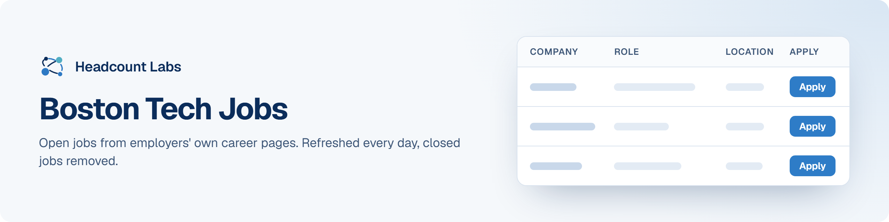

# Boston Tech Jobs

Software, data, AI, product and design jobs in the Boston area, sorted by field.

**93 open jobs** · 17 new since the last update · 324 removed because they closed or left the employer's board · updated November 17, 2026 at 5:21 AM EST

This list is built and refreshed every day by [Headcount Labs](https://headcountlabs.com/?utm_source=github&utm_medium=job-list&utm_campaign=boston-tech-jobs), which reads jobs straight from employers' own career pages and job boards. Every job here was still listed on its source board when we last read that board, within the past 3 days, and was posted in the past 30 days. Copies of the same job are merged into one row, and jobs that close are removed at the next update.

Want this data in your own app or agent? Use the [Headcount Labs jobs API](https://headcountlabs.com/docs/?utm_source=github&utm_medium=job-list&utm_campaign=boston-tech-jobs) (free tier), the [MCP server](https://headcountlabs.com/mcp/?utm_source=github&utm_medium=job-list&utm_campaign=boston-tech-jobs) for Claude, ChatGPT and other AI assistants, or the [public dataset subsets](https://huggingface.co/HeadcountLabs) on Hugging Face (the full dataset is coming soon).

**Full dataset.** A bigger, one-off snapshot dated 2026-10-19 (all matching jobs, not only the open jobs below) is on Hugging Face: [Tech and software jobs](https://huggingface.co/datasets/HeadcountLabs/tech-jobs). It loads with `datasets.load_dataset` and is under the Open Database License (ODbL) 1.0.

**Jump to:** [Software engineering (33)](#software-engineering) · [Data, AI and machine learning (42)](#data-ai-and-machine-learning) · [Product and design (17)](#product-and-design) · [Hardware and engineering (1)](#hardware-and-engineering)

**Columns.** *Apply* opens the original posting on the employer's site. *Details* opens the job on Headcount Labs, with every posting we found for it. *Remote* shows what the employer states; a dash means the posting doesn't say. *Pay* is the range the employer published.

## Software engineering

| Company | Role | Location | Remote | Pay | Posted | Apply | Details |
| --- | --- | --- | --- | --- | --- | :---: | :---: |
| **Autodesk** | Senior Software Engineer | 

2 locations
Novi, MI Boston, MA
 | Remote | $117k–$209k/yr | Nov 14 |  | <a href="https://headcountlabs.com/catalog/jobs/d0400674-f9b6-423c-bd14-70c220212eb8?utm_source=github&utm_medium=job-list&utm_campaign=boston-tech-jobs">via Headcount Labs</a> |
| **WMC Wellington Management Company LLP** | Senior Software Engineer | 

2 locations
Needham Boston, MA
 | — | $90k–$180k/yr | Nov 13 |  | <a href="https://headcountlabs.com/catalog/jobs/9b10b0be-8175-468a-8ec1-255d4cd7e409?utm_source=github&utm_medium=job-list&utm_campaign=boston-tech-jobs">via Headcount Labs</a> |
| **SSB&amp;T** | Software Engineer – Backend Platforms, Assistant Vice President (Wealth Custody &amp; Clearing) | 

5 locations
Dallas Austin, TX Boston, MA Clifton, NJ Quincy, MA
 | — | $80k–$140k/yr | Nov 13 |  | <a href="https://headcountlabs.com/catalog/jobs/23d07eac-9fc6-460d-9086-e541bd26dde4?utm_source=github&utm_medium=job-list&utm_campaign=boston-tech-jobs">via Headcount Labs</a> |
| **Schneider Electric** | Associate Account Executive - Software Sales | 

6 locations
Louisville, KY United States, KY Boston, MA Chicago, IL Dallas, TX Nashville, TN
 | — | $110k–$115k/yr | Nov 13 |  | <a href="https://headcountlabs.com/catalog/jobs/c5a2f9e2-3a12-4283-9098-8a47d55d46f4?utm_source=github&utm_medium=job-list&utm_campaign=boston-tech-jobs">via Headcount Labs</a> |
| **libertymutualgroup** | Principal Software Engineer | 

3 locations
Portsmouth, NH Boston, MA Plano, TX
 | On-site | — | Nov 13 |  | <a href="https://headcountlabs.com/catalog/jobs/2c3bd270-aae0-4373-a364-c8eec4a7b63f?utm_source=github&utm_medium=job-list&utm_campaign=boston-tech-jobs">via Headcount Labs</a> |
| **Humana Inc.** | Senior DevOps Platform Engineer | 

11 locations
Louisville, KY Arlington, VA Atlanta, GA Boston, MA Charlotte, NC Dallas, TX Frisco, TX Liberty Mutual Nashville, TN New York, NY Oak Brook, IL
 | Remote | $107k–$147k/yr | Nov 13 |  | <a href="https://headcountlabs.com/catalog/jobs/6b85d369-362c-4bef-a532-8a012c4ce65d?utm_source=github&utm_medium=job-list&utm_campaign=boston-tech-jobs">via Headcount Labs</a> |
| **Haemonetics Corporation** | Principal Software Developer - TEG (strong AWS background required) | Boston, MA | — | $104k–$176k/yr | Nov 13 |  | <a href="https://headcountlabs.com/catalog/jobs/7b857240-10fb-4dc5-996e-379314c0d842?utm_source=github&utm_medium=job-list&utm_campaign=boston-tech-jobs">via Headcount Labs</a> |
| **CMTelematics** | Software Engineer I, Cloud | Cambridge, MA | — | $93k–$116k/yr | Nov 13 |  | <a href="https://headcountlabs.com/catalog/jobs/f7a55480-3fdc-4134-b215-b8a6e23f225e?utm_source=github&utm_medium=job-list&utm_campaign=boston-tech-jobs">via Headcount Labs</a> |
| **athenahealth, Inc.** | Lead Software Engineer, Clinical Decision Support | Boston, MA | — | $143k–$243k/yr | Nov 13 |  | <a href="https://headcountlabs.com/catalog/jobs/73ed869d-1a62-44d7-9011-378a7867add0?utm_source=github&utm_medium=job-list&utm_campaign=boston-tech-jobs">via Headcount Labs</a> |
| **Anduril Industries** | Senior Software Security Engineer | 

4 locations
Costa Mesa, CA Seattle, WA Washington, DC Boston, MA
 | — | $191k–$254k/yr | Nov 13 |  | <a href="https://headcountlabs.com/catalog/jobs/fabd14ff-00d1-4e56-a300-116c2c7be807?utm_source=github&utm_medium=job-list&utm_campaign=boston-tech-jobs">via Headcount Labs</a> |
| **Anduril Industries** | Staff Software Engineer, Vehicle Management Systems | Boston, MA | — | $220k–$292k/yr | Nov 13 |  | <a href="https://headcountlabs.com/catalog/jobs/d31f822d-e94e-4431-aa26-ea892c47a5f1?utm_source=github&utm_medium=job-list&utm_campaign=boston-tech-jobs">via Headcount Labs</a> |
| **mthree Recruiting Portal** | Java Developer | Boston, MA | — | $66k/yr | Nov 12 |  | <a href="https://headcountlabs.com/catalog/jobs/79a9f3a5-aa46-4fc9-8b42-df4e0adfd0ba?utm_source=github&utm_medium=job-list&utm_campaign=boston-tech-jobs">via Headcount Labs</a> |
| **BNY** | Senior Specialist, Java/Angular Full-Stack Engineer | 

2 locations
Boston, MA Westborough, MA
 | On-site | $71k/yr | Nov 12 |  | <a href="https://headcountlabs.com/catalog/jobs/3cbbc4cc-2aa8-45fe-a135-5da133430dc9?utm_source=github&utm_medium=job-list&utm_campaign=boston-tech-jobs">via Headcount Labs</a> |
| **B10 Wells Fargo Bank, N. A.** | Lead Payments Software Engineer | 

2 locations
CHARLOTTE, NC BOSTON, MA
 | On-site | $119k–$224k/yr | Nov 12 |  | <a href="https://headcountlabs.com/catalog/jobs/30219b72-bb9d-4b09-b763-66fac62bf603?utm_source=github&utm_medium=job-list&utm_campaign=boston-tech-jobs">via Headcount Labs</a> |
| **Vista Higher Learning** | Senior DevOps Engineer | 

2 locations
Boston, MA United States
 | — | $140k–$160k/yr | Nov 10 |  | <a href="https://headcountlabs.com/catalog/jobs/3af94551-7f6e-490c-90d7-c5b72608144e?utm_source=github&utm_medium=job-list&utm_campaign=boston-tech-jobs">via Headcount Labs</a> |
| **Vista Higher Learning** | Sr Full stack Software Engineer | 

2 locations
Boston, MA United States
 | — | $140k–$150k/yr | Nov 10 |  | <a href="https://headcountlabs.com/catalog/jobs/0716ea7d-5fe2-47a4-8494-1d28eebfa187?utm_source=github&utm_medium=job-list&utm_campaign=boston-tech-jobs">via Headcount Labs</a> |
| **BNY** | Vice President, Full-Stack Engineer | Boston, MA | On-site | $83k–$195k/yr | Nov 10 |  | <a href="https://headcountlabs.com/catalog/jobs/bfdc61ba-590e-422c-970e-d504ac8438e8?utm_source=github&utm_medium=job-list&utm_campaign=boston-tech-jobs">via Headcount Labs</a> |
| **Keysight Technologies, Inc.** | Embedded Software Engineer Intern | Cambridge, MA | — | $33.60–$36.18/hr | Nov 9 |  | <a href="https://headcountlabs.com/catalog/jobs/d00adf6b-90c9-4558-a1cb-ef9e732ea78c?utm_source=github&utm_medium=job-list&utm_campaign=boston-tech-jobs">via Headcount Labs</a> |
| **CMTelematics** | IT Security Engineer II | Cambridge, MA | Hybrid | $91k–$113k/yr | Nov 9 |  | <a href="https://headcountlabs.com/catalog/jobs/401b6ac4-2467-4407-a623-6e929d700c08?utm_source=github&utm_medium=job-list&utm_campaign=boston-tech-jobs">via Headcount Labs</a> |
| **CMTelematics** | Senior Site Reliability Engineer, SecOps | Cambridge, MA | — | $118k–$148k/yr | Nov 9 |  | <a href="https://headcountlabs.com/catalog/jobs/98ab2466-e246-4ea6-87d5-a94a7bac876d?utm_source=github&utm_medium=job-list&utm_campaign=boston-tech-jobs">via Headcount Labs</a> |
| **Viasat, Inc.** | Senior Full Stack Software Engineer | 

5 locations
Boston, MA Germantown, MD Massachusetts New York, MA New Jersey, MA
 | Remote | $165k–$260k/yr | Nov 6 |  | <a href="https://headcountlabs.com/catalog/jobs/4815900b-8592-4be8-9a9c-4a6b8f15e88f?utm_source=github&utm_medium=job-list&utm_campaign=boston-tech-jobs">via Headcount Labs</a> |
| **Pendar Technologies** | Scientific Software Engineer – Algorithms | Cambridge, MA | — | $100k–$130k/yr | Nov 6 |  | <a href="https://headcountlabs.com/catalog/jobs/3c632243-8fa4-4054-9616-187854b93434?utm_source=github&utm_medium=job-list&utm_campaign=boston-tech-jobs">via Headcount Labs</a> |
| **Barracuda Networks Inc.** | Senior Endpoint Security Engineer | 

7 locations
Alpharetta, GA Ann Arbor, MI United States Chelmsford, MA Boston, MA Atlanta, GA Detroit, MI
 | Remote | $110k–$130k/yr | Nov 5 |  | <a href="https://headcountlabs.com/catalog/jobs/22d70b50-087d-47e5-864b-b5236a9e6881?utm_source=github&utm_medium=job-list&utm_campaign=boston-tech-jobs">via Headcount Labs</a> |
| **Zoox** | Staff Software Engineer - GPU System Software, Onboard Execution | 

3 locations
Foster City, CA Boston, MA Seattle, WA
 | Hybrid | $290k–$322k/yr | Nov 4 |  | <a href="https://headcountlabs.com/catalog/jobs/c2ee69a7-03d8-4cb2-9871-94423dfb78e9?utm_source=github&utm_medium=job-list&utm_campaign=boston-tech-jobs">via Headcount Labs</a> |
| **Axon** | Site Reliability Engineer II | 

2 locations
Boston, MA Seattle, WA
 | Hybrid | $116k–$185k/yr | Nov 4 |  | <a href="https://headcountlabs.com/catalog/jobs/78b8154d-ca3e-4ad0-99f3-7bfc5324aded?utm_source=github&utm_medium=job-list&utm_campaign=boston-tech-jobs">via Headcount Labs</a> |
| **Autodesk** | Senior DevOps Engineer | 

15 locations
Hartford, CT Columbia, SC Augusta, ME Boston, MA Providence, RI Albany, NY Annapolis, MD Trenton, NJ Atlanta, GA Raleigh, NC Concord, NH Montpelier, VT +3 more
 | — | $117k–$209k/yr | Nov 4 |  | <a href="https://headcountlabs.com/catalog/jobs/1a7f83f4-c867-4629-be4c-223fdd0cc63c?utm_source=github&utm_medium=job-list&utm_campaign=boston-tech-jobs">via Headcount Labs</a> |
| **AOP and Ignite Christian Academy** | Full Stack Engineer | Boston, MA | Hybrid | $120k–$190k/yr | Nov 4 |  | <a href="https://headcountlabs.com/catalog/jobs/5ffb6252-218f-437a-8b32-e93b7b0509bf?utm_source=github&utm_medium=job-list&utm_campaign=boston-tech-jobs">via Headcount Labs</a> |
| **Toast** | Senior Software Engineer, Onboarding | Boston, MA | Remote | — | Nov 3 |  | <a href="https://headcountlabs.com/catalog/jobs/1e1f0bae-fea7-4c8e-8358-c27a27613abe?utm_source=github&utm_medium=job-list&utm_campaign=boston-tech-jobs">via Headcount Labs</a> |
| **Fairmarkit** | Senior Full-Stack Engineer (Backend Leaning) (Boston, Hybrid) | Boston, MA | Hybrid | $180k–$230k/yr | Nov 3 |  | <a href="https://headcountlabs.com/catalog/jobs/480edb2c-6cf4-439a-bcf8-f24c5d544c73?utm_source=github&utm_medium=job-list&utm_campaign=boston-tech-jobs">via Headcount Labs</a> |
| **Ellevation** | Director, Software Engineering | Boston, MA | Remote | $200k–$250k/yr | Oct 30 |  | <a href="https://headcountlabs.com/catalog/jobs/59402929-2a97-4766-b396-0069816e0640?utm_source=github&utm_medium=job-list&utm_campaign=boston-tech-jobs">via Headcount Labs</a> |
| **Philo** | Sr. Backend Software Engineer (Infrastructure ML Ops) | 

3 locations
San Francisco, CA Brooklyn, NY Cambridge, MA
 | Remote | — | Oct 29 |  | <a href="https://headcountlabs.com/catalog/jobs/39ba3660-a142-47a0-aa0e-3a72a012d07b?utm_source=github&utm_medium=job-list&utm_campaign=boston-tech-jobs">via Headcount Labs</a> |
| **Zoox** | Senior Staff/Principal Software Engineer - GPU System Software, Onboard Execution | 

3 locations
Foster City, CA Seattle, WA Boston, MA
 | Hybrid | $339k–$455k/yr | Oct 22 |  | <a href="https://headcountlabs.com/catalog/jobs/7665ac5a-4dae-463d-a35e-c78b12b208f5?utm_source=github&utm_medium=job-list&utm_campaign=boston-tech-jobs">via Headcount Labs</a> |
| **ASUS USA -** | Senior Platform Security Engineer | Boston, MA | On-site | $164k–$237k/yr | Oct 21 |  | <a href="https://headcountlabs.com/catalog/jobs/b4954e50-a0f7-4e2e-b7ac-b4f6e32a8586?utm_source=github&utm_medium=job-list&utm_campaign=boston-tech-jobs">via Headcount Labs</a> |

## Data, AI and machine learning

| Company | Role | Location | Remote | Pay | Posted | Apply | Details |
| --- | --- | --- | --- | --- | --- | :---: | :---: |
| **libertymutualgroup** | Director, Data Science - Rollout acceleration AI | 

6 locations
Boston, MA United States Seattle, WA Plano, TX Portsmouth, NH Columbus, OH
 | Remote | — | Nov 16 |  | <a href="https://headcountlabs.com/catalog/jobs/d931b4c0-c2bc-4435-830a-bc075467ede5?utm_source=github&utm_medium=job-list&utm_campaign=boston-tech-jobs">via Headcount Labs</a> |
| **Experian** | Senior Account Executive- Experian Data Quality | Boston, MA | Remote | — | Nov 14 |  | <a href="https://headcountlabs.com/catalog/jobs/55cffad5-e6ad-4fa0-92c5-a82e4fb2c6d6?utm_source=github&utm_medium=job-list&utm_campaign=boston-tech-jobs">via Headcount Labs</a> |
| **7Z4 Pfizer, Inc.** | Sr. Manager, Solution Engineer, Visualization, Analytics &amp; Collaboration | 

13 locations
New York City, NY Berlin Thessaloniki Chortiatis Cork Dublin Kildare Sandwich Walton Oaks San Diego, CA Groton, CT Tampa, FL Cambridge, MA +1 more
 | — | $124k–$207k/yr | Nov 14 |  | <a href="https://headcountlabs.com/catalog/jobs/85cf5901-8bdf-4a81-9430-4905fc748794?utm_source=github&utm_medium=job-list&utm_campaign=boston-tech-jobs">via Headcount Labs</a> |
| **7Z4 Pfizer, Inc.** | Director, Solution Engineer, Data Storage and Registration | 

13 locations
New York City, NY Berlin Thessaloniki Chortiatis Cork Dublin Kildare Sandwich Walton Oaks San Diego, CA Groton, CT Tampa, FL Cambridge, MA +1 more
 | — | $163k–$272k/yr | Nov 14 |  | <a href="https://headcountlabs.com/catalog/jobs/c563b6fc-979c-4c34-8663-65c3d49b533f?utm_source=github&utm_medium=job-list&utm_campaign=boston-tech-jobs">via Headcount Labs</a> |
| **Vertex Pharmaceuticals Inc (US)** | Summer Intern 2027, OSD Process Data Analytics | Boston, MA | Hybrid | $23–$32/hr | Nov 13 |  | <a href="https://headcountlabs.com/catalog/jobs/54726e58-fc19-4800-a11a-b949c5043c93?utm_source=github&utm_medium=job-list&utm_campaign=boston-tech-jobs">via Headcount Labs</a> |
| **Vertex Pharmaceuticals Inc (US)** | GxP Operations Support Specialist Data Review | Boston, MA | On-site | $38–$57/hr | Nov 13 |  | <a href="https://headcountlabs.com/catalog/jobs/f765155f-5631-411a-b344-c88a9676a67b?utm_source=github&utm_medium=job-list&utm_campaign=boston-tech-jobs">via Headcount Labs</a> |
| **SSGA Trust Company** | AI QA Automation Engineer, AVP - State Street Investment Management | Boston, MA | — | $80k–$140k/yr | Nov 13 |  | <a href="https://headcountlabs.com/catalog/jobs/e1b0543c-7edf-4b8d-b9b7-1d36ffc76809?utm_source=github&utm_medium=job-list&utm_campaign=boston-tech-jobs">via Headcount Labs</a> |
| **Salesforce, Inc.** | Distinguished/Principal Platform Solution Engineer - Data Foundations | 

6 locations
Chicago, IL San Francisco, CA Atlanta, GA Boston, MA Illinois Dallas, TX
 | Remote | $158k–$245k/yr | Nov 13 |  | <a href="https://headcountlabs.com/catalog/jobs/91636aa8-b5a0-44f2-9963-874552724af0?utm_source=github&utm_medium=job-list&utm_campaign=boston-tech-jobs">via Headcount Labs</a> |
| **Philips** | AI Engineer – Physical AI for Surgical Robotics (Cambridge, MA) | Cambridge, MA | — | $129k–$205k/yr | Nov 13 |  | <a href="https://headcountlabs.com/catalog/jobs/a1c36c01-f4e5-47b5-87e3-2331416021dd?utm_source=github&utm_medium=job-list&utm_campaign=boston-tech-jobs">via Headcount Labs</a> |
| **libertymutualgroup** | Director, Data Science: Medical, Special Investigations, and Programs (MSP) Claims Data Science team | 

6 locations
United States Seattle, WA Boston, MA Plano, TX Columbus, OH Portsmouth, NH
 | Remote | — | Nov 13 |  | <a href="https://headcountlabs.com/catalog/jobs/963c14ee-52f7-471c-9471-1647c7514c85?utm_source=github&utm_medium=job-list&utm_campaign=boston-tech-jobs">via Headcount Labs</a> |
| **libertymutualgroup** | Principal Data Solutions Analyst, Compliance &amp; Insurance Analytics | 

6 locations
United States Seattle, WA Boston, MA Columbus, OH Portsmouth, NH Plano, TX
 | Remote | — | Nov 13 |  | <a href="https://headcountlabs.com/catalog/jobs/0fed96b4-0465-4dfa-b23d-5b34917f7b00?utm_source=github&utm_medium=job-list&utm_campaign=boston-tech-jobs">via Headcount Labs</a> |
| **Hartford Fire Ins. Co** | AVP Data Engineering – Business Insurance Ontology &amp; Knowledge Graph | 

2 locations
Hartford, CT Boston, MA
 | — | $182k–$273k/yr | Nov 13 |  | <a href="https://headcountlabs.com/catalog/jobs/24dea8af-b84e-4312-a425-f5a04e8c6f69?utm_source=github&utm_medium=job-list&utm_campaign=boston-tech-jobs">via Headcount Labs</a> |
| **Center For Health Information And Analysis** | Data Quality Assurance Analyst | Boston, MA | Hybrid | $76k–$126k/yr | Nov 13 |  | <a href="https://headcountlabs.com/catalog/jobs/499e6476-8284-463b-9eb8-ecb4c6e8639c?utm_source=github&utm_medium=job-list&utm_campaign=boston-tech-jobs">via Headcount Labs</a> |
| **Capital One** | Director, Data Science | 

5 locations
McLean, VA Cambridge, MA New York, NY Richmond, VA San Francisco, CA
 | Hybrid | $269k–$307k/yr | Nov 13 |  | <a href="https://headcountlabs.com/catalog/jobs/4850479d-93fe-4027-9257-9ee1314eaef9?utm_source=github&utm_medium=job-list&utm_campaign=boston-tech-jobs">via Headcount Labs</a> |
| **Autodesk** | Fusion Data Technical Sales Specialist | 

5 locations
Springfield, IL San Francisco, CA Novi, MI Boston, MA Albany, NY
 | Remote | $155k–$278k/yr | Nov 13 |  | <a href="https://headcountlabs.com/catalog/jobs/91cb9fb1-f1b7-43c1-8bf9-efa27befa521?utm_source=github&utm_medium=job-list&utm_campaign=boston-tech-jobs">via Headcount Labs</a> |
| **Zoox** | Contract Student Worker - Machine Learning Engineer | 

4 locations
Boston, MA Foster City, CA Seattle, WA San Diego, CA
 | On-site | $30/hr | Nov 12 |  | <a href="https://headcountlabs.com/catalog/jobs/50df4326-9c5c-4685-8cb1-00dc72719c3e?utm_source=github&utm_medium=job-list&utm_campaign=boston-tech-jobs">via Headcount Labs</a> |
| **Zoom** | Senior Product Manager, Analytics and Insights | Boston, MA | Remote | $124k–$271k/yr | Nov 11 |  | <a href="https://headcountlabs.com/catalog/jobs/ed40fecd-0632-438d-bd50-2a30b4bc9537?utm_source=github&utm_medium=job-list&utm_campaign=boston-tech-jobs">via Headcount Labs</a> |
| **ServiceNow, Inc.** | Sr Solution Sales Executive Data &amp; Analytics - State and Local Government | Boston, MA | — | $125k–$207k/yr | Nov 10 |  | <a href="https://headcountlabs.com/catalog/jobs/78fe423e-76f2-4123-9e2f-9b5d3bad0022?utm_source=github&utm_medium=job-list&utm_campaign=boston-tech-jobs">via Headcount Labs</a> |
| **Publicis Groupe Holdings B.V** | Analyst, Data and Analysis | Boston, MA | — | $56k–$82k/yr | Nov 10 |  | <a href="https://headcountlabs.com/catalog/jobs/9eb77761-ef10-49dc-9062-15347d1b8371?utm_source=github&utm_medium=job-list&utm_campaign=boston-tech-jobs">via Headcount Labs</a> |
| **Schneider Electric** | Strategy Director, Secure Power &amp; Data Centers | 

2 locations
Boston, MA GRENOBLE
 | — | — | Nov 9 |  | <a href="https://headcountlabs.com/catalog/jobs/8cea56eb-a5f1-4ebc-b413-ab92ac64392e?utm_source=github&utm_medium=job-list&utm_campaign=boston-tech-jobs">via Headcount Labs</a> |
| **Relay Therapeutics** | Associate Director, Clinical Data Management | Cambridge, MA | — | $147k–$210k/yr | Nov 9 |  | <a href="https://headcountlabs.com/catalog/jobs/2f1c2e01-ebdf-407b-9c63-253c5ad617ef?utm_source=github&utm_medium=job-list&utm_campaign=boston-tech-jobs">via Headcount Labs</a> |
| **Zoox** | Data Science Intern [Summer 2027] | 

2 locations
Foster City, CA Boston, MA
 | Hybrid | $6k–$10k/yr | Nov 6 |  | <a href="https://headcountlabs.com/catalog/jobs/9e7083dd-9d25-4fd8-94ae-f337a496d147?utm_source=github&utm_medium=job-list&utm_campaign=boston-tech-jobs">via Headcount Labs</a> |
| **Autodesk** | Fusion Data Sales Specialist | 

4 locations
Boston, MA San Francisco, CA Denver, CO Albany, NY
 | Remote | $155k–$278k/yr | Nov 6 |  | <a href="https://headcountlabs.com/catalog/jobs/1ab5784a-651d-49f9-80c3-cfc4ce8632ad?utm_source=github&utm_medium=job-list&utm_campaign=boston-tech-jobs">via Headcount Labs</a> |
| **Abt Global** | Medicaid Data Analyst | 

5 locations
United States Durham, NC Atlanta, GA Cambridge, MA Rockville, MD
 | Remote | $73k–$93k/yr | Nov 6 |  | <a href="https://headcountlabs.com/catalog/jobs/70b41cee-bb52-4807-8bc1-203d458db0b0?utm_source=github&utm_medium=job-list&utm_campaign=boston-tech-jobs">via Headcount Labs</a> |
| **HDR** | Federal Business Group Data Steward | 

75 locations
Omaha, NE Cincinnati, OH Charlotte, NC Bellevue, WA Cheyenne, WY Kansas City, MO Sioux Falls, SD Saint Louis Park, MN Fort Lauderdale, FL Nashville, TN Newark, NJ Baltimore, MD +63 more
 | — | — | Nov 5 |  | <a href="https://headcountlabs.com/catalog/jobs/631e8be7-9058-4b85-bf8b-4473f18fa976?utm_source=github&utm_medium=job-list&utm_campaign=boston-tech-jobs">via Headcount Labs</a> |
| **CrowdStrike, Inc.** | Principal Product Manager - Data Security (Hybrid) | 

4 locations
New York, NY Arlington, VA Austin, TX Boston, MA
 | Hybrid | $160k–$260k/yr | Nov 5 |  | <a href="https://headcountlabs.com/catalog/jobs/88fb02d5-0050-4ab3-ac24-68135e84ca7f?utm_source=github&utm_medium=job-list&utm_campaign=boston-tech-jobs">via Headcount Labs</a> |
| **Abt Global Inc.** | Data Engineer 3 | 

5 locations
Austin, TX Rockville, MD Atlanta, GA Durham, NC Cambridge, MA
 | Remote | $95k–$120k/yr | Nov 5 |  | <a href="https://headcountlabs.com/catalog/jobs/84397f91-faa9-43a5-a63d-81f90147c45c?utm_source=github&utm_medium=job-list&utm_campaign=boston-tech-jobs">via Headcount Labs</a> |
| **AOP and Ignite Christian Academy** | AI Engineer | Boston, MA | Hybrid | — | Nov 4 |  | <a href="https://headcountlabs.com/catalog/jobs/b44b54bf-6bd0-40d7-8015-22dd16fe7328?utm_source=github&utm_medium=job-list&utm_campaign=boston-tech-jobs">via Headcount Labs</a> |
| **AOP and Ignite Christian Academy** | Product Manager, AI | Boston, MA | Hybrid | $129k–$200k/yr | Nov 4 |  | <a href="https://headcountlabs.com/catalog/jobs/f2853d26-3588-4571-8826-f5dd1959890f?utm_source=github&utm_medium=job-list&utm_campaign=boston-tech-jobs">via Headcount Labs</a> |
| **Abt Global** | Data Engineer 3 | 

5 locations
Rockville, MD Durham, NC Atlanta, GA Cambridge, MA Austin, TX
 | Remote | $95k–$120k/yr | Nov 4 |  | <a href="https://headcountlabs.com/catalog/jobs/db18c052-dea0-4ea8-8688-f6c02604cf3b?utm_source=github&utm_medium=job-list&utm_campaign=boston-tech-jobs">via Headcount Labs</a> |
| **TowardJobs** | Work at Home Data Entry Agent - Part Time | Cambridge, MA | Remote | — | Nov 2 |  | <a href="https://headcountlabs.com/catalog/jobs/8f255f37-420d-4b01-85a6-00702ef84d52?utm_source=github&utm_medium=job-list&utm_campaign=boston-tech-jobs">via Headcount Labs</a> |
| **Toyota Research Institute** | Accelerated Science Intern, Machine Learning/Agentic AI | Cambridge, MA | Hybrid | $40–$58/hr | Oct 30 |  | <a href="https://headcountlabs.com/catalog/jobs/78932534-9fa3-4e74-b9cf-4b6cb5cb2944?utm_source=github&utm_medium=job-list&utm_campaign=boston-tech-jobs">via Headcount Labs</a> |
| **Zoox** | Senior Data Scientist | Boston, MA | Hybrid | $225k–$307k/yr | Oct 28 |  | <a href="https://headcountlabs.com/catalog/jobs/becfe6cb-2ab6-4bb4-b6fa-f207795cec67?utm_source=github&utm_medium=job-list&utm_campaign=boston-tech-jobs">via Headcount Labs</a> |
| **Zoox** | Machine Learning Engineer - Vision Foundation Models | 

4 locations
Foster City, CA Boston, MA Seattle, WA San Diego, CA
 | Hybrid | $254k–$305k/yr | Oct 27 |  | <a href="https://headcountlabs.com/catalog/jobs/d3411058-3e20-4fe2-b1e0-ddd0bf180fab?utm_source=github&utm_medium=job-list&utm_campaign=boston-tech-jobs">via Headcount Labs</a> |
| **Vesalius Therapeutics** | Principal Data Engineer | Cambridge, MA | — | $179k–$236k/yr | Oct 27 |  | <a href="https://headcountlabs.com/catalog/jobs/aa867fd5-10a6-410a-909b-8665028c3d7f?utm_source=github&utm_medium=job-list&utm_campaign=boston-tech-jobs">via Headcount Labs</a> |
| **Publicis Groupe Holdings B.V** | Data Strategy, Senior Consultant | 

3 locations
New York, NY Boston, MA Chicago, IL
 | — | $115k–$150k/yr | Oct 27 |  | <a href="https://headcountlabs.com/catalog/jobs/ef1de633-8c8c-445a-8284-eeb67277f94d?utm_source=github&utm_medium=job-list&utm_campaign=boston-tech-jobs">via Headcount Labs</a> |
| **Autodesk** | Senior Director, Product Management, AEC Data | 

4 locations
Toronto Denver, CO Portland, OR Boston, MA
 | — | $206k–$369k/yr | Oct 24 |  | <a href="https://headcountlabs.com/catalog/jobs/70f2546e-11d6-49f7-be05-f7de2cd38cbd?utm_source=github&utm_medium=job-list&utm_campaign=boston-tech-jobs">via Headcount Labs</a> |
| **Superluminal Medicines, Inc.** | Staff Engineer, Research Informatics and AI | Boston, MA | — | $191k–$219k/yr | Oct 23 |  | <a href="https://headcountlabs.com/catalog/jobs/1e15fa7e-c149-48f3-85fc-1e06ef1c3593?utm_source=github&utm_medium=job-list&utm_campaign=boston-tech-jobs">via Headcount Labs</a> |
| **PathAI** | Staff Biomedical Data Manager | Boston, MA | — | $109k–$167k/yr | Oct 22 |  | <a href="https://headcountlabs.com/catalog/jobs/f26f452a-1556-411a-96da-90676dcb8376?utm_source=github&utm_medium=job-list&utm_campaign=boston-tech-jobs">via Headcount Labs</a> |
| **Broad Institute** | Postdoctoral Associate – The Getz Lab, Multiple Myeloma – Machine Learning | Cambridge, MA | — | — | Oct 22 |  | <a href="https://headcountlabs.com/catalog/jobs/957b766b-1ea9-46b1-9235-0177637dd3b2?utm_source=github&utm_medium=job-list&utm_campaign=boston-tech-jobs">via Headcount Labs</a> |
| **ASUS USA -** | Senior Computer Vision Engineer | Boston, MA | On-site | $164k–$237k/yr | Oct 21 |  | <a href="https://headcountlabs.com/catalog/jobs/8e7e77dc-4860-49b4-bb6c-8383ab34f23a?utm_source=github&utm_medium=job-list&utm_campaign=boston-tech-jobs">via Headcount Labs</a> |
| **Publicis Groupe Holdings B.V** | Associate Director, Digital Product Management - AI Orchestration | Boston, MA | — | $112k–$172k/yr | Oct 20 |  | <a href="https://headcountlabs.com/catalog/jobs/4e486193-fbea-47e6-a4dc-b6e2202c7bec?utm_source=github&utm_medium=job-list&utm_campaign=boston-tech-jobs">via Headcount Labs</a> |

## Product and design

| Company | Role | Location | Remote | Pay | Posted | Apply | Details |
| --- | --- | --- | --- | --- | --- | :---: | :---: |
| **Red Hat** | Principal Product Manager - Technical | 

3 locations
Boston, MA United States Raleigh, NC
 | Hybrid | $154k–$254k/yr | Nov 15 |  | <a href="https://headcountlabs.com/catalog/jobs/e5d232ee-f8a0-48ae-ae7a-ce54e5e9ee91?utm_source=github&utm_medium=job-list&utm_campaign=boston-tech-jobs">via Headcount Labs</a> |
| **Autodesk** | Senior UX Designer - Incubation | 

10 locations
Springfield, IL Novi, MI Atlanta, GA Phoenix, AZ Denver, CO Nashville, TN Tallahassee, FL United States Pittsburgh, PA Boston, MA
 | — | $106k–$190k/yr | Nov 14 |  | <a href="https://headcountlabs.com/catalog/jobs/a9b66299-02d8-4e52-a2f4-e5f93f7e7d49?utm_source=github&utm_medium=job-list&utm_campaign=boston-tech-jobs">via Headcount Labs</a> |
| **JPMorgan Chase** | Securities Services - Traditional Fund Services Product Management - Associate | Boston, MA | On-site | $100k–$155k/yr | Nov 13 |  | <a href="https://headcountlabs.com/catalog/jobs/9a971704-d15c-44d7-8779-fbb186c5455d?utm_source=github&utm_medium=job-list&utm_campaign=boston-tech-jobs">via Headcount Labs</a> |
| **BOSTON CHILDRENS MUSEUM** | Exhibit Designer | Boston, MA | — | $70k/yr | Nov 13 |  | <a href="https://headcountlabs.com/catalog/jobs/a2e41bb3-14e4-43fb-a00d-b873fb0fcb87?utm_source=github&utm_medium=job-list&utm_campaign=boston-tech-jobs">via Headcount Labs</a> |
| **Publicis Groupe Holdings B.V** | Manager, Digital Product Management | Boston, MA | — | $89k–$136k/yr | Nov 12 |  | <a href="https://headcountlabs.com/catalog/jobs/5da2c370-1d17-4601-8387-fb9c3e932e41?utm_source=github&utm_medium=job-list&utm_campaign=boston-tech-jobs">via Headcount Labs</a> |
| **Candex** | Product Manager | 

3 locations
United States Miami, FL Boston, MA
 | Remote | — | Nov 12 |  | <a href="https://headcountlabs.com/catalog/jobs/b4772150-0ffb-4715-9d39-2327980609cf?utm_source=github&utm_medium=job-list&utm_campaign=boston-tech-jobs">via Headcount Labs</a> |
| **Gradient AI** | Senior Product Manager | Boston, MA | Hybrid | $150k–$195k/yr | Nov 11 |  | <a href="https://headcountlabs.com/catalog/jobs/c42db6c7-778d-441a-ba16-40d83267918b?utm_source=github&utm_medium=job-list&utm_campaign=boston-tech-jobs">via Headcount Labs</a> |
| **Cayuse Holdings** | ServiceNow Experience Designer | 

54 locations
Jackson, MS Hagatna Sacramento, CA Austin, TX Montgomery, AL Juneau, AK Little Rock, AR Boise, ID Oklahoma City, OK Denver, CO St Thomas Concord, NH +42 more
 | Remote | $70–$80/hr | Nov 11 |  | <a href="https://headcountlabs.com/catalog/jobs/183a2f58-9d90-4c1f-abd8-b90a632fb432?utm_source=github&utm_medium=job-list&utm_campaign=boston-tech-jobs">via Headcount Labs</a> |
| **Actalent** | Interior Designer | Boston, MA | Hybrid | $38–$48/hr | Nov 9 |  | <a href="https://headcountlabs.com/catalog/jobs/0b4b2b9d-7511-476b-b143-86f16d78aca9?utm_source=github&utm_medium=job-list&utm_campaign=boston-tech-jobs">via Headcount Labs</a> |
| **HDR** | Civil Designer / EIT | Boston, MA | — | — | Nov 6 |  | <a href="https://headcountlabs.com/catalog/jobs/c1699b43-2dcf-4a60-8c4d-bda23533d977?utm_source=github&utm_medium=job-list&utm_campaign=boston-tech-jobs">via Headcount Labs</a> |
| **Publicis Groupe Holdings B.V** | Product Manager (Asset Management) | 

2 locations
New York, NY Boston, MA
 | — | $140k–$180k/yr | Nov 5 |  | <a href="https://headcountlabs.com/catalog/jobs/4937f494-a97e-408e-b88c-6b22a23de38f?utm_source=github&utm_medium=job-list&utm_campaign=boston-tech-jobs">via Headcount Labs</a> |
| **CrowdStrike, Inc.** | Sr. Product Manager - Falcon Privileged Access (Hybrid) | 

7 locations
Sunnyvale, CA Toronto Arlington, VA Austin, TX Boston, MA New York, NY Redmond, WA
 | Hybrid | $140k–$220k/yr | Nov 5 |  | <a href="https://headcountlabs.com/catalog/jobs/6695b657-140d-459a-a8da-e542d4825ae5?utm_source=github&utm_medium=job-list&utm_campaign=boston-tech-jobs">via Headcount Labs</a> |
| **LCH Lab. Corp. of America Holdings** | Director, Product Management (Emerging Segments) | 

5 locations
Durham, NC Boston, MA Burlington, NC Madison, WI San Diego, CA
 | — | $150k–$165k/yr | Nov 3 |  | <a href="https://headcountlabs.com/catalog/jobs/cd382988-2867-4285-b175-8da79c5a7c0d?utm_source=github&utm_medium=job-list&utm_campaign=boston-tech-jobs">via Headcount Labs</a> |
| **Anduril Industries** | Senior Product Manager, Identity | 

4 locations
Washington, DC Boston, MA Seattle, WA Costa Mesa, CA
 | — | $167k–$222k/yr | Nov 3 |  | <a href="https://headcountlabs.com/catalog/jobs/9905b946-e71f-464c-be3d-76b46c2c6684?utm_source=github&utm_medium=job-list&utm_campaign=boston-tech-jobs">via Headcount Labs</a> |
| **Autodesk** | Principal Visual Experience Designer | 

5 locations
San Francisco, CA Montreal Toronto Boston, MA Portland, OR
 | — | $130k–$232k/yr | Nov 2 |  | <a href="https://headcountlabs.com/catalog/jobs/2e845f48-7eca-409c-8fdc-b4bc8fb0a7b5?utm_source=github&utm_medium=job-list&utm_campaign=boston-tech-jobs">via Headcount Labs</a> |
| **Nelnet** | Group Product Manager, NextGen | 

76 locations
Scottsbluff, NE Pierre, SD Eau Claire, WI Providence, RI Washington, DC Richmond, VA Concord, NH Hastings, NE Carson City, NV Columbus, OH Eagan, MN Augusta, ME +64 more
 | Remote | $115k–$165k/yr | Oct 31 |  | <a href="https://headcountlabs.com/catalog/jobs/84463904-9746-4a45-801d-4f56bb1d0ec7?utm_source=github&utm_medium=job-list&utm_campaign=boston-tech-jobs">via Headcount Labs</a> |
| **Ralliant** | Product Manager | 

52 locations
Montpelier, VT Raleigh, NC Juneau, AK Montgomery, AL Topeka, KS Saint Paul, MN United States Columbia, SC Salt Lake City, UT Madison, WI Boston, MA Carson City, NV +40 more
 | Remote | $83k–$155k/yr | Oct 22 |  | <a href="https://headcountlabs.com/catalog/jobs/819f3129-2bb9-45df-afc8-73e73af1e001?utm_source=github&utm_medium=job-list&utm_campaign=boston-tech-jobs">via Headcount Labs</a> |

## Hardware and engineering

| Company | Role | Location | Remote | Pay | Posted | Apply | Details |
| --- | --- | --- | --- | --- | --- | :---: | :---: |
| **ASUS USA -** | Autonomous Systems Engineer | Boston, MA | — | $161k–$246k/yr | Oct 21 |  | <a href="https://headcountlabs.com/catalog/jobs/f618a0a7-ff11-4d2e-83c9-9e1ae114a372?utm_source=github&utm_medium=job-list&utm_campaign=boston-tech-jobs">via Headcount Labs</a> |

## Related data on Headcount Labs

- [Job postings data for Massachusetts](https://headcountlabs.com/data/job-postings-massachusetts-us/)
- [Software engineer salary data from posted pay](https://headcountlabs.com/salary-data/software-engineer/)
- [US job market report: open jobs by state, top employers, pay and remote share](https://headcountlabs.com/reports/us-job-market/)

## More lists from Headcount Labs

[Software Engineering Internships](https://github.com/HeadcountLabs/software-engineering-internships) · [Data Science, AI and Machine Learning Internships](https://github.com/HeadcountLabs/data-science-ai-internships) · [Engineering Internships](https://github.com/HeadcountLabs/engineering-internships) · [Business, Finance and Marketing Internships](https://github.com/HeadcountLabs/business-finance-internships) · [Internships in the US](https://github.com/HeadcountLabs/internships) · [New Grad Software Engineer Jobs](https://github.com/HeadcountLabs/new-grad-software-engineer-jobs) · [Entry-Level and New Grad Jobs](https://github.com/HeadcountLabs/entry-level-jobs) · [Entry-Level Data Analyst Jobs](https://github.com/HeadcountLabs/entry-level-data-analyst-jobs) · [Remote Software Engineer Jobs](https://github.com/HeadcountLabs/remote-software-engineer-jobs) · [Remote Data, AI and Machine Learning Jobs](https://github.com/HeadcountLabs/remote-data-jobs) · [Remote Product Manager Jobs](https://github.com/HeadcountLabs/remote-product-manager-jobs) · [Remote Marketing Jobs](https://github.com/HeadcountLabs/remote-marketing-jobs) · [Remote Sales Jobs](https://github.com/HeadcountLabs/remote-sales-jobs) · [Remote Customer Support and Success Jobs](https://github.com/HeadcountLabs/remote-customer-support-jobs) · [Remote Healthcare Jobs](https://github.com/HeadcountLabs/remote-healthcare-jobs) · [Remote Finance and Accounting Jobs](https://github.com/HeadcountLabs/remote-finance-accounting-jobs) · [Remote Jobs in the US](https://github.com/HeadcountLabs/remote-jobs) · [AI and Machine Learning Engineer Jobs](https://github.com/HeadcountLabs/ai-ml-engineer-jobs) · [Data Engineer Jobs](https://github.com/HeadcountLabs/data-engineer-jobs) · [Cybersecurity Jobs](https://github.com/HeadcountLabs/cybersecurity-jobs) · [Product Manager Jobs](https://github.com/HeadcountLabs/product-manager-jobs) · [Registered Nurse Jobs](https://github.com/HeadcountLabs/registered-nurse-jobs) · [Software Jobs Paying $200k+](https://github.com/HeadcountLabs/high-paying-software-jobs) · [Tech and Software Jobs in the US](https://github.com/HeadcountLabs/tech-jobs) · [Jobs with Salary Listed in the US](https://github.com/HeadcountLabs/pay-transparency-jobs) · [San Francisco Bay Area Tech Jobs](https://github.com/HeadcountLabs/bay-area-tech-jobs) · [New York City Tech Jobs](https://github.com/HeadcountLabs/new-york-tech-jobs) · [Seattle Tech Jobs](https://github.com/HeadcountLabs/seattle-tech-jobs) · [Austin Tech Jobs](https://github.com/HeadcountLabs/austin-tech-jobs) · [Los Angeles Tech Jobs](https://github.com/HeadcountLabs/los-angeles-tech-jobs) · [Washington, DC Tech Jobs](https://github.com/HeadcountLabs/washington-dc-tech-jobs)

## Contributing

This README is generated, so edits to it are overwritten at the next update. If a job is closed, a link is broken or a detail is wrong, [open an issue](../../issues/new) with the link and we'll fix it in the data, which fixes it everywhere. Requests for new lists are welcome too.

## License

The list data is under the [Open Database License (ODbL) 1.0](LICENSE). Our own values in it are under the [Database Contents License (DbCL) 1.0](https://opendatacommons.org/licenses/dbcl/1-0/). Credit "Headcount Labs (https://headcountlabs.com)" when you reuse it. Job description text is the employer's own text and is not licensed by us. Takedown requests: [https://headcountlabs.com/remove/](https://headcountlabs.com/remove/). Location data includes data from OpenStreetMap contributors (ODbL) and Overture Maps. The same rows are in [`data/jobs.csv`](data/jobs.csv).

Generated by Headcount Labs from the jobs API on November 17, 2026 at 5:21 AM EST. At most 8 jobs per employer are shown in each list.
