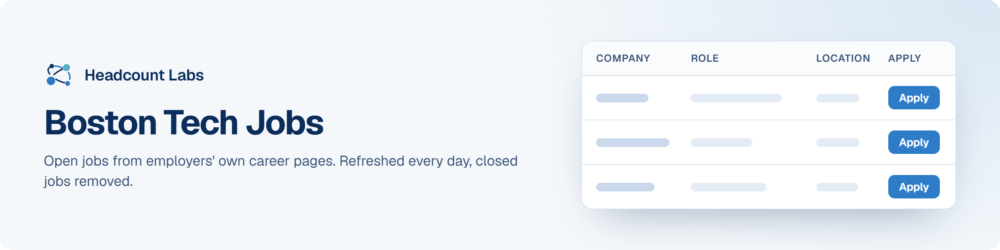

# Boston Tech Jobs

Software, data, AI, product and design jobs in the Boston area, sorted by field.

**303 open jobs** · 1 new since the last update · 83 removed because they closed or left the employer's board · updated October 23, 2026 at 6:16 AM EDT

This list is built and refreshed every day by [Headcount Labs](https://headcountlabs.com/?utm_source=github&utm_medium=job-list&utm_campaign=boston-tech-jobs), which reads jobs straight from employers' own career pages and job boards. Every job here was still listed on its source board when we last read that board, within the past 3 days, and was posted in the past 30 days. Copies of the same job are merged into one row, and jobs that close are removed at the next update.

Want this data in your own app or agent? Use the [Headcount Labs jobs API](https://headcountlabs.com/docs/?utm_source=github&utm_medium=job-list&utm_campaign=boston-tech-jobs) (free tier), the [MCP server](https://headcountlabs.com/mcp/?utm_source=github&utm_medium=job-list&utm_campaign=boston-tech-jobs) for Claude, ChatGPT and other AI assistants, or the [public dataset subsets](https://huggingface.co/HeadcountLabs) on Hugging Face (the full dataset is coming soon).

**Full dataset.** A bigger, one-off snapshot dated 2026-10-19 (all matching jobs, not only the open jobs below) is on Hugging Face: [Tech and software jobs](https://huggingface.co/datasets/HeadcountLabs/tech-jobs). It loads with `datasets.load_dataset` and is under the Open Database License (ODbL) 1.0.

**Jump to:** [Software engineering (140)](#software-engineering) · [Data, AI and machine learning (105)](#data-ai-and-machine-learning) · [Product and design (46)](#product-and-design) · [Hardware and engineering (12)](#hardware-and-engineering)

**Columns.** *Apply* opens the original posting on the employer's site. *Details* opens the job on Headcount Labs, with every posting we found for it. *Remote* shows what the employer states; a dash means the posting doesn't say. *Pay* is the range the employer published.

## Software engineering

| Company | Role | Location | Remote | Pay | Posted | Apply | Details |
| --- | --- | --- | --- | --- | --- | :---: | :---: |
| **WEX Inc** | Staff Software Engineer – Data Acquisition | 

7 locations
Maine Bay Area, CA Boston, MA Chicago, IL Dallas, TX Seattle, WA California
 | Remote | $141k–$173k/yr | Oct 21 |  | <a href="https://headcountlabs.com/catalog/jobs/80d4438a-9c08-41a4-bfe7-9eb47b5c4445?utm_source=github&utm_medium=job-list&utm_campaign=boston-tech-jobs">via Headcount Labs</a> |
| **Harvard University** | Senior Software Engineer | Boston, MA | Hybrid | — | Oct 21 |  | <a href="https://headcountlabs.com/catalog/jobs/87434052-41c1-4d01-9398-8ccdba45800a?utm_source=github&utm_medium=job-list&utm_campaign=boston-tech-jobs">via Headcount Labs</a> |
| **Global Payment Holding Company** | Senior Software Engineer – Java/Spring boot Engineer (Monolith Systems Development and Modernization) | 

2 locations
BOSTON, MA ALPHARETTA, GA
 | Remote | — | Oct 21 |  | <a href="https://headcountlabs.com/catalog/jobs/beb8a8db-3798-4933-9e16-f38ceefb7d1e?utm_source=github&utm_medium=job-list&utm_campaign=boston-tech-jobs">via Headcount Labs</a> |
| **American Lebanese Syrian Associated Charities** | Software Engineer III - Salesforce Data Cloud (Memphis or Remote in USA) | 

20 locations
Memphis, TN Arlington, VA Atlanta, GA Austin, TX Boston, MA Charlotte, NC Chicago, IL Dallas, TX Detroit, MI Durham, NC Houston, TX Indianapolis, IN +8 more
 | Remote | — | Oct 21 |  | <a href="https://headcountlabs.com/catalog/jobs/be49d93c-2a03-462e-b472-2a8d2302c93f?utm_source=github&utm_medium=job-list&utm_campaign=boston-tech-jobs">via Headcount Labs</a> |
| **WEX Inc** | Senior Full-Stack Engineer (Java / Spring Boot) | 

9 locations
Maine Bay Area, CA Boston, MA Dallas, TX Salt Lake City, UT Seattle, WA Portland, ME California United States
 | Remote | $122k–$146k/yr | Oct 20 |  | <a href="https://headcountlabs.com/catalog/jobs/ecfe7cee-95d5-4209-91b1-2e048212622e?utm_source=github&utm_medium=job-list&utm_campaign=boston-tech-jobs">via Headcount Labs</a> |
| **Viasat, Inc.** | Senior Full Stack Software Engineer (Go, AWS, GCP) | 

5 locations
Boston, MA Germantown, MD Massachusetts New York, MA New Jersey, MA
 | Remote | $165k–$260k/yr | Oct 20 |  | <a href="https://headcountlabs.com/catalog/jobs/4815900b-8592-4be8-9a9c-4a6b8f15e88f?utm_source=github&utm_medium=job-list&utm_campaign=boston-tech-jobs">via Headcount Labs</a> |
| **Vertex Pharmaceuticals Inc (US)** | Azure DevOps Engineer | Boston, MA | Hybrid | $112k–$168k/yr | Oct 20 |  | <a href="https://headcountlabs.com/catalog/jobs/4cb2761f-cac0-4376-80d4-7d32dba91588?utm_source=github&utm_medium=job-list&utm_campaign=boston-tech-jobs">via Headcount Labs</a> |
| **Verily Health Inc** | iOS Software Engineer III | Boston, MA | — | $156k–$176k/yr | Oct 20 |  | <a href="https://headcountlabs.com/catalog/jobs/83ee643c-62e3-4266-886f-0cfbfb678341?utm_source=github&utm_medium=job-list&utm_campaign=boston-tech-jobs">via Headcount Labs</a> |
| **Salesforce, Inc.** | Software Engineer, AI Systems (PMTS) | 

5 locations
San Francisco, CA Boston, MA New York Bellevue, WA Seattle, WA
 | — | $172k–$314k/yr | Oct 20 |  | <a href="https://headcountlabs.com/catalog/jobs/21393c34-c00e-4e78-b31f-f68f5d0cf023?utm_source=github&utm_medium=job-list&utm_campaign=boston-tech-jobs">via Headcount Labs</a> |
| **QuEra Computing, Inc.** | Senior DevOps Engineer | Boston, MA | — | — | Oct 20 |  | <a href="https://headcountlabs.com/catalog/jobs/dcef4ed5-a628-4d4b-85c7-53f9da7740b9?utm_source=github&utm_medium=job-list&utm_campaign=boston-tech-jobs">via Headcount Labs</a> |
| **MAK Technologies** | Senior Software Engineer | Cambridge, MA | On-site | — | Oct 20 |  | <a href="https://headcountlabs.com/catalog/jobs/49a33afc-5ada-4892-9fa2-45276f648de1?utm_source=github&utm_medium=job-list&utm_campaign=boston-tech-jobs">via Headcount Labs</a> |
| **LangChain** | Software Engineering Manager, AI Observability &amp; Evals Platform | Boston, MA | On-site | — | Oct 20 |  | <a href="https://headcountlabs.com/catalog/jobs/a2ab8b10-f77d-4ffe-9392-5b90d56345f6?utm_source=github&utm_medium=job-list&utm_campaign=boston-tech-jobs">via Headcount Labs</a> |
| **Klaviyo** | Senior Security Engineer - Detection and Response | Boston, MA | — | $142k–$212k/yr | Oct 20 |  | <a href="https://headcountlabs.com/catalog/jobs/9ec91c0b-dd7c-41b6-ad3a-f1734b356b40?utm_source=github&utm_medium=job-list&utm_campaign=boston-tech-jobs">via Headcount Labs</a> |
| **Humana Inc.** | Lead Full-Stack Engineer - Backend Focus | 

13 locations
NYC METRO, NY Atlanta, GA Boston, MA Charlotte, NC Chicago, IL Dallas, TX Fort Lauderdale, FL Louisville, KY Nashville, TN Tampa, FL Washington, DC Work at Home - Texas +1 more
 | Remote | $155k–$213k/yr | Oct 20 |  | <a href="https://headcountlabs.com/catalog/jobs/d5ffd123-0733-40db-8139-8fcf7b5c9075?utm_source=github&utm_medium=job-list&utm_campaign=boston-tech-jobs">via Headcount Labs</a> |
| **Digital Realty** | Senior Software Engineer | 

9 locations
Dallas, TX Ashburn, VA Boston, MA New York, NY San Francisco, CA San Jose, CA Denver, CO Austin, TX Charlotte, NC
 | Hybrid | $150k–$170k/yr | Oct 20 |  | <a href="https://headcountlabs.com/catalog/jobs/c0829bc8-9522-429a-a540-0501089f4e90?utm_source=github&utm_medium=job-list&utm_campaign=boston-tech-jobs">via Headcount Labs</a> |
| **Cognito Therapeutics** | Product Security Engineer | 

2 locations
Cambridge, MA United States
 | Hybrid | — | Oct 20 |  | <a href="https://headcountlabs.com/catalog/jobs/bc15ee1a-fd33-42f4-9522-c4581f82418c?utm_source=github&utm_medium=job-list&utm_campaign=boston-tech-jobs">via Headcount Labs</a> |
| **CarGurus** | Senior Principal Software Engineer, Cloud Architecture | Boston, MA | Hybrid | $191k–$239k/yr | Oct 20 |  | <a href="https://headcountlabs.com/catalog/jobs/d4b3ade0-bb50-4b9c-8dc8-9b6de69efb88?utm_source=github&utm_medium=job-list&utm_campaign=boston-tech-jobs">via Headcount Labs</a> |
| **CarGurus** | Senior Software Engineer, AI Developer Experience | Boston, MA | Hybrid | $140k–$176k/yr | Oct 20 |  | <a href="https://headcountlabs.com/catalog/jobs/3059f831-b65a-4a91-9c97-8a20a3b7d53d?utm_source=github&utm_medium=job-list&utm_campaign=boston-tech-jobs">via Headcount Labs</a> |
| **CarGurus** | Senior Software Development Engineer, DevX Pipelines and Automation | Boston, MA | Hybrid | $140k–$176k/yr | Oct 20 |  | <a href="https://headcountlabs.com/catalog/jobs/2da89667-3513-41dd-b23a-c22b223671c4?utm_source=github&utm_medium=job-list&utm_campaign=boston-tech-jobs">via Headcount Labs</a> |
| **Vertex Pharmaceuticals Inc (US)** | Senior Principal AI Platform Engineer, Data &amp; AI Platform | Boston, MA | Hybrid | $188k–$282k/yr | Oct 19 |  | <a href="https://headcountlabs.com/catalog/jobs/943e35f8-dc06-43a0-b1b3-697ff032b5e1?utm_source=github&utm_medium=job-list&utm_campaign=boston-tech-jobs">via Headcount Labs</a> |
| **Unframe** | Full Stack Software Engineer (Remote) | 

6 locations
Atlanta, GA Boston, MA Miami, FL New York, NY Tampa, FL Austin, TX
 | Remote | — | Oct 19 |  | <a href="https://headcountlabs.com/catalog/jobs/49d35038-5887-482e-8d67-7227cf897ec7?utm_source=github&utm_medium=job-list&utm_campaign=boston-tech-jobs">via Headcount Labs</a> |
| **The Charles Stark Draper Laboratory, Inc.** | Senior Web Developer | Cambridge, MA | Hybrid | $95k–$245k/yr | Oct 19 |  | <a href="https://headcountlabs.com/catalog/jobs/971e2dc2-c745-49b0-92fc-b113d8c004e4?utm_source=github&utm_medium=job-list&utm_campaign=boston-tech-jobs">via Headcount Labs</a> |
| **SSB&amp;T** | Software Engineer – Backend Platforms, Assistant Vice President (Wealth Custody &amp; Clearing) | 

6 locations
Dallas Austin, TX Boston, MA Clifton, NJ Quincy, MA Dallas, TX
 | — | $80k–$140k/yr | Oct 19 |  | <a href="https://headcountlabs.com/catalog/jobs/8b5ab4cb-7cde-42e5-af44-d220ed7e29b3?utm_source=github&utm_medium=job-list&utm_campaign=boston-tech-jobs">via Headcount Labs</a> |
| **Pivotal Solutions, Inc.** | Power BI Developer | Boston, MA | — | — | Oct 19 |  | <a href="https://headcountlabs.com/catalog/jobs/dfe935e9-aac1-4446-a004-7ca11cb8bf60?utm_source=github&utm_medium=job-list&utm_campaign=boston-tech-jobs">via Headcount Labs</a> |
| **New Leaf Energy, Inc.** | New Markets Project Developer, DG Capacity | 

2 locations
Boston, MA Lowell, MA
 | — | $125k/yr | Oct 19 |  | <a href="https://headcountlabs.com/catalog/jobs/f982ede1-4053-4ba2-9c2f-bc621c96e37c?utm_source=github&utm_medium=job-list&utm_campaign=boston-tech-jobs">via Headcount Labs</a> |
| **Motional** | Principal Software Engineer, Team Lead - Perception Platforms | 

3 locations
Boston, MA Las Vegas, NV Pittsburgh, PA
 | Remote | $240k–$330k/yr | Oct 19 |  | <a href="https://headcountlabs.com/catalog/jobs/4acfafa6-af38-4a96-84ca-69441b044cf1?utm_source=github&utm_medium=job-list&utm_campaign=boston-tech-jobs">via Headcount Labs</a> |
| **Massachusetts Mutual Life Insurance Co.** | Lead AI Platform Engineer | 

3 locations
Boston, MA New York, NY Springfield, MA
 | Hybrid | $172k–$226k/yr | Oct 19 |  | <a href="https://headcountlabs.com/catalog/jobs/ee124e90-7b61-41bd-a422-69f37b41ca10?utm_source=github&utm_medium=job-list&utm_campaign=boston-tech-jobs">via Headcount Labs</a> |
| **Lutron Electronics Co., Inc** | Experienced Application Software Engineer | 

4 locations
Philadelphia, PA Cincinnati, OH Austin, TX Boston, MA
 | — | $120k–$138k/yr | Oct 19 |  | <a href="https://headcountlabs.com/catalog/jobs/a8d463c2-7113-486f-85b8-e2b5257b2aae?utm_source=github&utm_medium=job-list&utm_campaign=boston-tech-jobs">via Headcount Labs</a> |
| **Klaviyo** | Senior Software Engineer - Data Automation | Boston, MA | — | $148k–$222k/yr | Oct 19 |  | <a href="https://headcountlabs.com/catalog/jobs/d63cde2f-985e-4cbd-b78b-b07a8a3de481?utm_source=github&utm_medium=job-list&utm_campaign=boston-tech-jobs">via Headcount Labs</a> |
| **Cambridge Mobile Telematics** | Senior Software Engineer, Backend | Cambridge, MA | — | $139k–$174k/yr | Oct 19 |  | <a href="https://headcountlabs.com/catalog/jobs/93e2e2af-3e30-47d7-945d-c507cb267e18?utm_source=github&utm_medium=job-list&utm_campaign=boston-tech-jobs">via Headcount Labs</a> |
| **Bracebridge Capital** | Northeastern University Software Engineer - Application Development Co-op | Boston, MA | — | $43–$48/hr | Oct 19 |  | <a href="https://headcountlabs.com/catalog/jobs/80c6c523-43ae-40f7-bd5c-234839e2d375?utm_source=github&utm_medium=job-list&utm_campaign=boston-tech-jobs">via Headcount Labs</a> |
| **Bracebridge Capital** | Northeastern University Software Engineer - Business Intelligence Co-op | Boston, MA | — | $43–$48/hr | Oct 19 |  | <a href="https://headcountlabs.com/catalog/jobs/338912e7-e6d9-42ff-a16c-0ed376664c0a?utm_source=github&utm_medium=job-list&utm_campaign=boston-tech-jobs">via Headcount Labs</a> |
| **Anthropic** | IT Systems Engineer, Client Platform Engineer, ChromeOS | 

3 locations
Boston, MA Friendly (Travel-Required) &#124; San Francisco, CA &#124; Seattle, WA &#124; New York City, NY Washington, DC
 | Remote | $325k–$360k/yr | Oct 19 |  | <a href="https://headcountlabs.com/catalog/jobs/d54baf90-8b82-4225-b73b-74b01b02ac83?utm_source=github&utm_medium=job-list&utm_campaign=boston-tech-jobs">via Headcount Labs</a> |
| **TetraScience** | Lead Software Platform Engineer, MLOps | 

2 locations
Cambridge, MA San Mateo, CA
 | Hybrid | — | Oct 16 |  | <a href="https://headcountlabs.com/catalog/jobs/ae4dbf0e-ac02-4ebd-8617-3b491415dc22?utm_source=github&utm_medium=job-list&utm_campaign=boston-tech-jobs">via Headcount Labs</a> |
| **Recorded Future** | Product Support Solutions Developer | 

2 locations
Washington, DC Boston, MA
 | Hybrid | $128k–$192k/yr | Oct 16 |  | <a href="https://headcountlabs.com/catalog/jobs/b92e3a16-4daf-4c84-b424-4c1a228b3028?utm_source=github&utm_medium=job-list&utm_campaign=boston-tech-jobs">via Headcount Labs</a> |
| **Klaviyo** | Sr. Lead Software Engineer | Boston, MA | — | $216k–$324k/yr | Oct 16 |  | <a href="https://headcountlabs.com/catalog/jobs/b2ed605d-2bfb-4176-9550-fd0e1cb3d8eb?utm_source=github&utm_medium=job-list&utm_campaign=boston-tech-jobs">via Headcount Labs</a> |
| **Datadog** | Senior Software Engineer - Husky Storage | 

2 locations
Boston, MA New York, NY
 | — | $192k–$240k/yr | Oct 16 |  | <a href="https://headcountlabs.com/catalog/jobs/25dc8eba-7486-46f2-a998-e4a5cae31dc0?utm_source=github&utm_medium=job-list&utm_campaign=boston-tech-jobs">via Headcount Labs</a> |
| **Lydian** | Senior Software Engineer | Boston, MA | On-site | $140k–$180k/yr | Oct 15 |  | <a href="https://headcountlabs.com/catalog/jobs/e1410733-dabc-440b-adb4-c1c77e0afff8?utm_source=github&utm_medium=job-list&utm_campaign=boston-tech-jobs">via Headcount Labs</a> |
| **UKG** | Principal Software Development Engineer | 

55 locations
Madison, WI Annapolis, MD Jefferson City, MO Austin, TX Salt Lake City, UT Dover, DE Phoenix, AZ Oklahoma City, OK United States Nashville, TN Providence, RI Indianapolis, IN +43 more
 | Remote | $150k–$214k/yr | Oct 14 |  | <a href="https://headcountlabs.com/catalog/jobs/fb112826-4c87-40ca-92fc-ed83e7b481b4?utm_source=github&utm_medium=job-list&utm_campaign=boston-tech-jobs">via Headcount Labs</a> |
| **UKG** | Lead Software Development Engineer | 

55 locations
Jackson, MS Tallahassee, FL Concord, NH Baton Rouge, LA Oklahoma City, OK Annapolis, MD Phoenix, AZ Richmond, VA Denver, CO Columbus, OH Charleston, WV Albany, NY +43 more
 | Remote | $134k–$191k/yr | Oct 14 |  | <a href="https://headcountlabs.com/catalog/jobs/56fe903e-62dd-49ab-9b08-f23fa8ee5050?utm_source=github&utm_medium=job-list&utm_campaign=boston-tech-jobs">via Headcount Labs</a> |
| **ElevenLabs** | Safety Engineer (Backend Leaning) | 

9 locations
Dublin Tokyo United States New York Los Angeles, CA London Boston, MA San Francisco, CA Washington
 | Remote | — | Oct 14 |  | <a href="https://headcountlabs.com/catalog/jobs/4ef40d07-b9fc-4700-8f76-96c3c3946b6b?utm_source=github&utm_medium=job-list&utm_campaign=boston-tech-jobs">via Headcount Labs</a> |
| **CarGurus** | Software Development Engineer II | Boston, MA | Hybrid | $112k–$141k/yr | Oct 14 |  | <a href="https://headcountlabs.com/catalog/jobs/218605d9-c096-4465-9b9f-b072a78373fa?utm_source=github&utm_medium=job-list&utm_campaign=boston-tech-jobs">via Headcount Labs</a> |
| **Beacon Biosignals** | Staff Software Engineer, PostgreSQL | Boston, MA | Remote | $170k–$190k/yr | Oct 14 |  | <a href="https://headcountlabs.com/catalog/jobs/242f4a97-8747-48dd-808d-c807af63c790?utm_source=github&utm_medium=job-list&utm_campaign=boston-tech-jobs">via Headcount Labs</a> |
| **Bay Cove Human Services, Inc.** | Senior Developer/Analyst - Information Services | Boston, MA | On-site | $90k–$100k/yr | Oct 14 |  | <a href="https://headcountlabs.com/catalog/jobs/b02fb9bc-8335-4b43-83bb-c3a1c73f4d7f?utm_source=github&utm_medium=job-list&utm_campaign=boston-tech-jobs">via Headcount Labs</a> |
| **Whoop** | Senior iOS Engineer (Connectivity) | Boston, MA | On-site | — | Oct 13 |  | <a href="https://headcountlabs.com/catalog/jobs/d4cd753b-2723-4965-ae04-2510e4a11d1b?utm_source=github&utm_medium=job-list&utm_campaign=boston-tech-jobs">via Headcount Labs</a> |
| **Vontier** | Senior Net Software Developer | 

2 locations
Boston, MA Stow, OH
 | Hybrid | $112k–$130k/yr | Oct 13 |  | <a href="https://headcountlabs.com/catalog/jobs/cfec9ad3-a94d-4f27-b037-85520ddb9e32?utm_source=github&utm_medium=job-list&utm_campaign=boston-tech-jobs">via Headcount Labs</a> |
| **Motional** | Director, Onboard Core Software | 

3 locations
Boston, MA Las Vegas, NV Pittsburgh, PA
 | Remote | $240k–$330k/yr | Oct 13 |  | <a href="https://headcountlabs.com/catalog/jobs/22f29cca-d770-4884-ab27-98a61e012d61?utm_source=github&utm_medium=job-list&utm_campaign=boston-tech-jobs">via Headcount Labs</a> |
| **Harvard University** | Software Developer | Boston, MA | Remote | — | Oct 13 |  | <a href="https://headcountlabs.com/catalog/jobs/74dea736-23ce-49f1-ae75-ed09c7cbb2c5?utm_source=github&utm_medium=job-list&utm_campaign=boston-tech-jobs">via Headcount Labs</a> |
| **Applus IDIADA** | Vehicle Hardware &amp; Software Technician | Boston, MA | — | $27–$30/hr | Oct 13 |  | <a href="https://headcountlabs.com/catalog/jobs/4a3dcfc4-22fd-4996-b55b-12ec280bab11?utm_source=github&utm_medium=job-list&utm_campaign=boston-tech-jobs">via Headcount Labs</a> |
| **Akamai** | Principal Software Development Engineer in Test (Performance &amp; Bare-Metal) | 

2 locations
United States Cambridge, MA
 | Remote | $169k–$305k/yr | Oct 13 |  | <a href="https://headcountlabs.com/catalog/jobs/f31637e7-6370-45bf-ab60-4b1e426e18d6?utm_source=github&utm_medium=job-list&utm_campaign=boston-tech-jobs">via Headcount Labs</a> |
| **Pennrose** | Associate Developer | Boston, MA | — | $80k–$90k/yr | Oct 12 |  | <a href="https://headcountlabs.com/catalog/jobs/ee648819-7589-4b6c-a938-8e0ec7bd06a0?utm_source=github&utm_medium=job-list&utm_campaign=boston-tech-jobs">via Headcount Labs</a> |
| **Mathematica Inc** | Digital Quality Measure Developer (Remote Eligible) | 

7 locations
Ann Arbor, MI Cambridge, MA Chicago, IL Princeton, NJ Washington, DC Windsor Mill, MD United States
 | Remote | $100k–$140k/yr | Oct 12 |  | <a href="https://headcountlabs.com/catalog/jobs/8bfeb689-aa09-4530-95d3-58f38f5d06a8?utm_source=github&utm_medium=job-list&utm_campaign=boston-tech-jobs">via Headcount Labs</a> |
| **Fidelity Technology Group, LLC** | Principal Software Engineer | Boston, MA | — | $107k–$216k/yr | Oct 12 |  | <a href="https://headcountlabs.com/catalog/jobs/86110b2a-b7fb-41f6-b8ce-4b96dd93622c?utm_source=github&utm_medium=job-list&utm_campaign=boston-tech-jobs">via Headcount Labs</a> |
| **Fidelity Technology Group, LLC** | July 2027 - Leap Software Engineer | 

4 locations
Westlake, TX Durham, NC Merrimack, NH Boston, MA
 | — | $71k–$134k/yr | Oct 12 |  | <a href="https://headcountlabs.com/catalog/jobs/bb06bbe9-c900-4fc5-9c6a-a6489c633145?utm_source=github&utm_medium=job-list&utm_campaign=boston-tech-jobs">via Headcount Labs</a> |
| **Fidelity Technology Group, LLC** | January 2027 - Leap Software Engineer | 

4 locations
Westlake, TX Boston, MA Durham, NC Merrimack, NH
 | — | $55k–$134k/yr | Oct 12 |  | <a href="https://headcountlabs.com/catalog/jobs/58f6fa71-a7eb-4bcd-a6b0-fafe3c16b06f?utm_source=github&utm_medium=job-list&utm_campaign=boston-tech-jobs">via Headcount Labs</a> |
| **Whoop** | Software Engineering Manager, Device Experience | Boston, MA | On-site | — | Oct 9 |  | <a href="https://headcountlabs.com/catalog/jobs/bb1c46e6-9cab-4c50-bd02-fa3e2d9d6382?utm_source=github&utm_medium=job-list&utm_campaign=boston-tech-jobs">via Headcount Labs</a> |
| **Whoop** | Software Engineering Manager (Hardware Accelerate) | Boston, MA | On-site | — | Oct 9 |  | <a href="https://headcountlabs.com/catalog/jobs/ab1d0037-3776-449b-972f-28841862fc85?utm_source=github&utm_medium=job-list&utm_campaign=boston-tech-jobs">via Headcount Labs</a> |
| **Scribd, Inc.** | Senior Software Engineer (Frontend), Search | 

11 locations
San Francisco, CA Toronto Los Angeles, CA Denver, CO Chicago, IL New York City, NY Vancouver Seattle, WA Austin, TX Boston, MA Dallas, TX
 | — | — | Oct 9 |  | <a href="https://headcountlabs.com/catalog/jobs/90a1fce2-3d1e-49aa-be10-e1331979f925?utm_source=github&utm_medium=job-list&utm_campaign=boston-tech-jobs">via Headcount Labs</a> |
| **Reframe Systems** | Staff Software Engineer, Pixels to Parts | Boston, MA | Hybrid | $160k–$210k/yr | Oct 9 |  | <a href="https://headcountlabs.com/catalog/jobs/d220c246-4009-416c-b959-44b4f7402401?utm_source=github&utm_medium=job-list&utm_campaign=boston-tech-jobs">via Headcount Labs</a> |
| **NexHealth** | Senior Software Engineer | 

9 locations
Seattle, WA San Francisco, CA Austin, TX Boston, MA Denver, CO New York, NY Atlanta, GA Raleigh, NC Chicago, IL
 | Remote | $165k–$230k/yr | Oct 9 |  | <a href="https://headcountlabs.com/catalog/jobs/65ab7378-111b-4814-b97a-9957e63cbe47?utm_source=github&utm_medium=job-list&utm_campaign=boston-tech-jobs">via Headcount Labs</a> |
| **Grant Thornton** | Cyber Data Protection Manager - MSFT Purview | 

10 locations
Arlington, VA Dallas, TX Austin, TX Houston, TX Atlanta, GA Charlotte, NC New York, NY Boston, MA Philadelphia, PA Chicago, IL
 | Hybrid | $162k–$202k/yr | Oct 9 |  | <a href="https://headcountlabs.com/catalog/jobs/d514bad6-d273-466d-a6b3-6d87dcbac6b2?utm_source=github&utm_medium=job-list&utm_campaign=boston-tech-jobs">via Headcount Labs</a> |
| **Escher Group** | Senior Software Engineer | Boston, MA | Hybrid | $110k–$140k/yr | Oct 9 |  | <a href="https://headcountlabs.com/catalog/jobs/0c2fd999-b52f-48e4-9e1e-66ef92bb31f1?utm_source=github&utm_medium=job-list&utm_campaign=boston-tech-jobs">via Headcount Labs</a> |
| **DK Crown Holdings Inc.** | Senior Lead Software Engineer | Boston, MA | — | $161k–$201k/yr | Oct 9 |  | <a href="https://headcountlabs.com/catalog/jobs/f5b7a597-748e-44fd-8786-1c91bd3df81d?utm_source=github&utm_medium=job-list&utm_campaign=boston-tech-jobs">via Headcount Labs</a> |
| **DK Crown Holdings Inc.** | Senior Software Engineer, Backend | Boston, MA | — | $120k–$149k/yr | Oct 9 |  | <a href="https://headcountlabs.com/catalog/jobs/af6676bb-e3b2-40bf-85e2-6667886b24ac?utm_source=github&utm_medium=job-list&utm_campaign=boston-tech-jobs">via Headcount Labs</a> |
| **Cytel** | Senior Software Engineer | 

2 locations
United States Cambridge, MA
 | Remote | — | Oct 9 |  | <a href="https://headcountlabs.com/catalog/jobs/9039ce3a-760a-48d7-ac6a-80f136929135?utm_source=github&utm_medium=job-list&utm_campaign=boston-tech-jobs">via Headcount Labs</a> |
| **BitSight Technologies** | Senior Software Engineer, Full Stack | Boston, MA | — | $119k–$179k/yr | Oct 9 |  | <a href="https://headcountlabs.com/catalog/jobs/08c7713b-79b6-420c-89d9-6a9e150d26b9?utm_source=github&utm_medium=job-list&utm_campaign=boston-tech-jobs">via Headcount Labs</a> |
| **Beacon Biosignals** | Senior Mobile Engineer, BLE &amp; Device Connectivity (iOS/Android) | Boston, MA | Remote | $150k–$190k/yr | Oct 9 |  | <a href="https://headcountlabs.com/catalog/jobs/937c0bf1-0cc6-411c-8205-8cde8689f10c?utm_source=github&utm_medium=job-list&utm_campaign=boston-tech-jobs">via Headcount Labs</a> |
| **Beacon Biosignals** | Senior Product Manager, Web Apps | Boston, MA | Remote | $160k–$183k/yr | Oct 9 |  | <a href="https://headcountlabs.com/catalog/jobs/6f54f96b-1fd4-404e-97dc-54a8fae47378?utm_source=github&utm_medium=job-list&utm_campaign=boston-tech-jobs">via Headcount Labs</a> |
| **Akamai** | Senior Site Reliability Engineer - Hardware, Infrastructure, and Virtualization (HIVE) - Core Linux Platforms Team | 

2 locations
United States Cambridge, MA
 | Remote | $121k–$219k/yr | Oct 9 |  | <a href="https://headcountlabs.com/catalog/jobs/ea7adbb2-0448-4d8f-a058-a88051845bf3?utm_source=github&utm_medium=job-list&utm_campaign=boston-tech-jobs">via Headcount Labs</a> |
| **Akamai** | Site Reliability Engineer II | 

2 locations
United States Cambridge, MA
 | On-site | $111k–$171k/yr | Oct 9 |  | <a href="https://headcountlabs.com/catalog/jobs/41225bc2-67d2-46a3-a23e-9bcc794dcc19?utm_source=github&utm_medium=job-list&utm_campaign=boston-tech-jobs">via Headcount Labs</a> |
| **Akamai** | Senior Software Development Engineer in Test | 

2 locations
United States Cambridge, MA
 | On-site | $121k–$219k/yr | Oct 9 |  | <a href="https://headcountlabs.com/catalog/jobs/f290f1d9-dd68-4b37-90f7-7263adc2096e?utm_source=github&utm_medium=job-list&utm_campaign=boston-tech-jobs">via Headcount Labs</a> |
| **Akamai** | Senior Software Engineer | 

2 locations
United States Cambridge, MA
 | On-site | $186k–$219k/yr | Oct 9 |  | <a href="https://headcountlabs.com/catalog/jobs/f5ba2509-8f08-4fc9-b693-75f63205ba10?utm_source=github&utm_medium=job-list&utm_campaign=boston-tech-jobs">via Headcount Labs</a> |
| **Akamai** | Software Engineer II | 

2 locations
United States Cambridge, MA
 | On-site | $138k–$171k/yr | Oct 9 |  | <a href="https://headcountlabs.com/catalog/jobs/894a460d-bdaa-4558-b3f1-1455687da4ce?utm_source=github&utm_medium=job-list&utm_campaign=boston-tech-jobs">via Headcount Labs</a> |
| **Whoop** | Director of Embedded Software Engineering | Boston, MA | On-site | — | Oct 8 |  | <a href="https://headcountlabs.com/catalog/jobs/431b3560-a7fe-4f76-80d2-8a43a67cb261?utm_source=github&utm_medium=job-list&utm_campaign=boston-tech-jobs">via Headcount Labs</a> |
| **Veho** | Senior Software Engineer, Facilties (Android Mobile Experience) | 

2 locations
Boston, MA New York City, NY
 | Hybrid | $170k–$200k/yr | Oct 8 |  | <a href="https://headcountlabs.com/catalog/jobs/f96320f7-af8d-49e3-a5f4-f43d18afcc0b?utm_source=github&utm_medium=job-list&utm_campaign=boston-tech-jobs">via Headcount Labs</a> |
| **Schneider Electric** | Offer Manager, Digital Power Software and Systems | 

8 locations
Franklin, TN Chicago, IL Nashville, TN Boston, MA Raleigh, NC Dallas, TX Foxboro, MA Andover, MA
 | — | — | Oct 8 |  | <a href="https://headcountlabs.com/catalog/jobs/d1932dba-3761-42d7-9c44-c8c70b04f2d7?utm_source=github&utm_medium=job-list&utm_campaign=boston-tech-jobs">via Headcount Labs</a> |
| **Maven AGI** | Software Engineering Manager/Tech Lead, Maven Voice | 

2 locations
Boston, MA San Francisco, CA
 | Hybrid | $185k–$235k/yr | Oct 8 |  | <a href="https://headcountlabs.com/catalog/jobs/bb952e25-77dd-41db-b698-25fed6c14159?utm_source=github&utm_medium=job-list&utm_campaign=boston-tech-jobs">via Headcount Labs</a> |
| **KAYAK** | Software Engineer, Ads (Backend) | 

2 locations
Cambridge, MA Concord, MA
 | Hybrid | — | Oct 8 |  | <a href="https://headcountlabs.com/catalog/jobs/978918ed-49a6-4849-aed7-6e85e36a7b36?utm_source=github&utm_medium=job-list&utm_campaign=boston-tech-jobs">via Headcount Labs</a> |
| **Expedition Medicines** | Senior / Principal Data Infrastructure Engineer | Cambridge, MA | — | $165k–$209k/yr | Oct 8 |  | <a href="https://headcountlabs.com/catalog/jobs/0ccdd9ea-72ae-42f5-8931-3408182a07d5?utm_source=github&utm_medium=job-list&utm_campaign=boston-tech-jobs">via Headcount Labs</a> |
| **The Charles Stark Draper Laboratory, Inc.** | Operating Systems and Embedded Software Development Co-Op (Spring 2027) | 

2 locations
Lowell, MA Cambridge, MA
 | On-site | $20–$45/hr | Oct 7 |  | <a href="https://headcountlabs.com/catalog/jobs/20f0aed3-eea9-4e36-94e2-fb2103ddf30e?utm_source=github&utm_medium=job-list&utm_campaign=boston-tech-jobs">via Headcount Labs</a> |
| **Scribd, Inc.** | Staff Software Engineer, Core Everand | 

11 locations
San Francisco, CA Toronto Los Angeles, CA Denver, CO Chicago, IL New York City, NY Vancouver Seattle, WA Austin, TX Boston, MA Dallas, TX
 | Remote | — | Oct 7 |  | <a href="https://headcountlabs.com/catalog/jobs/989134f2-462c-4355-b305-89e5ed624e62?utm_source=github&utm_medium=job-list&utm_campaign=boston-tech-jobs">via Headcount Labs</a> |
| **Iterable** | Software Engineer II | 

6 locations
United States Chicago, IL Atlanta, GA Austin, TX Boston, MA Denver, CO
 | Remote | $115k–$160k/yr | Oct 7 |  | <a href="https://headcountlabs.com/catalog/jobs/e91e1d11-41cc-4747-a5dd-818781244e23?utm_source=github&utm_medium=job-list&utm_campaign=boston-tech-jobs">via Headcount Labs</a> |
| **Inari Agriculture, Inc.** | Sr. Software Engineer | Cambridge, MA | — | $127k–$175k/yr | Oct 7 |  | <a href="https://headcountlabs.com/catalog/jobs/1dbceea1-ac15-4ec8-9e86-d7b2f8dcba86?utm_source=github&utm_medium=job-list&utm_campaign=boston-tech-jobs">via Headcount Labs</a> |
| **Global Payment Holding Company** | Software Engineer – Java/Spring boot Engineer | 

2 locations
BOSTON, MA ALPHARETTA, GA
 | Hybrid | — | Oct 7 |  | <a href="https://headcountlabs.com/catalog/jobs/014e0124-1eb0-43a2-8866-6fa6de959463?utm_source=github&utm_medium=job-list&utm_campaign=boston-tech-jobs">via Headcount Labs</a> |
| **Beacon Biosignals** | Staff Software Engineer | Boston, MA | Remote | $170k–$190k/yr | Oct 7 |  | <a href="https://headcountlabs.com/catalog/jobs/e882b601-e22b-4b15-92ac-95b72b0b4eed?utm_source=github&utm_medium=job-list&utm_campaign=boston-tech-jobs">via Headcount Labs</a> |
| **Scribd, Inc.** | Staff Cloud Security Engineer | 

11 locations
San Francisco, CA Toronto Los Angeles, CA Denver, CO Chicago, IL New York City, NY Vancouver Seattle, WA Austin, TX Boston, MA Dallas, TX
 | — | — | Oct 6 |  | <a href="https://headcountlabs.com/catalog/jobs/f706c7f3-86ca-4993-b3d1-e0b22d8a5667?utm_source=github&utm_medium=job-list&utm_campaign=boston-tech-jobs">via Headcount Labs</a> |
| **Scribd, Inc.** | Senior iOS Engineer | 

11 locations
San Francisco, CA Toronto Los Angeles, CA Denver, CO Chicago, IL New York City, NY Vancouver Seattle, WA Austin, TX Boston, MA Dallas, TX
 | — | — | Oct 6 |  | <a href="https://headcountlabs.com/catalog/jobs/3275af16-3194-4103-8b25-6ddd578c96ed?utm_source=github&utm_medium=job-list&utm_campaign=boston-tech-jobs">via Headcount Labs</a> |
| **Foundation Medicine** | Cybersecurity and Data Protection Software Quality Engineer | Boston, MA | Hybrid | $94k–$116k/yr | Oct 6 |  | <a href="https://headcountlabs.com/catalog/jobs/1821daf6-4089-4c89-b095-d944cea04a3f?utm_source=github&utm_medium=job-list&utm_campaign=boston-tech-jobs">via Headcount Labs</a> |
| **Digital Realty** | Senior Software Manager Platform | 

9 locations
Dallas, TX Austin, TX Charlotte, NC Boston, MA Denver, CO Seattle, WA Chicago, IL Ashburn, VA New York, NY
 | Hybrid | $155k–$175k/yr | Oct 6 |  | <a href="https://headcountlabs.com/catalog/jobs/6c1c3bd8-f3ab-42d1-8857-b6af5f58a4f1?utm_source=github&utm_medium=job-list&utm_campaign=boston-tech-jobs">via Headcount Labs</a> |
| **Catholic Charities Archdiocese of Boston** | IT Job Developer and Career Coach | Boston, MA | — | $35–$37/hr | Oct 6 |  | <a href="https://headcountlabs.com/catalog/jobs/4e2b8bad-15fd-4764-a83f-ee6d222c3c74?utm_source=github&utm_medium=job-list&utm_campaign=boston-tech-jobs">via Headcount Labs</a> |
| **Audax Group** | Data Security Engineer | Boston, MA | — | $140k–$165k/yr | Oct 6 |  | <a href="https://headcountlabs.com/catalog/jobs/a3b03f69-1065-41ed-99e9-e49f74cfa248?utm_source=github&utm_medium=job-list&utm_campaign=boston-tech-jobs">via Headcount Labs</a> |
| **Anduril Industries** | Senior Security Engineer, Identity | 

3 locations
Boston, MA Washington, DC Seattle, WA
 | — | $166k–$220k/yr | Oct 6 |  | <a href="https://headcountlabs.com/catalog/jobs/222bc094-93d6-4216-bcd1-30188251b45a?utm_source=github&utm_medium=job-list&utm_campaign=boston-tech-jobs">via Headcount Labs</a> |
| **SOPHiA GENETICS** | Software Development Engineer, Strategic Internal Projects | Boston, MA | — | — | Oct 5 |  | <a href="https://headcountlabs.com/catalog/jobs/09ecb710-b0b2-4071-b9fc-d017e25ce55e?utm_source=github&utm_medium=job-list&utm_campaign=boston-tech-jobs">via Headcount Labs</a> |
| **12L Federal Reserve Bank of San Francisco** | Lead Site Reliability Engineer | 

11 locations
San Francisco, CA Atlanta, GA Boston, MA Charlotte, NC Chicago, IL Cleveland, OH Dallas, TX Minneapolis, MN New York, NY Richmond, VA Saint Louis, MO
 | — | $147k–$234k/yr | Oct 5 |  | <a href="https://headcountlabs.com/catalog/jobs/283fd61b-f98a-4203-a680-54d622bb4699?utm_source=github&utm_medium=job-list&utm_campaign=boston-tech-jobs">via Headcount Labs</a> |
| **Anduril Industries** | NX Developer | 

6 locations
Costa Mesa, CA Boston, MA Bellevue, WA Seattle, WA Atlanta, GA Mountain View, CA
 | — | $129k–$171k/yr | Oct 4 |  | <a href="https://headcountlabs.com/catalog/jobs/dfe46645-e16c-42d8-807c-c97926e517a7?utm_source=github&utm_medium=job-list&utm_campaign=boston-tech-jobs">via Headcount Labs</a> |
| **Systems Engineering Solutions Corporation** | JIRA Developer - Administrator | 

2 locations
Boston, MA Montgomery, AL
 | On-site | — | Oct 2 |  | <a href="https://headcountlabs.com/catalog/jobs/81f93a92-372b-4f9a-889d-ddfb23d90a0c?utm_source=github&utm_medium=job-list&utm_campaign=boston-tech-jobs">via Headcount Labs</a> |
| **LILT** | Backend Engineer | 

3 locations
Washington D.C., DC Boston, MA Indianapolis, IN
 | Hybrid | $110k–$138k/yr | Oct 2 |  | <a href="https://headcountlabs.com/catalog/jobs/626bdc4c-f7ca-4b84-aaf6-55fe70058bec?utm_source=github&utm_medium=job-list&utm_campaign=boston-tech-jobs">via Headcount Labs</a> |
| **LILT** | Senior Full Stack Engineer | 

3 locations
Washington D.C., DC Boston, MA Indianapolis, IN
 | Hybrid | $133k–$166k/yr | Oct 2 |  | <a href="https://headcountlabs.com/catalog/jobs/1c89b0ee-2c64-4929-86ff-e59c97301a62?utm_source=github&utm_medium=job-list&utm_campaign=boston-tech-jobs">via Headcount Labs</a> |
| **Later** | Senior Data Platform Engineer | 

2 locations
Boston, MA Vancouver
 | — | $125k–$205k/yr | Oct 2 |  | <a href="https://headcountlabs.com/catalog/jobs/ef74c4b7-7a12-4676-9529-941da0096f97?utm_source=github&utm_medium=job-list&utm_campaign=boston-tech-jobs">via Headcount Labs</a> |
| **10J Federal Reserve Bank of Kansas City** | CADRE Data/Software Engineer | 

15 locations
Kansas City, MO Atlanta, GA Boston, MA Chicago, IL Cleveland, OH Dallas, TX Denver, CO Minneapolis, MN New York, NY Oklahoma City, OK Omaha, NE Philadelphia, PA +3 more
 | — | $114k–$162k/yr | Oct 2 |  | <a href="https://headcountlabs.com/catalog/jobs/a6f0b386-b49b-4aa5-9c87-5431418a6d24?utm_source=github&utm_medium=job-list&utm_campaign=boston-tech-jobs">via Headcount Labs</a> |
| **US Tech Solutions** | Kotlin/Jetpack Compose Developer - #26-24934 | Boston, MA | — | $85–$115/hr | Oct 1 |  | <a href="https://headcountlabs.com/catalog/jobs/0fde2099-603c-4e17-8f30-594422b36f13?utm_source=github&utm_medium=job-list&utm_campaign=boston-tech-jobs">via Headcount Labs</a> |
| **Silicon Laboratories Inc.** | Senior/ Associate Staff Wireless Embedded Software Engineer | Boston, MA | — | $125k–$231k/yr | Oct 1 |  | <a href="https://headcountlabs.com/catalog/jobs/dd097ca9-0dc4-4db1-a145-612b81857556?utm_source=github&utm_medium=job-list&utm_campaign=boston-tech-jobs">via Headcount Labs</a> |
| **RELX INC** | Senior Site Reliability Engineer I | 

3 locations
Cambridge, MA Philadelphia, PA Massachusetts
 | — | $95k–$159k/yr | Oct 1 |  | <a href="https://headcountlabs.com/catalog/jobs/c0106649-663d-4095-b247-3d817ce716b8?utm_source=github&utm_medium=job-list&utm_campaign=boston-tech-jobs">via Headcount Labs</a> |
| **Pear Suite** | Staff/Software Software Engineer | 

6 locations
Los Angeles, CA Austin, TX Seattle, WA Portland, OR Boston, MA Denver, CO
 | Hybrid | $120k–$150k/yr | Oct 1 |  | <a href="https://headcountlabs.com/catalog/jobs/8039ac67-b983-4b79-862c-f15b72b271c3?utm_source=github&utm_medium=job-list&utm_campaign=boston-tech-jobs">via Headcount Labs</a> |
| **Maven AGI** | Senior Software Engineer – Platform Team | 

2 locations
Boston, MA San Francisco, CA
 | Hybrid | $150k–$185k/yr | Oct 1 |  | <a href="https://headcountlabs.com/catalog/jobs/2a2c9ff5-9241-4fdb-90ce-263cbfe34f24?utm_source=github&utm_medium=job-list&utm_campaign=boston-tech-jobs">via Headcount Labs</a> |
| **Maven AGI** | Staff Software Engineer – Platform Team | 

2 locations
Boston, MA San Francisco, CA
 | Hybrid | $180k–$215k/yr | Oct 1 |  | <a href="https://headcountlabs.com/catalog/jobs/b1ca7023-f306-4c7b-9edc-ab92330fa8d0?utm_source=github&utm_medium=job-list&utm_campaign=boston-tech-jobs">via Headcount Labs</a> |
| **Join Our Talent Community** | 2026 AfroTech Software Engineer | 

5 locations
Boston, MA New York, NY Scottsdale, AZ Seattle, WA Sterling, VA
 | Hybrid | $106k–$238k/yr | Oct 1 |  | <a href="https://headcountlabs.com/catalog/jobs/00824d7e-c965-41b7-a4b0-a8183f37968c?utm_source=github&utm_medium=job-list&utm_campaign=boston-tech-jobs">via Headcount Labs</a> |
| **Datadog** | Senior Software Engineer - Incident Insights &amp; Readiness | 

2 locations
Boston, MA New York, NY
 | — | $192k–$240k/yr | Oct 1 |  | <a href="https://headcountlabs.com/catalog/jobs/afefd7cb-d54a-4fa5-9ac0-26760381b60b?utm_source=github&utm_medium=job-list&utm_campaign=boston-tech-jobs">via Headcount Labs</a> |
| **Anduril Industries** | Senior Flight Software Engineer | 

2 locations
Quincy, MA Boston, MA
 | — | $191k–$253k/yr | Oct 1 |  | <a href="https://headcountlabs.com/catalog/jobs/475785b0-7735-412e-a973-97fda0632991?utm_source=github&utm_medium=job-list&utm_campaign=boston-tech-jobs">via Headcount Labs</a> |
| **Anduril Industries** | Senior Software Engineer, Vehicle Management Systems | 

2 locations
Quincy, MA Boston, MA
 | — | $191k–$253k/yr | Oct 1 |  | <a href="https://headcountlabs.com/catalog/jobs/9e40869c-bab4-4d79-9256-53cf94f9d2b1?utm_source=github&utm_medium=job-list&utm_campaign=boston-tech-jobs">via Headcount Labs</a> |
| **Foundation Medicine** | Associate Director / Director, Software Engineering | Boston, MA | Hybrid | $209k–$248k/yr | Sep 30 |  | <a href="https://headcountlabs.com/catalog/jobs/b2352494-b149-458e-b18d-83b1e9febdf9?utm_source=github&utm_medium=job-list&utm_campaign=boston-tech-jobs">via Headcount Labs</a> |
| **athenahealth, Inc.** | Lead Software Engineer, Front End Rearchitecture | Boston, MA | Hybrid | $143k–$243k/yr | Sep 30 |  | <a href="https://headcountlabs.com/catalog/jobs/ff230db7-38e1-4b28-b8b7-4a36b61724db?utm_source=github&utm_medium=job-list&utm_campaign=boston-tech-jobs">via Headcount Labs</a> |
| **WEX Inc** | Senior Backend Engineer – AI Platform | 

8 locations
Maine California Boston, MA Dallas, TX Salt Lake City, UT San Francisco, CA Seattle, WA Bay Area, CA
 | Remote | $122k–$146k/yr | Sep 29 |  | <a href="https://headcountlabs.com/catalog/jobs/91a74f71-9648-4fbc-9316-18a12e2b86dc?utm_source=github&utm_medium=job-list&utm_campaign=boston-tech-jobs">via Headcount Labs</a> |
| **The Charles Stark Draper Laboratory, Inc.** | Principal Embedded Software Engineer | Cambridge, MA | — | $95k–$245k/yr | Sep 29 |  | <a href="https://headcountlabs.com/catalog/jobs/9c2728cf-3081-403c-b991-cf46604cf94c?utm_source=github&utm_medium=job-list&utm_campaign=boston-tech-jobs">via Headcount Labs</a> |
| **The Charles Stark Draper Laboratory, Inc.** | Senior Flight Software Engineer | Cambridge, MA | — | $82k–$220k/yr | Sep 29 |  | <a href="https://headcountlabs.com/catalog/jobs/52fb5286-0db3-4d1a-82b6-01fc9f9c44e9?utm_source=github&utm_medium=job-list&utm_campaign=boston-tech-jobs">via Headcount Labs</a> |
| **Foundation Medicine** | Principal Software Engineer | Boston, MA | Hybrid | $197k–$232k/yr | Sep 29 |  | <a href="https://headcountlabs.com/catalog/jobs/b54825d5-e109-4ef3-8f59-f88d1dd4a128?utm_source=github&utm_medium=job-list&utm_campaign=boston-tech-jobs">via Headcount Labs</a> |
| **The Charles Stark Draper Laboratory, Inc.** | Embedded Software Engineer | Cambridge, MA | On-site | $75k–$156k/yr | Sep 28 |  | <a href="https://headcountlabs.com/catalog/jobs/fc32e8b5-05d6-4a32-93fc-7258234b2142?utm_source=github&utm_medium=job-list&utm_campaign=boston-tech-jobs">via Headcount Labs</a> |
| **The Charles Stark Draper Laboratory, Inc.** | Digital Engineering Developer | 

3 locations
Cambridge, MA Huntsville, AL Lowell, MA
 | On-site | $75k–$156k/yr | Sep 28 |  | <a href="https://headcountlabs.com/catalog/jobs/c3b06b65-4ce3-48e5-b3ef-6582cf4104df?utm_source=github&utm_medium=job-list&utm_campaign=boston-tech-jobs">via Headcount Labs</a> |
| **The Charles Stark Draper Laboratory, Inc.** | Flight Software Engineer, Distinguished | Cambridge, MA | On-site | $100k–$275k/yr | Sep 28 |  | <a href="https://headcountlabs.com/catalog/jobs/82a14096-00ea-42ee-8f5a-9aa5b64017a4?utm_source=github&utm_medium=job-list&utm_campaign=boston-tech-jobs">via Headcount Labs</a> |
| **The Charles Stark Draper Laboratory, Inc.** | Flight Software Engineer | Cambridge, MA | On-site | $62k–$245k/yr | Sep 28 |  | <a href="https://headcountlabs.com/catalog/jobs/708a65eb-cf94-4603-b316-f28e6b224c31?utm_source=github&utm_medium=job-list&utm_campaign=boston-tech-jobs">via Headcount Labs</a> |
| **QuEra Computing, Inc.** | QPU Software Engineer | Boston, MA | — | $130k–$170k/yr | Sep 28 |  | <a href="https://headcountlabs.com/catalog/jobs/2953e511-4ad4-4866-93c5-040041fa24d1?utm_source=github&utm_medium=job-list&utm_campaign=boston-tech-jobs">via Headcount Labs</a> |
| **PTC Inc** | Principal Software Engineer - Onshape | Boston, MA | — | $131k–$180k/yr | Sep 28 |  | <a href="https://headcountlabs.com/catalog/jobs/d6284dc8-a0d9-409c-96a2-a8cbb8fdaf04?utm_source=github&utm_medium=job-list&utm_campaign=boston-tech-jobs">via Headcount Labs</a> |
| **LE018 Zelis Healthcare, LLC** | AI Platform Engineer | 

3 locations
Boston, MA Morristown, NJ Missouri
 | Remote | $180k–$248k/yr | Sep 28 |  | <a href="https://headcountlabs.com/catalog/jobs/111380ac-903b-4c57-a86d-66a8d99f7945?utm_source=github&utm_medium=job-list&utm_campaign=boston-tech-jobs">via Headcount Labs</a> |
| **LCS Lifespan Corporate Services d/b/a Brown University Health** | Cloud Engineer II | A Boston, MA | Remote | $95k–$157k/yr | Sep 28 |  | <a href="https://headcountlabs.com/catalog/jobs/22801f99-611d-4471-bde3-3f5bf118c928?utm_source=github&utm_medium=job-list&utm_campaign=boston-tech-jobs">via Headcount Labs</a> |
| **QuEra Computing, Inc.** | Internship - Scientific Software and Compilation | Boston, MA | — | — | Sep 27 |  | <a href="https://headcountlabs.com/catalog/jobs/9815c127-079e-4a05-807c-991824723a05?utm_source=github&utm_medium=job-list&utm_campaign=boston-tech-jobs">via Headcount Labs</a> |
| **Worldpay (UK) Limited** | Senior ML Software Engineer | 

4 locations
LONDON ATLANTA, GA BOSTON, MA CINCINNATI, OH
 | Hybrid | — | Sep 25 |  | <a href="https://headcountlabs.com/catalog/jobs/f520e08f-56b1-403b-a567-013b9a058dbe?utm_source=github&utm_medium=job-list&utm_campaign=boston-tech-jobs">via Headcount Labs</a> |
| **Verisk Careers &#124; Verisk** | Senior Software Engineer | Boston, MA | Hybrid | $125k–$150k/yr | Sep 25 |  | <a href="https://headcountlabs.com/catalog/jobs/64695a33-160b-4374-81b0-2d77f8bb67b1?utm_source=github&utm_medium=job-list&utm_campaign=boston-tech-jobs">via Headcount Labs</a> |
| **Synera GmbH** | Senior Fullstack Developer (f/m/d) - Remote in Germany | Boston, MA | Remote | — | Sep 25 |  | <a href="https://headcountlabs.com/catalog/jobs/425a403d-988d-4ca7-9fbe-f122c04038f5?utm_source=github&utm_medium=job-list&utm_campaign=boston-tech-jobs">via Headcount Labs</a> |
| **Iambic Therapeutics, Inc** | Software Engineer I/II - Scientific Computing | Boston, MA | Hybrid | $129k–$162k/yr | Sep 25 |  | <a href="https://headcountlabs.com/catalog/jobs/ba2418a2-0fda-4463-b5c9-3e85a7c3d7a3?utm_source=github&utm_medium=job-list&utm_campaign=boston-tech-jobs">via Headcount Labs</a> |
| **US: Mastercard Technologies, LLC** | Principal AI Platform Engineer - AI Center of Excellence | 

13 locations
Arlington, VA Atlanta, GA Austin, TX Boston, MA Miami, FL New York City, NY O'Fallon, MO Purchase, NY San Francisco, CA Atlanta New York City, New York (150 5th Avenue) O'Fallon, Missouri (Main Campus) +1 more
 | — | $195k–$323k/yr | Sep 24 |  | <a href="https://headcountlabs.com/catalog/jobs/51161a2d-614c-4803-9212-e02eebc6d928?utm_source=github&utm_medium=job-list&utm_campaign=boston-tech-jobs">via Headcount Labs</a> |
| **Starburst** | Senior Software Engineer, Context Layer | 

2 locations
Boston, MA Warsaw
 | Hybrid | $185k–$215k/yr | Sep 24 |  | <a href="https://headcountlabs.com/catalog/jobs/894a7533-2728-44d8-8ac1-371c1b5bc8f0?utm_source=github&utm_medium=job-list&utm_campaign=boston-tech-jobs">via Headcount Labs</a> |
| **Motional** | Senior Software Engineer, Data Platform | 

3 locations
Boston, MA Las Vegas, NV Pittsburgh, PA
 | Remote | $149k–$198k/yr | Sep 24 |  | <a href="https://headcountlabs.com/catalog/jobs/c622e4e0-7f72-4aec-b0f2-466fedfb9cbd?utm_source=github&utm_medium=job-list&utm_campaign=boston-tech-jobs">via Headcount Labs</a> |
| **LangChain** | Senior Frontend Engineer, AI Observabilty Platform | Boston, MA | On-site | — | Sep 24 |  | <a href="https://headcountlabs.com/catalog/jobs/9f68043e-e5b1-46c1-ab2c-8cf767090138?utm_source=github&utm_medium=job-list&utm_campaign=boston-tech-jobs">via Headcount Labs</a> |
| **Laminar** | Senior Software Engineer, Edge Platform | Boston, MA | Hybrid | $114k–$180k/yr | Sep 24 |  | <a href="https://headcountlabs.com/catalog/jobs/7d7ad6cd-89ea-45f8-92aa-56339bfde12c?utm_source=github&utm_medium=job-list&utm_campaign=boston-tech-jobs">via Headcount Labs</a> |
| **DK Crown Holdings Inc.** | Software Engineer, iOS | 

2 locations
Boston, MA United States
 | Remote | $104k–$130k/yr | Sep 24 |  | <a href="https://headcountlabs.com/catalog/jobs/4d144251-b327-4fb3-993a-b299d7ff5b4f?utm_source=github&utm_medium=job-list&utm_campaign=boston-tech-jobs">via Headcount Labs</a> |
| **Cambridge Mobile Telematics** | Senior Site Reliability Engineer, SecOps | Cambridge, MA | — | $118k–$148k/yr | Sep 24 |  | <a href="https://headcountlabs.com/catalog/jobs/8b67b529-f6de-4bbb-97b1-5a6984a9f5f6?utm_source=github&utm_medium=job-list&utm_campaign=boston-tech-jobs">via Headcount Labs</a> |
| **Rockland Trust** | Senior Network Security Engineer | 

3 locations
Plymouth, MA Rockland, MA Boston, MA
 | — | $120k–$155k/yr | Sep 23 |  | <a href="https://headcountlabs.com/catalog/jobs/5cc5e80b-04b6-4634-9e2b-3c36fd788377?utm_source=github&utm_medium=job-list&utm_campaign=boston-tech-jobs">via Headcount Labs</a> |
| **DK Crown Holdings Inc.** | Senior Site Reliability Engineer, Infrastructure | Boston, MA | — | $128k–$160k/yr | Sep 23 |  | <a href="https://headcountlabs.com/catalog/jobs/ffdc57f5-dabb-4ae3-a819-1de4dc6d35aa?utm_source=github&utm_medium=job-list&utm_campaign=boston-tech-jobs">via Headcount Labs</a> |
| **Credence** | Senior AI Software Engineer | 

5 locations
Boston, MA McLean, VA Rome, NY Warner Robins, GA Wright-Patterson Air Force Base, OH
 | — | — | Sep 23 |  | <a href="https://headcountlabs.com/catalog/jobs/27268fba-3543-4906-bf20-0ffdca745f4b?utm_source=github&utm_medium=job-list&utm_campaign=boston-tech-jobs">via Headcount Labs</a> |
| **Cornerstone Research US** | Senior Developer, BI Reporting | 

6 locations
San Francisco, CA Boston, MA Chicago, IL Los Angeles, CA New York, NY Washington, DC
 | Hybrid | $137k–$167k/yr | Sep 23 |  | <a href="https://headcountlabs.com/catalog/jobs/06a74c77-8bc2-40e6-afa1-ea86ee50ae73?utm_source=github&utm_medium=job-list&utm_campaign=boston-tech-jobs">via Headcount Labs</a> |

## Data, AI and machine learning

| Company | Role | Location | Remote | Pay | Posted | Apply | Details |
| --- | --- | --- | --- | --- | --- | :---: | :---: |
| **Zus Health** | Staff/Principal AI/ML Engineer | Boston, MA | — | $190k–$250k/yr | Oct 21 |  | <a href="https://headcountlabs.com/catalog/jobs/bbb28812-782b-4685-8989-636d9d3ff336?utm_source=github&utm_medium=job-list&utm_campaign=boston-tech-jobs">via Headcount Labs</a> |
| **Verizon Data Services LLC** | Principal Engineer - Data Science | 

3 locations
Basking Ridge, NJ Alpharetta, GA Boston, MA
 | Hybrid | $120k–$231k/yr | Oct 21 |  | <a href="https://headcountlabs.com/catalog/jobs/16edc826-3565-48bf-8862-9c8b1c8e0c38?utm_source=github&utm_medium=job-list&utm_campaign=boston-tech-jobs">via Headcount Labs</a> |
| **Compass Therapeutics** | Clinical Data Manager II | Boston, MA | — | $130k–$170k/yr | Oct 21 |  | <a href="https://headcountlabs.com/catalog/jobs/66153739-2e4b-4e2e-9308-716a85adef20?utm_source=github&utm_medium=job-list&utm_campaign=boston-tech-jobs">via Headcount Labs</a> |
| **Vantage Risk Companies** | AVP, Data Engineer | 

8 locations
Chicago, IL Norwalk, CT New York, NY Atlanta, GA West Hartford, CT Boston, MA Washington, DC United States
 | Hybrid | $175k–$210k/yr | Oct 20 |  | <a href="https://headcountlabs.com/catalog/jobs/d202d4d2-fc70-4eaa-87ab-d5f42a251574?utm_source=github&utm_medium=job-list&utm_campaign=boston-tech-jobs">via Headcount Labs</a> |
| **True Talent Solutions Partners** | Product Engineer, AI | Boston, MA | On-site | — | Oct 20 |  | <a href="https://headcountlabs.com/catalog/jobs/3166e372-6ab7-4564-a22f-d6f9d8dae533?utm_source=github&utm_medium=job-list&utm_campaign=boston-tech-jobs">via Headcount Labs</a> |
| **SSB&amp;T** | Performance and Analytics Product Owner, Vice President | Boston, MA | — | $110k–$189k/yr | Oct 20 |  | <a href="https://headcountlabs.com/catalog/jobs/ec292d18-4cae-4af7-b26a-f382c31cac29?utm_source=github&utm_medium=job-list&utm_campaign=boston-tech-jobs">via Headcount Labs</a> |
| **Schneider Electric** | Senior Data Project Manager | 

7 locations
Nashville, TN Raleigh, NC Chicago, IL Dallas, TX Boston, MA Monterrey Mexico
 | — | — | Oct 20 |  | <a href="https://headcountlabs.com/catalog/jobs/ee475b97-7fb0-40b0-8e67-ddc53e85b216?utm_source=github&utm_medium=job-list&utm_campaign=boston-tech-jobs">via Headcount Labs</a> |
| **Regeneron Pharmaceuticals, Inc (USA)** | Associate Director Clinical Data Management Program Lead | 

4 locations
Warren, NJ Armonk Cambridge, MA TARRYTOWN
 | Hybrid | $157k–$257k/yr | Oct 20 |  | <a href="https://headcountlabs.com/catalog/jobs/a8d91b91-a130-4e52-8981-b38e9a51e4db?utm_source=github&utm_medium=job-list&utm_campaign=boston-tech-jobs">via Headcount Labs</a> |
| **Publicis Groupe Holdings B.V** | Account Executive, Retail Data Solutions | 

4 locations
Chicago, IL Westminster, CO Boston, MA New York, NY
 | — | $72k–$108k/yr | Oct 20 |  | <a href="https://headcountlabs.com/catalog/jobs/b4c09d1e-2f29-4152-8e23-8aa98e603761?utm_source=github&utm_medium=job-list&utm_campaign=boston-tech-jobs">via Headcount Labs</a> |
| **Publicis Groupe Holdings B.V** | Associate Director, Digital Product Management - AI Orchestration | Boston, MA | — | $112k–$172k/yr | Oct 20 |  | <a href="https://headcountlabs.com/catalog/jobs/4e486193-fbea-47e6-a4dc-b6e2202c7bec?utm_source=github&utm_medium=job-list&utm_campaign=boston-tech-jobs">via Headcount Labs</a> |
| **Mass Financial Services** | Investment Data Analyst | Boston, MA | Hybrid | $123k–$178k/yr | Oct 20 |  | <a href="https://headcountlabs.com/catalog/jobs/3adc8478-b8c7-4858-8b6a-88217746d652?utm_source=github&utm_medium=job-list&utm_campaign=boston-tech-jobs">via Headcount Labs</a> |
| **Jerry.ai** | Data Scientist | 

4 locations
New York, NY Chicago, IL Boston, MA San Francisco Bay Area, CA
 | Remote | $140k–$160k/yr | Oct 20 |  | <a href="https://headcountlabs.com/catalog/jobs/36580264-9a92-45b3-b01f-6f4b64e9d0b2?utm_source=github&utm_medium=job-list&utm_campaign=boston-tech-jobs">via Headcount Labs</a> |
| **Jerry.ai** | Associate Data Scientist | 

4 locations
New York, NY Chicago, IL Boston, MA San Francisco Bay Area, CA
 | Remote | $110k–$140k/yr | Oct 20 |  | <a href="https://headcountlabs.com/catalog/jobs/1493d1d6-4454-4adb-96c9-212099bb9109?utm_source=github&utm_medium=job-list&utm_campaign=boston-tech-jobs">via Headcount Labs</a> |
| **HMH** | Machine Learning Engineer | Boston, MA | Remote | $110k–$115k/yr | Oct 20 |  | <a href="https://headcountlabs.com/catalog/jobs/42b9431b-b17d-4438-8671-703028510489?utm_source=github&utm_medium=job-list&utm_campaign=boston-tech-jobs">via Headcount Labs</a> |
| **Harvard University** | Data Scientist | Cambridge, MA | Hybrid | — | Oct 20 |  | <a href="https://headcountlabs.com/catalog/jobs/f8edb0f7-f806-4eb4-977c-3205dd3b7101?utm_source=github&utm_medium=job-list&utm_campaign=boston-tech-jobs">via Headcount Labs</a> |
| **argenx BV** | Data Management Lead | 

2 locations
Gent Boston, MA
 | — | — | Oct 20 |  | <a href="https://headcountlabs.com/catalog/jobs/8ae0482a-a2be-4fea-bd04-38f4caf54dec?utm_source=github&utm_medium=job-list&utm_campaign=boston-tech-jobs">via Headcount Labs</a> |
| **Vertex US Distribution** | Data Governance Associate Director | Boston, MA | Hybrid | $158k–$237k/yr | Oct 19 |  | <a href="https://headcountlabs.com/catalog/jobs/88b6d7bb-7bd2-407b-bfcf-e3dc8f4b0ff7?utm_source=github&utm_medium=job-list&utm_campaign=boston-tech-jobs">via Headcount Labs</a> |
| **Simmons College Company** | Academic Advisor &amp; Student Data Specialist, Pre-licensure Nursing | Boston, MA | Hybrid | — | Oct 19 |  | <a href="https://headcountlabs.com/catalog/jobs/bf355ea3-4752-430b-8f9f-a3b3d8033c85?utm_source=github&utm_medium=job-list&utm_campaign=boston-tech-jobs">via Headcount Labs</a> |
| **Harvard University** | Manager, Research Data Management and Acquisition | Cambridge, MA | Hybrid | — | Oct 19 |  | <a href="https://headcountlabs.com/catalog/jobs/1f2e57da-473b-4df8-bf90-695a57e5fe52?utm_source=github&utm_medium=job-list&utm_campaign=boston-tech-jobs">via Headcount Labs</a> |
| **Genentech, Inc.** | Senior Data Scientist (AI-assisted Clinical Development) | Boston, MA | — | $143k–$265k/yr | Oct 19 |  | <a href="https://headcountlabs.com/catalog/jobs/60654004-ccac-4e9c-bbdf-477206d38baf?utm_source=github&utm_medium=job-list&utm_campaign=boston-tech-jobs">via Headcount Labs</a> |
| **Axiomatic_AI** | Senior Applied AI Engineer | Boston, MA | — | — | Oct 19 |  | <a href="https://headcountlabs.com/catalog/jobs/e75156a2-9caa-46ee-a3d6-dd3e113bf6fe?utm_source=github&utm_medium=job-list&utm_campaign=boston-tech-jobs">via Headcount Labs</a> |
| **Analysis Group, Inc.** | Network and Data Center Manager | Boston, MA | — | $150k–$175k/yr | Oct 19 |  | <a href="https://headcountlabs.com/catalog/jobs/48cf2c00-0c5f-4293-98c1-bd668ec1bc32?utm_source=github&utm_medium=job-list&utm_campaign=boston-tech-jobs">via Headcount Labs</a> |
| **Akamai** | Senior Cloud Architect - Data Services | 

2 locations
United States Cambridge, MA
 | Remote | $169k–$305k/yr | Oct 19 |  | <a href="https://headcountlabs.com/catalog/jobs/0bccd243-d884-435f-9413-9b33df01bdfa?utm_source=github&utm_medium=job-list&utm_campaign=boston-tech-jobs">via Headcount Labs</a> |
| **Tomorrow.io** | Meteorological Data Scientist | Boston, MA | — | $105k–$115k/yr | Oct 16 |  | <a href="https://headcountlabs.com/catalog/jobs/79c7e404-f579-42e0-a654-1bfca41f640f?utm_source=github&utm_medium=job-list&utm_campaign=boston-tech-jobs">via Headcount Labs</a> |
| **Scribd, Inc.** | Principal Analytics Engineer, AI Native Self Service Analytics | 

11 locations
San Francisco, CA Toronto Los Angeles, CA Denver, CO Chicago, IL New York City, NY Vancouver Seattle, WA Austin, TX Boston, MA Dallas, TX
 | — | — | Oct 16 |  | <a href="https://headcountlabs.com/catalog/jobs/7906482c-5cb7-419d-b354-db61cb0dbeb6?utm_source=github&utm_medium=job-list&utm_campaign=boston-tech-jobs">via Headcount Labs</a> |
| **Scribd, Inc.** | Lead Analytics Engineer — Payments, Identity &amp; Trust and Safety | 

11 locations
San Francisco, CA Toronto Los Angeles, CA Denver, CO Chicago, IL New York City, NY Vancouver Seattle, WA Austin, TX Boston, MA Dallas, TX
 | — | — | Oct 16 |  | <a href="https://headcountlabs.com/catalog/jobs/535cc226-ff87-45da-94d7-085537f13291?utm_source=github&utm_medium=job-list&utm_campaign=boston-tech-jobs">via Headcount Labs</a> |
| **QuEra Computing, Inc.** | QPU Build Co-Op – Optics &amp; Data Analysis | Boston, MA | — | — | Oct 16 |  | <a href="https://headcountlabs.com/catalog/jobs/ac4c20fa-2a8e-4e84-bab1-16175ab27c5f?utm_source=github&utm_medium=job-list&utm_campaign=boston-tech-jobs">via Headcount Labs</a> |
| **Publicis Groupe Holdings B.V** | Senior Data Scientist | 

5 locations
Boston, MA Chicago, IL Westminster, CO Wakefield, MA New York, NY
 | — | $89k–$136k/yr | Oct 16 |  | <a href="https://headcountlabs.com/catalog/jobs/e5fcf3a4-3600-435d-8803-a65fb72770ac?utm_source=github&utm_medium=job-list&utm_campaign=boston-tech-jobs">via Headcount Labs</a> |
| **Publicis Groupe Holdings B.V** | Senior Analyst, Digital Product Management – AI | Boston, MA | — | $73k–$108k/yr | Oct 16 |  | <a href="https://headcountlabs.com/catalog/jobs/9ad77bfb-1a0c-413f-86fb-224573872ddb?utm_source=github&utm_medium=job-list&utm_campaign=boston-tech-jobs">via Headcount Labs</a> |
| **Olema Oncology** | Director, Commercial Data Science | 

2 locations
Boston, MA San Francisco, CA
 | — | $220k/yr | Oct 16 |  | <a href="https://headcountlabs.com/catalog/jobs/23dfd332-29fb-49f8-86e5-bdbaf9687977?utm_source=github&utm_medium=job-list&utm_campaign=boston-tech-jobs">via Headcount Labs</a> |
| **Whoop** | Director, Data Governance | Boston, MA | On-site | — | Oct 15 |  | <a href="https://headcountlabs.com/catalog/jobs/cce5f5dc-6c63-4b09-bff3-01297f69e967?utm_source=github&utm_medium=job-list&utm_campaign=boston-tech-jobs">via Headcount Labs</a> |
| **Vor Bio** | Senior Data Manager | Boston, MA | — | $170k–$190k/yr | Oct 15 |  | <a href="https://headcountlabs.com/catalog/jobs/d3bea529-9040-4253-a081-8bb22a993860?utm_source=github&utm_medium=job-list&utm_campaign=boston-tech-jobs">via Headcount Labs</a> |
| **S&amp;P Global** | Machine Learning Operations Engineer I | 

2 locations
Cambridge, MA New York, NY
 | — | — | Oct 15 |  | <a href="https://headcountlabs.com/catalog/jobs/ae8a72b3-fefc-4f75-8a26-15ced17f20e1?utm_source=github&utm_medium=job-list&utm_campaign=boston-tech-jobs">via Headcount Labs</a> |
| **Pfizer Inc** | Senior Machine Learning Research Scientist | Cambridge, MA | — | $106k–$177k/yr | Oct 15 |  | <a href="https://headcountlabs.com/catalog/jobs/9be9040c-7efa-4e0e-a21b-78b0f24dfc8c?utm_source=github&utm_medium=job-list&utm_campaign=boston-tech-jobs">via Headcount Labs</a> |
| **KENSHO TECHNOLOGIES LLC** | Machine Learning Operations Engineer I | 

2 locations
Cambridge, MA New York, NY
 | — | — | Oct 15 |  | <a href="https://headcountlabs.com/catalog/jobs/be2203df-08b2-4ca5-af0b-179ffd1ee3c2?utm_source=github&utm_medium=job-list&utm_campaign=boston-tech-jobs">via Headcount Labs</a> |
| **Cartesian Systems** | Machine Learning Scientist | Cambridge, MA | — | — | Oct 15 |  | <a href="https://headcountlabs.com/catalog/jobs/6392766e-3879-43f0-ad99-3cbb787d97bc?utm_source=github&utm_medium=job-list&utm_campaign=boston-tech-jobs">via Headcount Labs</a> |
| **SonderMind** | Sr. Staff Data Engineer | 

13 locations
Denver, CO Dallas, TX Salt Lake City, UT Raleigh, NC Columbus, OH Seattle, WA Trenton, NJ Boston, MA Portland, OR Philadelphia, PA Austin, TX New York City, NY +1 more
 | Remote | — | Oct 14 |  | <a href="https://headcountlabs.com/catalog/jobs/cb863fe9-cfcb-4d2c-ba8a-3482397b25aa?utm_source=github&utm_medium=job-list&utm_campaign=boston-tech-jobs">via Headcount Labs</a> |
| **Publicis Groupe Holdings B.V** | Analyst, Data and Analysis | Boston, MA | — | $56k–$82k/yr | Oct 14 |  | <a href="https://headcountlabs.com/catalog/jobs/112d4aae-7f5b-4a71-aec8-27cc50b029ce?utm_source=github&utm_medium=job-list&utm_campaign=boston-tech-jobs">via Headcount Labs</a> |
| **Keolis America, Inc.** | Performance Data Quality Analyst | Boston, MA | — | $85k–$90k/yr | Oct 14 |  | <a href="https://headcountlabs.com/catalog/jobs/a66e69f7-3b98-4f0b-bccb-3e88365c96c6?utm_source=github&utm_medium=job-list&utm_campaign=boston-tech-jobs">via Headcount Labs</a> |
| **DK Crown Holdings Inc.** | Senior Technical Program Manager, Data | 

2 locations
Boston, MA United States
 | Remote | $146k–$182k/yr | Oct 14 |  | <a href="https://headcountlabs.com/catalog/jobs/61ac2ce8-d639-4470-82a6-ea04d1311e73?utm_source=github&utm_medium=job-list&utm_campaign=boston-tech-jobs">via Headcount Labs</a> |
| **Altana** | Senior Staff Machine Learning Engineer | 

4 locations
Boston, MA Brooklyn, NY San Francisco, CA Washington, D.C.
 | Hybrid | $250k–$295k/yr | Oct 14 |  | <a href="https://headcountlabs.com/catalog/jobs/2d85f0b5-5deb-4be7-b52a-2ec7bbcf0041?utm_source=github&utm_medium=job-list&utm_campaign=boston-tech-jobs">via Headcount Labs</a> |
| **Altana** | Staff Machine Learning Engineer | 

4 locations
Boston, MA Brooklyn, NY San Francisco, CA Washington, D.C.
 | Hybrid | $205k–$240k/yr | Oct 14 |  | <a href="https://headcountlabs.com/catalog/jobs/02d4729d-12a5-4cf7-a57c-0454e313136f?utm_source=github&utm_medium=job-list&utm_campaign=boston-tech-jobs">via Headcount Labs</a> |
| **WGBH** | Audio Visual Metadata and Training Data Internship -Spring 2027 | Boston, MA | Hybrid | $17/hr | Oct 13 |  | <a href="https://headcountlabs.com/catalog/jobs/c9d3005b-5ee4-4fe4-9da0-781be678918d?utm_source=github&utm_medium=job-list&utm_campaign=boston-tech-jobs">via Headcount Labs</a> |
| **TetraScience** | Senior Scientific Data Engineer | 

2 locations
Boston, MA New York, NY
 | Hybrid | — | Oct 13 |  | <a href="https://headcountlabs.com/catalog/jobs/bd72c654-ae4c-44c0-af78-e901b4604680?utm_source=github&utm_medium=job-list&utm_campaign=boston-tech-jobs">via Headcount Labs</a> |
| **Proofpoint** | Senior Sales Engineer - Data Security | 

14 locations
Chicago, IL Las Vegas, NV Seattle, WA Orlando, FL Houston, TX New York City, NY Austin, TX Boston, MA Albany, NY Miami, FL Tampa, FL Dallas, TX +2 more
 | — | — | Oct 13 |  | <a href="https://headcountlabs.com/catalog/jobs/08b3ed29-b0fd-45d8-932d-99e2bd9ce2f3?utm_source=github&utm_medium=job-list&utm_campaign=boston-tech-jobs">via Headcount Labs</a> |
| **Pfizer Inc** | Associate Director, Group Lead, Data Management Reporting and Analytics | 

7 locations
Groton, CT Kirkland Tampa, FL Cambridge, MA New York City, NY Pearl River, NY Collegeville, PA
 | — | — | Oct 13 |  | <a href="https://headcountlabs.com/catalog/jobs/32dd67cb-fec0-47bd-9239-6d66e4bb8b2b?utm_source=github&utm_medium=job-list&utm_campaign=boston-tech-jobs">via Headcount Labs</a> |
| **01A Federal Reserve Bank of Boston** | Director, Data &amp; Analytics | Boston, MA | — | $166k–$248k/yr | Oct 13 |  | <a href="https://headcountlabs.com/catalog/jobs/71784625-b033-42ee-aa53-8b498a4364df?utm_source=github&utm_medium=job-list&utm_campaign=boston-tech-jobs">via Headcount Labs</a> |
| **Ropes &amp; Gray** | LPM Data &amp; Analytics Senior Analyst | 

4 locations
Boston, MA Chicago, IL New York, NY Washington, DC, DC
 | — | $117k–$179k/yr | Oct 12 |  | <a href="https://headcountlabs.com/catalog/jobs/0fec32ca-2b3f-4ea4-96c3-930f6b0f8f5a?utm_source=github&utm_medium=job-list&utm_campaign=boston-tech-jobs">via Headcount Labs</a> |
| **Publicis Groupe Holdings B.V** | Manager, Data Operations | 

3 locations
Boston, MA New York, NY Chicago, IL
 | — | $89k–$136k/yr | Oct 12 |  | <a href="https://headcountlabs.com/catalog/jobs/a1305e20-fcd6-40e0-895d-0c890af294a9?utm_source=github&utm_medium=job-list&utm_campaign=boston-tech-jobs">via Headcount Labs</a> |
| **Publicis Groupe Holdings B.V** | Data Strategy, Senior Principal | 

3 locations
Chicago, IL Boston, MA New York, NY
 | — | $175k–$250k/yr | Oct 12 |  | <a href="https://headcountlabs.com/catalog/jobs/7c35a30c-bcaf-4cc6-b2f5-106d8c011629?utm_source=github&utm_medium=job-list&utm_campaign=boston-tech-jobs">via Headcount Labs</a> |
| **Orca Security** | Sales Engineer - AI/AppSec/Cloud Security | Boston, MA | Remote | $140k–$155k/yr | Oct 12 |  | <a href="https://headcountlabs.com/catalog/jobs/807f3ceb-4055-4ecb-8917-915ba7e4716a?utm_source=github&utm_medium=job-list&utm_campaign=boston-tech-jobs">via Headcount Labs</a> |
| **Under Armour, Inc.** | Lead, Enterprise Data &amp; AI Governance | 

53 locations
Frankfort, KY San Juan Boston, MA Phoenix, AZ Pierre, SD Jefferson City, MO Albany, NY Lincoln, NE Montpelier, VT Trenton, NJ Cheyenne, WY Charleston, WV +41 more
 | Remote | $100k–$135k/yr | Oct 10 |  | <a href="https://headcountlabs.com/catalog/jobs/d1ab2962-17c7-4857-9ab3-c50eeeb81ccc?utm_source=github&utm_medium=job-list&utm_campaign=boston-tech-jobs">via Headcount Labs</a> |
| **Whoop** | Staff Applied Machine Learning Scientist (Health) | Boston, MA | On-site | $170k–$230k/yr | Oct 9 |  | <a href="https://headcountlabs.com/catalog/jobs/e9f6cb07-d10d-433b-a344-0a9d4aa50edf?utm_source=github&utm_medium=job-list&utm_campaign=boston-tech-jobs">via Headcount Labs</a> |
| **Whoop** | Senior Applied ML Algorithm Engineer | Boston, MA | On-site | $150k–$215k/yr | Oct 9 |  | <a href="https://headcountlabs.com/catalog/jobs/bb2c770c-7616-4b68-a545-d64eb7f64053?utm_source=github&utm_medium=job-list&utm_campaign=boston-tech-jobs">via Headcount Labs</a> |
| **Later** | Data &amp; Analytics Co-op | Boston, MA | On-site | $21/hr | Oct 9 |  | <a href="https://headcountlabs.com/catalog/jobs/1e33a5cf-05ae-47b5-b4dc-7319d6e9c838?utm_source=github&utm_medium=job-list&utm_campaign=boston-tech-jobs">via Headcount Labs</a> |
| **Cambridge Mobile Telematics** | Principal Analytics Engineer | Cambridge, MA | — | $170k–$212k/yr | Oct 9 |  | <a href="https://headcountlabs.com/catalog/jobs/755a6240-764f-4b75-bbd4-45b035d5b2c3?utm_source=github&utm_medium=job-list&utm_campaign=boston-tech-jobs">via Headcount Labs</a> |
| **BeOne Medicines USA, Inc.** | Sr. Manager, Master Data Management | Cambridge, MA | — | $227k–$240k/yr | Oct 9 |  | <a href="https://headcountlabs.com/catalog/jobs/c03701ce-4a59-4e64-9877-b4a4813529e9?utm_source=github&utm_medium=job-list&utm_campaign=boston-tech-jobs">via Headcount Labs</a> |
| **Akamai** | Senior Network Delivery Architect (Data center &amp; Network Infrastructure Planning) | 

2 locations
United States Cambridge, MA
 | Remote | $112k–$202k/yr | Oct 9 |  | <a href="https://headcountlabs.com/catalog/jobs/489e95ed-c974-42f3-8388-454c82673554?utm_source=github&utm_medium=job-list&utm_campaign=boston-tech-jobs">via Headcount Labs</a> |
| **Salesforce, Inc.** | Solution Engineer (Pre-Sales) – Data Foundation (MuleSoft &amp; Informatica) | 

12 locations
New York Irvine, CA San Francisco, CA Denver, CO Atlanta, GA Chicago, IL Indianapolis, IN Boston, MA Austin, TX Dallas, TX Mclean, VA Seattle, WA
 | — | $70k–$245k/yr | Oct 8 |  | <a href="https://headcountlabs.com/catalog/jobs/333056e0-e35d-4184-89e6-ffd8c68f9a7c?utm_source=github&utm_medium=job-list&utm_campaign=boston-tech-jobs">via Headcount Labs</a> |
| **Motional** | Senior Data Scientist, Systems Performance | 

3 locations
Boston, MA Las Vegas, NV Pittsburgh, PA
 | Remote | $149k–$198k/yr | Oct 8 |  | <a href="https://headcountlabs.com/catalog/jobs/796c3fc7-d8fc-4dc5-abb5-8ed22cd7672f?utm_source=github&utm_medium=job-list&utm_campaign=boston-tech-jobs">via Headcount Labs</a> |
| **EF World Journeys** | Senior Analytics Engineer | 

2 locations
Boston, MA Cambridge, MA
 | Hybrid | $135k–$170k/yr | Oct 8 |  | <a href="https://headcountlabs.com/catalog/jobs/62d3c3f3-49d9-413d-9a04-eeb8f56d7aad?utm_source=github&utm_medium=job-list&utm_campaign=boston-tech-jobs">via Headcount Labs</a> |
| **US: Mastercard International Incor** | Senior Principal AI Engineer- AI Center of Excellence | 

8 locations
San Francisco, CA Atlanta, GA Boston, MA Miami, FL New York City, NY O'Fallon, MO Purchase, NY Seattle, WA
 | Remote | $254k–$407k/yr | Oct 7 |  | <a href="https://headcountlabs.com/catalog/jobs/f5e5b294-887a-4982-9461-77be191e7418?utm_source=github&utm_medium=job-list&utm_campaign=boston-tech-jobs">via Headcount Labs</a> |
| **Prime Medicine** | Associate Scientist/Engineer II Technology, Development and Operations - Chemistry | Cambridge, MA | — | $80k–$90k/yr | Oct 7 |  | <a href="https://headcountlabs.com/catalog/jobs/9da3a376-2434-4c87-bc49-7ad3a7d7c791?utm_source=github&utm_medium=job-list&utm_campaign=boston-tech-jobs">via Headcount Labs</a> |
| **NU USA Northeastern University** | Associate Data Scientist, DIBI | Boston, MA | — | $76k–$108k/yr | Oct 7 |  | <a href="https://headcountlabs.com/catalog/jobs/5d693698-37e5-4aec-9949-16c9b4f8fc41?utm_source=github&utm_medium=job-list&utm_campaign=boston-tech-jobs">via Headcount Labs</a> |
| **LILT** | Data Engineering Manager | 

3 locations
Indianapolis, IN Boston, MA Washington D.C., DC
 | Remote | $147k–$184k/yr | Oct 7 |  | <a href="https://headcountlabs.com/catalog/jobs/f577877f-54a0-4fa3-b279-1dfde5c6a033?utm_source=github&utm_medium=job-list&utm_campaign=boston-tech-jobs">via Headcount Labs</a> |
| **Georg Fischer LLC** | Sales Manager, Microelectronics &amp; Data Centers | Boston, MA | Remote | — | Oct 7 |  | <a href="https://headcountlabs.com/catalog/jobs/03b4c2e4-c4b9-4a7d-acce-1999d8625e4a?utm_source=github&utm_medium=job-list&utm_campaign=boston-tech-jobs">via Headcount Labs</a> |
| **Credence** | Senior Data Engineer | 

4 locations
Boston, MA McLean, VA Warner Robins, GA Wright-Patterson Air Force Base, OH
 | On-site | — | Oct 7 |  | <a href="https://headcountlabs.com/catalog/jobs/248df080-c083-4310-bf48-53fcfbbdbfd9?utm_source=github&utm_medium=job-list&utm_campaign=boston-tech-jobs">via Headcount Labs</a> |
| **Cartesian Systems** | Field Data Collection Specialist | Cambridge, MA | On-site | $65k–$80k/yr | Oct 7 |  | <a href="https://headcountlabs.com/catalog/jobs/95cc6c0c-da71-44b9-99e2-91bba374f091?utm_source=github&utm_medium=job-list&utm_campaign=boston-tech-jobs">via Headcount Labs</a> |
| **Turner Construction** | Traveling Commissioning Manager - Data Centers | 

6 locations
Boston, MA Nashville, TN Fort Wayne, IN Minneapolis, MN Kansas City, MO Phoenix, AZ
 | — | $140k–$200k/yr | Oct 6 |  | <a href="https://headcountlabs.com/catalog/jobs/729fe0eb-7268-455b-891e-e973d9a0d084?utm_source=github&utm_medium=job-list&utm_campaign=boston-tech-jobs">via Headcount Labs</a> |
| **Schneider Electric** | HR AI Product Owner | 

6 locations
Nashville, TN Raleigh, NC Boston, MA Andover, MA Foxboro, MA Chicago, IL
 | — | — | Oct 6 |  | <a href="https://headcountlabs.com/catalog/jobs/0bea95d4-1285-42f2-a30f-3b3e00c9b597?utm_source=github&utm_medium=job-list&utm_campaign=boston-tech-jobs">via Headcount Labs</a> |
| **Plymouth Rock Assurance Corporation** | Senior Data Governance Analyst | Boston, MA | — | $105k–$140k/yr | Oct 6 |  | <a href="https://headcountlabs.com/catalog/jobs/1e324e8a-deb7-4b71-8bcf-44a7241d4a64?utm_source=github&utm_medium=job-list&utm_campaign=boston-tech-jobs">via Headcount Labs</a> |
| **Anduril Industries** | Senior Product Engineer, Data | 

2 locations
Costa Mesa, CA Boston, MA
 | — | $166k–$220k/yr | Oct 6 |  | <a href="https://headcountlabs.com/catalog/jobs/aa62a646-41ca-4c25-9518-27dd00d575c2?utm_source=github&utm_medium=job-list&utm_campaign=boston-tech-jobs">via Headcount Labs</a> |
| **Vertex Pharmaceuticals Inc (US)** | Spring Co-Op 2027, Supply Chain Master Data Management | Boston, MA | — | $25–$35/hr | Oct 5 |  | <a href="https://headcountlabs.com/catalog/jobs/c32df131-f430-4b3c-afbb-0d6beb0693cb?utm_source=github&utm_medium=job-list&utm_campaign=boston-tech-jobs">via Headcount Labs</a> |
| **Vertex Pharmaceuticals Inc (US)** | Spring Co-Op 2027, Process Engineering Data Analytics | Boston, MA | — | $30–$50/hr | Oct 5 |  | <a href="https://headcountlabs.com/catalog/jobs/03096eeb-147f-4c98-9df3-5acbb6c31850?utm_source=github&utm_medium=job-list&utm_campaign=boston-tech-jobs">via Headcount Labs</a> |
| **Toast** | Senior Manager, CS Data &amp; Analytics | Boston, MA | — | $145k–$232k/yr | Oct 5 |  | <a href="https://headcountlabs.com/catalog/jobs/a39b4e5a-44ae-422c-afdb-9dea5962d64a?utm_source=github&utm_medium=job-list&utm_campaign=boston-tech-jobs">via Headcount Labs</a> |
| **Found Industries** | Data Engineer Co-op | Cambridge, MA | — | — | Oct 5 |  | <a href="https://headcountlabs.com/catalog/jobs/2ac114bb-a4b5-4218-bcce-55a0c0ecbf52?utm_source=github&utm_medium=job-list&utm_campaign=boston-tech-jobs">via Headcount Labs</a> |
| **Regeneron Pharmaceuticals, Inc (USA)** | Senior Manager Data Privacy Operations | 

3 locations
United States Cambridge, MA Warren
 | — | $115k–$187k/yr | Oct 2 |  | <a href="https://headcountlabs.com/catalog/jobs/94dbd6d9-9540-4754-a8ae-482d028f6a36?utm_source=github&utm_medium=job-list&utm_campaign=boston-tech-jobs">via Headcount Labs</a> |
| **LILT** | Machine Learning Engineer (Real-Time Speech Translation) | 

3 locations
Washington D.C., DC Boston, MA Indianapolis, IN
 | Hybrid | $129k–$161k/yr | Oct 2 |  | <a href="https://headcountlabs.com/catalog/jobs/a4d0e420-74cf-40c2-bb53-4575667bfe8a?utm_source=github&utm_medium=job-list&utm_campaign=boston-tech-jobs">via Headcount Labs</a> |
| **Fusion Worldwide** | Senior Data Engineer | Boston, MA | — | — | Oct 2 |  | <a href="https://headcountlabs.com/catalog/jobs/df70e244-e690-4783-ba8b-6464732703e9?utm_source=github&utm_medium=job-list&utm_campaign=boston-tech-jobs">via Headcount Labs</a> |
| **Charles River Analytics** | Scientist - AI &amp; Machine Learning | Cambridge, MA | — | $120k–$200k/yr | Oct 2 |  | <a href="https://headcountlabs.com/catalog/jobs/121533c0-9439-494f-b550-2f6dae769f63?utm_source=github&utm_medium=job-list&utm_campaign=boston-tech-jobs">via Headcount Labs</a> |
| **Alegeus Technologies, LLC** | Data Reliability Engineer | 

3 locations
Boston, MA Maitland Milwaukee
 | Hybrid | $88k–$150k/yr | Oct 2 |  | <a href="https://headcountlabs.com/catalog/jobs/fdcd3b87-8f05-47b7-a0c9-11cc20942f53?utm_source=github&utm_medium=job-list&utm_campaign=boston-tech-jobs">via Headcount Labs</a> |
| **The Cadmus Group, Inc.** | Senior Data Analyst | 

8 locations
United States Arlington, VA Boston, MA Boulder, CO New York, NY Portland, OR Santa Monica, CA Waltham, MA
 | — | $80k–$95k/yr | Oct 1 |  | <a href="https://headcountlabs.com/catalog/jobs/e4c5a581-41a2-497e-aab3-1fa287840e34?utm_source=github&utm_medium=job-list&utm_campaign=boston-tech-jobs">via Headcount Labs</a> |
| **Sail Biomedicines** | Scientist I/Senior Engineer I, Pilot Lab Lead | Cambridge, MA | — | $100k–$150k/yr | Oct 1 |  | <a href="https://headcountlabs.com/catalog/jobs/4261ed64-e112-4c45-86d2-a51a96786c2a?utm_source=github&utm_medium=job-list&utm_campaign=boston-tech-jobs">via Headcount Labs</a> |
| **Relay Therapeutics** | Senior Manager, Clinical Data Management | Cambridge, MA | — | $129k–$184k/yr | Oct 1 |  | <a href="https://headcountlabs.com/catalog/jobs/d7a96cd4-e626-42f4-8c95-61268bb56a5e?utm_source=github&utm_medium=job-list&utm_campaign=boston-tech-jobs">via Headcount Labs</a> |
| **Waters Corporation** | Principal AI Solutions Engineer | 

2 locations
Milford, MA Cambridge, MA
 | — | — | Sep 30 |  | <a href="https://headcountlabs.com/catalog/jobs/1f773ec5-e881-4afc-bcc3-a6dbb2a6614b?utm_source=github&utm_medium=job-list&utm_campaign=boston-tech-jobs">via Headcount Labs</a> |
| **Schneider Electric** | Change Manager - Data | 

5 locations
Nashville, TN Dallas, TX Chicago, IL Boston, MA Raleigh, NC
 | — | — | Sep 30 |  | <a href="https://headcountlabs.com/catalog/jobs/9847ae3c-66b3-4dea-95af-2f2b52cc6c1e?utm_source=github&utm_medium=job-list&utm_campaign=boston-tech-jobs">via Headcount Labs</a> |
| **LE011 Zelis Claims Integrity, LLC** | Data Analyst | 

8 locations
Cottonwood Heights, UT Saint Petersburg, FL Atlanta, GA Boston, MA Saint Louis, MO Morristown, NJ St. Petersburg, FL Creve Coeur, MO
 | — | $71k–$90k/yr | Sep 30 |  | <a href="https://headcountlabs.com/catalog/jobs/59a858ce-64f0-4e5a-8350-387c2b7780c5?utm_source=github&utm_medium=job-list&utm_campaign=boston-tech-jobs">via Headcount Labs</a> |
| **Grant Thornton** | AI Engineer Manager - Finance | 

9 locations
Arlington, VA New York, NY Philadelphia, PA Charlotte, NC Atlanta, GA Boston, MA Chicago, IL Dallas, TX Edison, NJ
 | Hybrid | $171k–$197k/yr | Sep 30 |  | <a href="https://headcountlabs.com/catalog/jobs/477875cc-a8ff-4084-9198-bedfc083ba24?utm_source=github&utm_medium=job-list&utm_campaign=boston-tech-jobs">via Headcount Labs</a> |
| **EverQuote** | Data Scientist | Cambridge, MA | Hybrid | $130k–$153k/yr | Sep 30 |  | <a href="https://headcountlabs.com/catalog/jobs/b9f4aa30-b176-4ef0-b874-82409699a593?utm_source=github&utm_medium=job-list&utm_campaign=boston-tech-jobs">via Headcount Labs</a> |
| **Crowe Advisory LLC** | Machine Learning Intern | 

75 locations
Chicago, IL Austin, TX Boca Raton, FL Boston, MA Burlington, VT Charlotte, NC Cleveland, OH Columbus, OH Costa Mesa, CA Dallas, TX Denver, CO Fort Wayne, IN +63 more
 | On-site | $27–$42/hr | Sep 30 |  | <a href="https://headcountlabs.com/catalog/jobs/6709c5ca-8341-489d-b524-b041b9540fea?utm_source=github&utm_medium=job-list&utm_campaign=boston-tech-jobs">via Headcount Labs</a> |
| **Crowe Advisory LLC** | Machine Learning Engineer | 

75 locations
Chicago IL USA Atlanta GA USA Austin TX USA Boston MA USA Burlington VT USA Charlotte NC USA Cleveland OH USA Columbus OH USA Costa Mesa CA USA Dallas TX USA Denver CO USA Fort Lauderdale FL USA +63 more
 | On-site | $62k–$100k/yr | Sep 30 |  | <a href="https://headcountlabs.com/catalog/jobs/c13b9dd2-faf1-408f-8989-a4888572ff08?utm_source=github&utm_medium=job-list&utm_campaign=boston-tech-jobs">via Headcount Labs</a> |
| **Synera GmbH** | Senior AI Engineer (f/m/d) - Remote in Germany | Boston, MA | Remote | — | Sep 29 |  | <a href="https://headcountlabs.com/catalog/jobs/dc0e77e4-bd86-4a0a-9bc6-e1894fe9046a?utm_source=github&utm_medium=job-list&utm_campaign=boston-tech-jobs">via Headcount Labs</a> |
| **Curvion Blue** | HubSpot Systems &amp; Data Engineer | 

26 locations
Indianapolis, IN New York, NY Phoenix, AZ Nashville, TN Fort Worth, TX Boise, ID Little Rock, AR Dallas, TX Tampa Bay, FL Albuquerque, NM Seattle, WA Denver, CO +14 more
 | Remote | $72k–$100k/yr | Sep 29 |  | <a href="https://headcountlabs.com/catalog/jobs/dc0d23b9-7df3-4e39-8571-9199e25e9631?utm_source=github&utm_medium=job-list&utm_campaign=boston-tech-jobs">via Headcount Labs</a> |
| **Bala consulting Engineers** | Systems Specialist Technology, Data Center Focus – Boston | Boston, MA | — | $70k–$100k/yr | Sep 29 |  | <a href="https://headcountlabs.com/catalog/jobs/18a09848-7c39-45c2-bcae-8336992bd902?utm_source=github&utm_medium=job-list&utm_campaign=boston-tech-jobs">via Headcount Labs</a> |
| **Anduril Industries** | Senior Quality Engineer, Applied AI | 

3 locations
Costa Mesa, CA Seattle, WA Boston, MA
 | — | $191k–$253k/yr | Sep 29 |  | <a href="https://headcountlabs.com/catalog/jobs/1f4e5e4b-8c17-4e02-8c35-ceeb9e15843c?utm_source=github&utm_medium=job-list&utm_campaign=boston-tech-jobs">via Headcount Labs</a> |
| **Alnylam Pharmaceuticals** | Associate Director, Commercial Technology &amp; Data Engineering | Cambridge, MA | — | — | Sep 29 |  | <a href="https://headcountlabs.com/catalog/jobs/5d137852-60e0-4071-abca-3b2ec5bedd98?utm_source=github&utm_medium=job-list&utm_campaign=boston-tech-jobs">via Headcount Labs</a> |
| **05E Federal Reserve Bank of Richmond** | AI Solutions Engineer - ERP Systems | 

12 locations
Richmond, VA Atlanta, GA Boston, MA Chicago, IL Cleveland, OH Dallas, TX Kansas City, MO Minneapolis, MN New York, NY Philadelphia, PA San Francisco, CA Saint Louis, MO
 | — | $133k–$183k/yr | Sep 29 |  | <a href="https://headcountlabs.com/catalog/jobs/10e08aa4-f602-438d-8d49-21ac1fdad0b4?utm_source=github&utm_medium=job-list&utm_campaign=boston-tech-jobs">via Headcount Labs</a> |
| **Motional** | Director of Data Science | 

3 locations
Boston, MA Las Vegas, NV Pittsburgh, PA
 | Remote | $288k–$396k/yr | Sep 25 |  | <a href="https://headcountlabs.com/catalog/jobs/d4455ef4-af55-4ce6-b642-be92f1cd93d1?utm_source=github&utm_medium=job-list&utm_campaign=boston-tech-jobs">via Headcount Labs</a> |
| **LE002 Duck Creek Technologies, LLC** | Senior Product Manager – Semantic Insurance Data | 

2 locations
Boston, MA California
 | Remote | — | Sep 25 |  | <a href="https://headcountlabs.com/catalog/jobs/8baed7a1-4483-46d0-bdf5-ecff82c46e7c?utm_source=github&utm_medium=job-list&utm_campaign=boston-tech-jobs">via Headcount Labs</a> |
| **Insurify** | Senior Manager, Media Operations &amp; Data Partnerships | Cambridge, MA | Hybrid | $130k–$150k/yr | Sep 25 |  | <a href="https://headcountlabs.com/catalog/jobs/59cefa5a-d875-4936-8357-737cdd1e67d7?utm_source=github&utm_medium=job-list&utm_campaign=boston-tech-jobs">via Headcount Labs</a> |
| **LE04 Public Consulting Group LLC (TC)** | Data Conversion Specialist | 

6 locations
US Boston, MA Sacramento, CA US CO Texas Colorado
 | Hybrid | $75k–$125k/yr | Sep 24 |  | <a href="https://headcountlabs.com/catalog/jobs/c387b2f5-1458-4c82-8c42-40a6332b3bfb?utm_source=github&utm_medium=job-list&utm_campaign=boston-tech-jobs">via Headcount Labs</a> |
| **KMK Consulting, Inc.** | Associate Director (Data Integration &amp; Commercial Analytics) | Boston, MA | On-site | — | Sep 23 |  | <a href="https://headcountlabs.com/catalog/jobs/b7590e9f-4552-4a8f-985c-58ebb27a573d?utm_source=github&utm_medium=job-list&utm_campaign=boston-tech-jobs">via Headcount Labs</a> |
| **Klaviyo Campus** | AI Engineer Intern (Summer 2027) | Boston, MA | On-site | $60/hr | Sep 23 |  | <a href="https://headcountlabs.com/catalog/jobs/ce50275c-b333-41fc-8f40-54c1b06119ba?utm_source=github&utm_medium=job-list&utm_campaign=boston-tech-jobs">via Headcount Labs</a> |
| **Klaviyo Campus** | AI Engineer I | Boston, MA | — | $104k–$156k/yr | Sep 23 |  | <a href="https://headcountlabs.com/catalog/jobs/a1191325-705b-438b-84a0-e658b5f87445?utm_source=github&utm_medium=job-list&utm_campaign=boston-tech-jobs">via Headcount Labs</a> |
| **Analog Devices Inc.** | Associate Machine Learning Engineer | Boston, MA | — | $122k–$167k/yr | Sep 23 |  | <a href="https://headcountlabs.com/catalog/jobs/ba0b6944-f0e7-414d-9811-2252170ca055?utm_source=github&utm_medium=job-list&utm_campaign=boston-tech-jobs">via Headcount Labs</a> |

## Product and design

| Company | Role | Location | Remote | Pay | Posted | Apply | Details |
| --- | --- | --- | --- | --- | --- | :---: | :---: |
| **Maven AGI** | Senior Product Manager, Integrations | 

2 locations
Boston, MA San Francisco, CA
 | Hybrid | $175k–$230k/yr | Oct 21 |  | <a href="https://headcountlabs.com/catalog/jobs/f34c9a9b-67ff-4c1f-a016-9aab8fd08c8f?utm_source=github&utm_medium=job-list&utm_campaign=boston-tech-jobs">via Headcount Labs</a> |
| **Gather Health** | Product Designer - Hybrid, Boston Area | BOSTON, MA | Hybrid | $140k–$175k/yr | Oct 21 |  | <a href="https://headcountlabs.com/catalog/jobs/7b55e587-980c-4371-994a-16ffdeb25ae7?utm_source=github&utm_medium=job-list&utm_campaign=boston-tech-jobs">via Headcount Labs</a> |
| **COV Covidien LP** | Senior Director, Downstream Marketing - Hugo Product Management &amp; US Region Marketing | 

4 locations
Boston, MA Lafayette, CO Mounds View, MN North Haven, CT
 | On-site | $228k–$342k/yr | Oct 21 |  | <a href="https://headcountlabs.com/catalog/jobs/3646b32f-3785-447d-a2ec-c2b179a16ca9?utm_source=github&utm_medium=job-list&utm_campaign=boston-tech-jobs">via Headcount Labs</a> |
| **Sea Machines** | UX Engineer | Boston, MA | On-site | — | Oct 20 |  | <a href="https://headcountlabs.com/catalog/jobs/7c7d8f84-1f8d-4975-8d33-ac1de1081028?utm_source=github&utm_medium=job-list&utm_campaign=boston-tech-jobs">via Headcount Labs</a> |
| **Publicis Groupe Holdings B.V** | Product Manager, Portfolio Management Platforms (Asset Management) | Boston, MA | — | $140k–$180k/yr | Oct 20 |  | <a href="https://headcountlabs.com/catalog/jobs/c3dc1610-9072-4fd3-a580-93db10fadfbb?utm_source=github&utm_medium=job-list&utm_campaign=boston-tech-jobs">via Headcount Labs</a> |
| **Massachusetts Mutual Life Insurance Co.** | Investment Product Management Director | 

3 locations
Boston, MA New York, NY Springfield, MA
 | Hybrid | $141k–$185k/yr | Oct 20 |  | <a href="https://headcountlabs.com/catalog/jobs/38244096-9e8c-41dc-b84f-f95c402e36f0?utm_source=github&utm_medium=job-list&utm_campaign=boston-tech-jobs">via Headcount Labs</a> |
| **Jerry.ai** | Product Manager (2x YC founder mentorship) | 

6 locations
Palo Alto, CA Chicago, IL Boston, MA Austin, TX New York, NY San Francisco Bay Area, CA
 | Remote | $130k–$160k/yr | Oct 20 |  | <a href="https://headcountlabs.com/catalog/jobs/5255550a-1daa-4dff-bf19-b35793f17990?utm_source=github&utm_medium=job-list&utm_campaign=boston-tech-jobs">via Headcount Labs</a> |
| **Jerry.ai** | Product Manager-in-Training (YC cofounder/CEO-led) | 

5 locations
Palo Alto, CA Chicago, IL Boston, MA New York, NY San Francisco Bay Area, CA
 | Remote | $130k–$160k/yr | Oct 20 |  | <a href="https://headcountlabs.com/catalog/jobs/0cfc2cd1-da7b-40d2-8ef5-f7abe3c729ae?utm_source=github&utm_medium=job-list&utm_campaign=boston-tech-jobs">via Headcount Labs</a> |
| **Ōura** | Senior Product Manager, Women’s Health | 

2 locations
San Francisco, CA Boston, MA
 | Remote | $173k–$203k/yr | Oct 19 |  | <a href="https://headcountlabs.com/catalog/jobs/4510ce67-5a6c-4673-acbe-5252d0cfb8ec?utm_source=github&utm_medium=job-list&utm_campaign=boston-tech-jobs">via Headcount Labs</a> |
| **Spear Bio** | Product Manager, Commercial Neuroscience Portfolio | 

2 locations
Woburn, MA Boston, MA
 | On-site | $130k–$160k/yr | Oct 19 |  | <a href="https://headcountlabs.com/catalog/jobs/d0c1fd4d-75f0-43b4-8fe8-90349fcd4673?utm_source=github&utm_medium=job-list&utm_campaign=boston-tech-jobs">via Headcount Labs</a> |
| **Assured Allies** | Designer - Brand &amp; Marketing (Contract to Perm) | greater boston, MA | Remote | — | Oct 19 |  | <a href="https://headcountlabs.com/catalog/jobs/4fc8e987-9bdd-4b28-82f4-6248517731a8?utm_source=github&utm_medium=job-list&utm_campaign=boston-tech-jobs">via Headcount Labs</a> |
| **Accordion** | Presales / Product Manager (Anaplan &amp; Pigment) | 

8 locations
New York, NY Atlanta, GA Boston, MA Charlotte, NC Chicago, IL Dallas, TX Los Angeles, CA San Francisco, CA
 | — | $110k–$165k/yr | Oct 19 |  | <a href="https://headcountlabs.com/catalog/jobs/dc3f7f39-7e26-4fd1-a2e5-67c8d54bd130?utm_source=github&utm_medium=job-list&utm_campaign=boston-tech-jobs">via Headcount Labs</a> |
| **Scribd, Inc.** | Lead Product Manager, User Acquisition (scribd.com) | 

11 locations
San Francisco, CA Toronto Los Angeles, CA Denver, CO Chicago, IL New York City, NY Vancouver Seattle, WA Austin, TX Boston, MA Dallas, TX
 | Hybrid | — | Oct 16 |  | <a href="https://headcountlabs.com/catalog/jobs/8688f56e-57fd-4afb-90c5-1b4a07285e11?utm_source=github&utm_medium=job-list&utm_campaign=boston-tech-jobs">via Headcount Labs</a> |
| **RG Vanderweil.com** | Senior Electrical Designer | 

8 locations
Atlanta, GA Charlotte, NC Newark, NJ Philadelphia, PA New York, NY Alexandria, VA Boston, MA Miami, FL
 | Hybrid | $90k–$115k/yr | Oct 15 |  | <a href="https://headcountlabs.com/catalog/jobs/6c491810-0ded-40f0-8f91-318d01227c39?utm_source=github&utm_medium=job-list&utm_campaign=boston-tech-jobs">via Headcount Labs</a> |
| **NBBJ** | Junior Interior Designer - Corporate Practice | Boston, MA | — | $65k–$73k/yr | Oct 15 |  | <a href="https://headcountlabs.com/catalog/jobs/a5513a9c-752e-48e3-b622-ce0a59b61724?utm_source=github&utm_medium=job-list&utm_campaign=boston-tech-jobs">via Headcount Labs</a> |
| **UKG** | Principal Product Manager - Territory Management | 

55 locations
United States Hartford, CT Montpelier, VT Boise, ID Pierre, SD Columbus, OH Denver, CO Topeka, KS Dover, DE Baton Rouge, LA Charleston, WV Madison, WI +43 more
 | Remote | $115k–$165k/yr | Oct 14 |  | <a href="https://headcountlabs.com/catalog/jobs/8192b0a0-90d9-4d09-b13e-e72b534062c1?utm_source=github&utm_medium=job-list&utm_campaign=boston-tech-jobs">via Headcount Labs</a> |
| **Klaviyo** | Sr. Product Manager, Growth (PLG) | Boston, MA | — | $136k–$204k/yr | Oct 13 |  | <a href="https://headcountlabs.com/catalog/jobs/cdb93fd6-c7c6-4b67-9721-3bf312303102?utm_source=github&utm_medium=job-list&utm_campaign=boston-tech-jobs">via Headcount Labs</a> |
| **First Citizens Bank** | Senior Product Manager | 

4 locations
Raleigh, NC Albany, NY Sacramento, CA Boston, MA
 | Remote | — | Oct 13 |  | <a href="https://headcountlabs.com/catalog/jobs/2cb87fdf-2294-4bc6-8bec-2113cd6849e9?utm_source=github&utm_medium=job-list&utm_campaign=boston-tech-jobs">via Headcount Labs</a> |
| **Catapult Sports** | Senior Product Manager | Boston, MA | — | $87k–$201k/yr | Oct 13 |  | <a href="https://headcountlabs.com/catalog/jobs/6f7ace7a-673f-4afa-8ed7-8ca6baf98f38?utm_source=github&utm_medium=job-list&utm_campaign=boston-tech-jobs">via Headcount Labs</a> |
| **NBBJ** | Senior Higher Education Campus Planner/Designer | 

4 locations
Columbus, OH Seattle, WA New York, NY Boston, MA
 | — | $120k–$145k/yr | Oct 12 |  | <a href="https://headcountlabs.com/catalog/jobs/2f54f1f1-5345-423f-86dc-914806fea7c9?utm_source=github&utm_medium=job-list&utm_campaign=boston-tech-jobs">via Headcount Labs</a> |
| **Scribd, Inc.** | Senior Product Designer, Growth (Everand &amp; Fable) | 

11 locations
San Francisco, CA Toronto Los Angeles, CA Denver, CO Chicago, IL New York City, NY Vancouver Seattle, WA Austin, TX Boston, MA Dallas, TX
 | — | — | Oct 9 |  | <a href="https://headcountlabs.com/catalog/jobs/3ad1555a-f5b3-449a-aafd-3139a727c78e?utm_source=github&utm_medium=job-list&utm_campaign=boston-tech-jobs">via Headcount Labs</a> |
| **Peaksware** | Product Manager - Peaksware | Boston, MA | Hybrid | — | Oct 8 |  | <a href="https://headcountlabs.com/catalog/jobs/18526c0d-b203-4d81-80f8-defd707a173a?utm_source=github&utm_medium=job-list&utm_campaign=boston-tech-jobs">via Headcount Labs</a> |
| **CarGurus** | Product Manager, Inventory &amp; Listing Experience | Boston, MA | Hybrid | $123k–$154k/yr | Oct 8 |  | <a href="https://headcountlabs.com/catalog/jobs/6ff72105-389a-42f9-a44a-85158c599d34?utm_source=github&utm_medium=job-list&utm_campaign=boston-tech-jobs">via Headcount Labs</a> |
| **WMC Wellington Management Company LLP** | Principal, Client Platform Product Designer | 

2 locations
Needham Boston, MA
 | — | $120k–$225k/yr | Oct 7 |  | <a href="https://headcountlabs.com/catalog/jobs/5651a428-58fe-4179-b892-75f3561048a0?utm_source=github&utm_medium=job-list&utm_campaign=boston-tech-jobs">via Headcount Labs</a> |
| **Piaggio Fast Forward** | Principal Product Manager | Boston, MA | — | — | Oct 7 |  | <a href="https://headcountlabs.com/catalog/jobs/0b5262c4-e23c-431f-9650-2d58fb330896?utm_source=github&utm_medium=job-list&utm_campaign=boston-tech-jobs">via Headcount Labs</a> |
| **LE011 Zelis Claims Integrity, LLC** | Product Manager, Payment Integrity | 

7 locations
Morristown, NJ St. Petersburg, FL Atlanta, GA Boston, MA Creve Coeur, MO Saint Petersburg, FL Saint Louis, MO
 | — | $115k–$145k/yr | Oct 7 |  | <a href="https://headcountlabs.com/catalog/jobs/a28209f7-aeb0-44a0-ab4d-489cec81e662?utm_source=github&utm_medium=job-list&utm_campaign=boston-tech-jobs">via Headcount Labs</a> |
| **Citizens** | Private Bank, Deposit/Liquidity Product Manager | 

5 locations
United States Boston, MA New York, NY San Francisco, CA Westwood, MA
 | On-site | $128k–$150k/yr | Oct 7 |  | <a href="https://headcountlabs.com/catalog/jobs/db01104b-12ce-4549-b870-9ecf8c2de6a1?utm_source=github&utm_medium=job-list&utm_campaign=boston-tech-jobs">via Headcount Labs</a> |
| **Perficient** | Senior Product Manager - Healthcare | 

2 locations
BOSTON, MA Fargo, ND
 | Remote | $104k–$210k/yr | Oct 6 |  | <a href="https://headcountlabs.com/catalog/jobs/53b5fd6b-a4c5-449a-80ef-f50d6a1da6b1?utm_source=github&utm_medium=job-list&utm_campaign=boston-tech-jobs">via Headcount Labs</a> |
| **IMEG Consultants Corp.** | Electrical Engineering Designer &#124; Boston, MA | Boston, MA | — | $71k–$94k/yr | Oct 6 |  | <a href="https://headcountlabs.com/catalog/jobs/a6b9760c-49db-486d-b54d-148fa536e40f?utm_source=github&utm_medium=job-list&utm_campaign=boston-tech-jobs">via Headcount Labs</a> |
| **Buckingham Browne Nichols School** | Costume Designer, Long Term Substitute (Oct 2026-June 2027) | Cambridge, MA | — | $70k–$116k/yr | Oct 5 |  | <a href="https://headcountlabs.com/catalog/jobs/f9eca42f-a8c0-47ce-b0c0-aa63846de96e?utm_source=github&utm_medium=job-list&utm_campaign=boston-tech-jobs">via Headcount Labs</a> |
| **Barry-Wehmiller** | Designer, Instrumentation and Controls | 

7 locations
Dallas, TX Atlanta, GA Boston, MA Denver, CO Pasadena, CA Philadelphia, PA Portland, OR
 | — | $35–$50/hr | Oct 5 |  | <a href="https://headcountlabs.com/catalog/jobs/3ea785c7-44e4-4a18-a5a5-063916d9c1dd?utm_source=github&utm_medium=job-list&utm_campaign=boston-tech-jobs">via Headcount Labs</a> |
| **athenahealth, Inc.** | Senior Manager, Product Management - Medications | Boston, MA | Hybrid | $141k–$239k/yr | Oct 5 |  | <a href="https://headcountlabs.com/catalog/jobs/cf16c52e-ecf5-4f11-887d-26dbbba9e7e4?utm_source=github&utm_medium=job-list&utm_campaign=boston-tech-jobs">via Headcount Labs</a> |
| **athenahealth, Inc.** | Product Manager - athenaClinicals | Boston, MA | Hybrid | $121k–$207k/yr | Oct 5 |  | <a href="https://headcountlabs.com/catalog/jobs/65f6e813-3021-4bf8-9613-579c31fb79b5?utm_source=github&utm_medium=job-list&utm_campaign=boston-tech-jobs">via Headcount Labs</a> |
| **Ryder System** | Commercial Storage Trailer Product Manager | 

56 locations
Juneau, AK Concord, NH Little Rock, AR Boston, MA Helena, MT Raleigh, NC St Thomas Boise, ID Honolulu, HI Lansing, MI Sacramento, CA Pierre, SD +44 more
 | Remote | $70k–$75k/yr | Oct 1 |  | <a href="https://headcountlabs.com/catalog/jobs/55f22fe0-43af-4c82-af18-ec6d8671dd41?utm_source=github&utm_medium=job-list&utm_campaign=boston-tech-jobs">via Headcount Labs</a> |
| **Ryder System** | Instructional Designer II - REMOTE | 

56 locations
Salt Lake City, UT Tallahassee, FL Miami, FL Olympia, WA Sacramento, CA Providence, RI Boston, MA Annapolis, MD Des Moines, IA Juneau, AK Austin, TX Topeka, KS +44 more
 | Remote | $75k–$80k/yr | Oct 1 |  | <a href="https://headcountlabs.com/catalog/jobs/fae4283d-00b9-4d7b-87e1-28576afe2bef?utm_source=github&utm_medium=job-list&utm_campaign=boston-tech-jobs">via Headcount Labs</a> |
| **PTC Inc** | Product Manager – Service Engineering | Boston, MA | Remote | $112k–$126k/yr | Oct 1 |  | <a href="https://headcountlabs.com/catalog/jobs/b31192dc-44dd-417f-9838-f5cfe1e2ed92?utm_source=github&utm_medium=job-list&utm_campaign=boston-tech-jobs">via Headcount Labs</a> |
| **PTC Inc** | Product Manager | Boston, MA | — | $90k–$107k/yr | Sep 30 |  | <a href="https://headcountlabs.com/catalog/jobs/a6cc61c2-965c-487a-8f8a-8097909d3caf?utm_source=github&utm_medium=job-list&utm_campaign=boston-tech-jobs">via Headcount Labs</a> |
| **George P. Johnson Experience Marketing** | Graphic Designer | Boston, MA | Hybrid | — | Sep 30 |  | <a href="https://headcountlabs.com/catalog/jobs/a7c46d53-9df2-4482-9425-e2753600a5fb?utm_source=github&utm_medium=job-list&utm_campaign=boston-tech-jobs">via Headcount Labs</a> |
| **George P. Johnson Experience Marketing** | 3D Experience Designer | Boston, MA | Hybrid | — | Sep 30 |  | <a href="https://headcountlabs.com/catalog/jobs/64e65850-ef04-48d0-ab73-7e52f27ecb34?utm_source=github&utm_medium=job-list&utm_campaign=boston-tech-jobs">via Headcount Labs</a> |
| **Danaher** | Senior Commercial Product Manager | 

4 locations
Boston, MA Fargo, ND Fremont, CA San Diego, CA
 | Remote | $140k–$170k/yr | Sep 30 |  | <a href="https://headcountlabs.com/catalog/jobs/f09c5ebe-7ff3-4604-87bb-132549a0bfc6?utm_source=github&utm_medium=job-list&utm_campaign=boston-tech-jobs">via Headcount Labs</a> |
| **LILT** | Senior Technical Product Manager, Connectors | 

4 locations
New York, NY Boston, MA Washington D.C., DC London
 | Remote | $160k–$200k/yr | Sep 29 |  | <a href="https://headcountlabs.com/catalog/jobs/c5c34388-eacd-4d79-9f1a-4e23a5e26f16?utm_source=github&utm_medium=job-list&utm_campaign=boston-tech-jobs">via Headcount Labs</a> |
| **Cerity Partners Management LLC** | Product Designer | 

10 locations
New York City, NY Austin, TX Boston, MA Chicago, IL Denver, CO Los Angeles, CA Louisville, KY New York San Francisco, CA Saratoga Springs, NY
 | Hybrid | $177k–$260k/yr | Sep 29 |  | <a href="https://headcountlabs.com/catalog/jobs/d14392cb-de0d-4dc2-827b-e515c20035f8?utm_source=github&utm_medium=job-list&utm_campaign=boston-tech-jobs">via Headcount Labs</a> |
| **Daymark Health** | Associate Product Manager | New York, NY / Philadelphia, PA / Boston, MA | Remote | $100k–$115k/yr | Sep 28 |  | <a href="https://headcountlabs.com/catalog/jobs/dd993db7-6225-4342-a1fa-7b339db1d9c4?utm_source=github&utm_medium=job-list&utm_campaign=boston-tech-jobs">via Headcount Labs</a> |
| **05E Federal Reserve Bank of Richmond** | Network Automation Product Manager | 

12 locations
Richmond, VA Atlanta, GA Boston, MA Chicago, IL Cleveland, OH Dallas, TX Kansas City, MO Minneapolis, MN New York, NY Philadelphia, PA San Francisco, CA Saint Louis, MO
 | — | $113k–$155k/yr | Sep 28 |  | <a href="https://headcountlabs.com/catalog/jobs/e1903cd3-4ac8-4867-9d67-40418302ead2?utm_source=github&utm_medium=job-list&utm_campaign=boston-tech-jobs">via Headcount Labs</a> |
| **Axon** | Senior Marketing Designer | 

3 locations
Seattle, WA Boston, MA Scottsdale, AZ
 | Hybrid | $133k–$212k/yr | Sep 25 |  | <a href="https://headcountlabs.com/catalog/jobs/f2d6a511-a88c-4c74-b928-6bcce6dd3aad?utm_source=github&utm_medium=job-list&utm_campaign=boston-tech-jobs">via Headcount Labs</a> |
| **MCPHS** | Senior Instructional Designer | Boston, MA | — | — | Sep 23 |  | <a href="https://headcountlabs.com/catalog/jobs/9d5da902-8c23-43a2-8392-fc35c8b47952?utm_source=github&utm_medium=job-list&utm_campaign=boston-tech-jobs">via Headcount Labs</a> |

## Hardware and engineering

| Company | Role | Location | Remote | Pay | Posted | Apply | Details |
| --- | --- | --- | --- | --- | --- | :---: | :---: |
| **Whoop** | Systems Engineer II, Endpoint | Boston, MA | On-site | — | Oct 20 |  | <a href="https://headcountlabs.com/catalog/jobs/8c6aaf2b-922b-4ec5-9d2f-23808ce07cc2?utm_source=github&utm_medium=job-list&utm_campaign=boston-tech-jobs">via Headcount Labs</a> |
| **Halo** | Principal Mechanical Engineer / Systems Engineer | Cambridge, MA | On-site | — | Oct 20 |  | <a href="https://headcountlabs.com/catalog/jobs/277927cc-aaf8-4ec3-8289-4a6eb6e22a13?utm_source=github&utm_medium=job-list&utm_campaign=boston-tech-jobs">via Headcount Labs</a> |
| **Motional** | Senior Onboard Vehicle Network Engineer | 

3 locations
Las Vegas, NV Pittsburgh, PA Boston, MA
 | Hybrid | $149k–$198k/yr | Oct 15 |  | <a href="https://headcountlabs.com/catalog/jobs/af38a1ca-4c83-4625-b173-4bfe40c2950b?utm_source=github&utm_medium=job-list&utm_campaign=boston-tech-jobs">via Headcount Labs</a> |
| **CarGurus** | Cloud FinOps Engineer II | Boston, MA | Hybrid | $109k–$136k/yr | Oct 15 |  | <a href="https://headcountlabs.com/catalog/jobs/e80594ce-cb79-4c66-b42d-f83562c0a1c5?utm_source=github&utm_medium=job-list&utm_campaign=boston-tech-jobs">via Headcount Labs</a> |
| **Morrison &amp; Foerster, LLP** | Senior Cloud Systems Engineer | 

8 locations
San Francisco, CA Los Angeles, CA Austin, TX New York, NY Palo Alto, CA Boston, MA Washington, DC San Diego, CA
 | — | $140k–$185k/yr | Oct 14 |  | <a href="https://headcountlabs.com/catalog/jobs/e82e6147-4b6b-4a4e-8db5-c2aecf9c4fc1?utm_source=github&utm_medium=job-list&utm_campaign=boston-tech-jobs">via Headcount Labs</a> |
| **Everpure** | Senior Pre-Sales Systems Engineer, Enterprise - Massachusetts | Boston, MA | Remote | $141k–$212k/yr | Oct 14 |  | <a href="https://headcountlabs.com/catalog/jobs/f585abf9-1acc-4ce5-8861-477ec6478329?utm_source=github&utm_medium=job-list&utm_campaign=boston-tech-jobs">via Headcount Labs</a> |
| **Cognito Therapeutics** | Senior Systems Engineer | 

2 locations
Cambridge, MA United States
 | Hybrid | — | Oct 13 |  | <a href="https://headcountlabs.com/catalog/jobs/55de499c-2820-4d87-9083-3633f94ccc6f?utm_source=github&utm_medium=job-list&utm_campaign=boston-tech-jobs">via Headcount Labs</a> |
| **Anduril Industries** | 2027 Early Career Systems Engineer | 

8 locations
Boston, MA Boulder, CO Costa Mesa, CA Foothill Ranch, CA Huntsville, AL Reston, VA Seattle, WA Washington, DC
 | — | $100k–$130k/yr | Oct 9 |  | <a href="https://headcountlabs.com/catalog/jobs/6cbd06fc-d6b2-4cc5-8a30-714ec278ad77?utm_source=github&utm_medium=job-list&utm_campaign=boston-tech-jobs">via Headcount Labs</a> |
| **Anduril Industries** | 2027 Systems Engineer Intern | 

5 locations
Boston, MA Costa Mesa, CA Fort Collins, CO Reston, VA Seattle, WA
 | — | $32–$48/hr | Oct 6 |  | <a href="https://headcountlabs.com/catalog/jobs/157f8118-69c3-475e-8ed1-2cd7cd191492?utm_source=github&utm_medium=job-list&utm_campaign=boston-tech-jobs">via Headcount Labs</a> |
| **Motional** | Senior Systems Engineer, Robotaxi Systems | 

3 locations
Boston, MA Las Vegas, NV Pittsburgh, PA
 | Remote | $172k–$229k/yr | Oct 2 |  | <a href="https://headcountlabs.com/catalog/jobs/5fac1b9a-be36-4072-b78d-53553c502b66?utm_source=github&utm_medium=job-list&utm_campaign=boston-tech-jobs">via Headcount Labs</a> |
| **WGBH** | Network Engineer | Boston, MA | — | $77k–$100k/yr | Sep 30 |  | <a href="https://headcountlabs.com/catalog/jobs/ccb1ee2b-0f0e-4e10-9494-7f4fb64a423e?utm_source=github&utm_medium=job-list&utm_campaign=boston-tech-jobs">via Headcount Labs</a> |
| **Analysis Group, Inc.** | Infrastructure Systems Engineer | Boston, MA | — | $120k–$140k/yr | Sep 25 |  | <a href="https://headcountlabs.com/catalog/jobs/252530ac-23c7-4846-a3db-d1b84ba87e1f?utm_source=github&utm_medium=job-list&utm_campaign=boston-tech-jobs">via Headcount Labs</a> |

## Related data on Headcount Labs

- [Job postings data for Massachusetts](https://headcountlabs.com/data/job-postings-massachusetts-us/)
- [Software engineer salary data from posted pay](https://headcountlabs.com/salary-data/software-engineer/)
- [US job market report: open jobs by state, top employers, pay and remote share](https://headcountlabs.com/reports/us-job-market/)

## More lists from Headcount Labs

[Software Engineering Internships](https://github.com/HeadcountLabs/software-engineering-internships) · [Data Science, AI and Machine Learning Internships](https://github.com/HeadcountLabs/data-science-ai-internships) · [Engineering Internships](https://github.com/HeadcountLabs/engineering-internships) · [Business, Finance and Marketing Internships](https://github.com/HeadcountLabs/business-finance-internships) · [Internships in the US](https://github.com/HeadcountLabs/internships) · [New Grad Software Engineer Jobs](https://github.com/HeadcountLabs/new-grad-software-engineer-jobs) · [Entry-Level and New Grad Jobs](https://github.com/HeadcountLabs/entry-level-jobs) · [Entry-Level Data Analyst Jobs](https://github.com/HeadcountLabs/entry-level-data-analyst-jobs) · [Remote Software Engineer Jobs](https://github.com/HeadcountLabs/remote-software-engineer-jobs) · [Remote Data, AI and Machine Learning Jobs](https://github.com/HeadcountLabs/remote-data-jobs) · [Remote Product Manager Jobs](https://github.com/HeadcountLabs/remote-product-manager-jobs) · [Remote Marketing Jobs](https://github.com/HeadcountLabs/remote-marketing-jobs) · [Remote Sales Jobs](https://github.com/HeadcountLabs/remote-sales-jobs) · [Remote Customer Support and Success Jobs](https://github.com/HeadcountLabs/remote-customer-support-jobs) · [Remote Healthcare Jobs](https://github.com/HeadcountLabs/remote-healthcare-jobs) · [Remote Finance and Accounting Jobs](https://github.com/HeadcountLabs/remote-finance-accounting-jobs) · [Remote Jobs in the US](https://github.com/HeadcountLabs/remote-jobs) · [AI and Machine Learning Engineer Jobs](https://github.com/HeadcountLabs/ai-ml-engineer-jobs) · [Data Engineer Jobs](https://github.com/HeadcountLabs/data-engineer-jobs) · [Cybersecurity Jobs](https://github.com/HeadcountLabs/cybersecurity-jobs) · [Product Manager Jobs](https://github.com/HeadcountLabs/product-manager-jobs) · [Registered Nurse Jobs](https://github.com/HeadcountLabs/registered-nurse-jobs) · [Software Jobs Paying $200k+](https://github.com/HeadcountLabs/high-paying-software-jobs) · [Tech and Software Jobs in the US](https://github.com/HeadcountLabs/tech-jobs) · [Jobs with Salary Listed in the US](https://github.com/HeadcountLabs/pay-transparency-jobs) · [San Francisco Bay Area Tech Jobs](https://github.com/HeadcountLabs/bay-area-tech-jobs) · [New York City Tech Jobs](https://github.com/HeadcountLabs/new-york-tech-jobs) · [Seattle Tech Jobs](https://github.com/HeadcountLabs/seattle-tech-jobs) · [Austin Tech Jobs](https://github.com/HeadcountLabs/austin-tech-jobs) · [Los Angeles Tech Jobs](https://github.com/HeadcountLabs/los-angeles-tech-jobs) · [Washington, DC Tech Jobs](https://github.com/HeadcountLabs/washington-dc-tech-jobs)

## Contributing

This README is generated, so edits to it are overwritten at the next update. If a job is closed, a link is broken or a detail is wrong, [open an issue](../../issues/new) with the link and we'll fix it in the data, which fixes it everywhere. Requests for new lists are welcome too.

## License

The list data is under the [Open Database License (ODbL) 1.0](LICENSE). Our own values in it are under the [Database Contents License (DbCL) 1.0](https://opendatacommons.org/licenses/dbcl/1-0/). Credit "Headcount Labs (https://headcountlabs.com)" when you reuse it. Job description text is the employer's own text and is not licensed by us. Takedown requests: [https://headcountlabs.com/remove/](https://headcountlabs.com/remove/). Location data includes data from OpenStreetMap contributors (ODbL) and Overture Maps. The same rows are in [`data/jobs.csv`](data/jobs.csv).

Generated by Headcount Labs from the jobs API on October 23, 2026 at 6:16 AM EDT. At most 8 jobs per employer are shown in each list.
