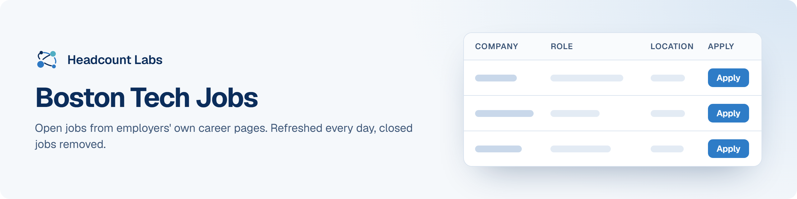

# Boston Tech Jobs

Software, data, AI, product and design jobs in the Boston area, sorted by field.

**400 open jobs** · 229 new since the last update · 119 removed because they closed or left the employer's board · updated November 3, 2026 at 5:13 AM EST

This list is built and refreshed every day by [Headcount Labs](https://headcountlabs.com/?utm_source=github&utm_medium=job-list&utm_campaign=boston-tech-jobs), which reads jobs straight from employers' own career pages and job boards. Every job here was still listed on its source board when we last read that board, within the past 3 days, and was posted in the past 30 days. Copies of the same job are merged into one row, and jobs that close are removed at the next update.

Want this data in your own app or agent? Use the [Headcount Labs jobs API](https://headcountlabs.com/docs/?utm_source=github&utm_medium=job-list&utm_campaign=boston-tech-jobs) (free tier), the [MCP server](https://headcountlabs.com/mcp/?utm_source=github&utm_medium=job-list&utm_campaign=boston-tech-jobs) for Claude, ChatGPT and other AI assistants, or the [public dataset subsets](https://huggingface.co/HeadcountLabs) on Hugging Face (the full dataset is coming soon).

**Full dataset.** A bigger, one-off snapshot dated 2026-10-19 (all matching jobs, not only the open jobs below) is on Hugging Face: [Tech and software jobs](https://huggingface.co/datasets/HeadcountLabs/tech-jobs). It loads with `datasets.load_dataset` and is under the Open Database License (ODbL) 1.0.

**Jump to:** [Software engineering (122)](#software-engineering) · [Data, AI and machine learning (178)](#data-ai-and-machine-learning) · [Product and design (91)](#product-and-design) · [Hardware and engineering (9)](#hardware-and-engineering)

**Columns.** *Apply* opens the original posting on the employer's site. *Details* opens the job on Headcount Labs, with every posting we found for it. *Remote* shows what the employer states; a dash means the posting doesn't say. *Pay* is the range the employer published.

## Software engineering

| Company | Role | Location | Remote | Pay | Posted | Apply | Details |
| --- | --- | --- | --- | --- | --- | :---: | :---: |
| **General Motors** | Staff Software Engineer - Robotics (Simulation) | 

2 locations
Boston, MA United States
 | Remote | $160k–$291k/yr | Nov 3 |  | <a href="https://headcountlabs.com/catalog/jobs/7a07813d-db28-4c6b-a8a3-714f6d4af971?utm_source=github&utm_medium=job-list&utm_campaign=boston-tech-jobs">via Headcount Labs</a> |
| **Whoop** | Staff Software Engineer (Backend, Business Systems) | Boston, MA | On-site | $170k–$230k/yr | Nov 1 |  | <a href="https://headcountlabs.com/catalog/jobs/e285a26e-be4f-4259-a21e-b0fe66ade27b?utm_source=github&utm_medium=job-list&utm_campaign=boston-tech-jobs">via Headcount Labs</a> |
| **True Talent Solutions Partners** | Senior Full Stack Engineer | Boston, MA | On-site | — | Nov 1 |  | <a href="https://headcountlabs.com/catalog/jobs/8c7d0ba5-3ec8-43b9-8852-eac735598b55?utm_source=github&utm_medium=job-list&utm_campaign=boston-tech-jobs">via Headcount Labs</a> |
| **QuEra Computing, Inc.** | Scientific Software Lead — Infrastructure | Boston, MA | — | $150k–$240k/yr | Nov 1 |  | <a href="https://headcountlabs.com/catalog/jobs/aed4f1be-581d-4500-949f-097558dcf82a?utm_source=github&utm_medium=job-list&utm_campaign=boston-tech-jobs">via Headcount Labs</a> |
| **Capital One** | Full Stack Engineer 5 (Senior Manager, IC, MLX Group) | 

6 locations
Cambridge, MA McLean, VA New York, NY Richmond, VA San Francisco, CA San Jose, CA
 | — | $209k–$238k/yr | Nov 1 |  | <a href="https://headcountlabs.com/catalog/jobs/42350eb1-a352-418d-9f64-6160dd0ea0df?utm_source=github&utm_medium=job-list&utm_campaign=boston-tech-jobs">via Headcount Labs</a> |
| **Whoop** | Senior iOS Engineer (Connectivity) | Boston, MA | On-site | — | Oct 30 |  | <a href="https://headcountlabs.com/catalog/jobs/d4cd753b-2723-4965-ae04-2510e4a11d1b?utm_source=github&utm_medium=job-list&utm_campaign=boston-tech-jobs">via Headcount Labs</a> |
| **Whoop** | Software Engineer II (Fullstack, Business Systems) | Boston, MA | On-site | — | Oct 30 |  | <a href="https://headcountlabs.com/catalog/jobs/bbcead17-999f-4e08-80c7-4ecdc0d7d1c5?utm_source=github&utm_medium=job-list&utm_campaign=boston-tech-jobs">via Headcount Labs</a> |
| **Prime Therapeutics** | SQL Programmer-Health Data Analyst Senior - Remote | 

41 locations
Topeka, KS Raleigh, NC Boston, MA Little Rock, AR Santa Fe, NM Helena, MT Atlanta, GA Washington, DC Saint Paul, MN Des Moines, IA Salt Lake City, UT Columbus, OH +29 more
 | Remote | $81k–$138k/yr | Oct 30 |  | <a href="https://headcountlabs.com/catalog/jobs/8b992d76-eadc-4b91-b2b0-05fbd4990fcb?utm_source=github&utm_medium=job-list&utm_campaign=boston-tech-jobs">via Headcount Labs</a> |
| **MAK Technologies** | Software Quality Assurance Engineer | Cambridge, MA | On-site | — | Oct 30 |  | <a href="https://headcountlabs.com/catalog/jobs/82f0f31f-e949-4a69-8fac-068eee1f0425?utm_source=github&utm_medium=job-list&utm_campaign=boston-tech-jobs">via Headcount Labs</a> |
| **MAK Technologies** | Principal Software Engineer | Cambridge, MA | On-site | — | Oct 30 |  | <a href="https://headcountlabs.com/catalog/jobs/6533dc83-edcf-4ad5-8a36-14f6beb715ad?utm_source=github&utm_medium=job-list&utm_campaign=boston-tech-jobs">via Headcount Labs</a> |
| **Capital One** | Full Stack Engineer 4 (AI Operations/MLX Group) | 

3 locations
New York, NY Cambridge, MA McLean, VA
 | — | $197k–$225k/yr | Oct 30 |  | <a href="https://headcountlabs.com/catalog/jobs/65cba0cf-39f3-403e-8db7-749babbc346d?utm_source=github&utm_medium=job-list&utm_campaign=boston-tech-jobs">via Headcount Labs</a> |
| **Amazon.com Services LLC** | Software Development Engineer (Database) Early Career- 2027 (US) | 

5 locations
Boston, MA Austin, TX Seattle, WA Redmond, WA East Palo Alto, CA
 | — | — | Oct 30 |  | <a href="https://headcountlabs.com/catalog/jobs/2f6e78b8-cffc-4fa2-877e-ad2bdd9d3c0f?utm_source=github&utm_medium=job-list&utm_campaign=boston-tech-jobs">via Headcount Labs</a> |
| **Amazon.com Services LLC** | Software Development Engineer Intern, Machine Learning/Automated Reasoning- Summer 2027 | 

9 locations
Boston, MA Austin, TX Sunnyvale, CA Seattle, WA Arlington, VA Bellevue, WA New York, NY Irvine, CA San Diego, CA
 | — | — | Oct 30 |  | <a href="https://headcountlabs.com/catalog/jobs/e0aabec4-3252-402b-88cc-8d3c3a039564?utm_source=github&utm_medium=job-list&utm_campaign=boston-tech-jobs">via Headcount Labs</a> |
| **Akamai** | Principal Software Engineer - (Reston or Cambridge) | 

2 locations
United States Cambridge, MA
 | Remote | $169k–$305k/yr | Oct 30 |  | <a href="https://headcountlabs.com/catalog/jobs/a301b2f3-edf8-47d1-87c8-5ec07816f009?utm_source=github&utm_medium=job-list&utm_campaign=boston-tech-jobs">via Headcount Labs</a> |
| **Sonos, Inc.** | Software Partner Engineering Intern (Boston) | Boston, MA | — | — | Oct 29 |  | <a href="https://headcountlabs.com/catalog/jobs/eaf7a7cc-ea96-4784-b1d4-a3b5848b5e4c?utm_source=github&utm_medium=job-list&utm_campaign=boston-tech-jobs">via Headcount Labs</a> |
| **Schneider Electric** | Expert Cybersecurity Engineer - Networks | Boston, MA | — | $178k–$187k/yr | Oct 29 |  | <a href="https://headcountlabs.com/catalog/jobs/c1c762d8-69c1-4e57-9915-026b37585444?utm_source=github&utm_medium=job-list&utm_campaign=boston-tech-jobs">via Headcount Labs</a> |
| **Polsinelli** | Security Engineer | 

28 locations
Washington, DC Kansas City, MO New York, NY Clayton, MO Chicago, IL Atlanta, GA Birmingham, AL Boston, MA Chattanooga, TN Charleston, SC Dallas, TX Denver, CO +16 more
 | Remote | $100k–$150k/yr | Oct 29 |  | <a href="https://headcountlabs.com/catalog/jobs/81cc4e41-a92b-49c5-9f5a-df24c35446d0?utm_source=github&utm_medium=job-list&utm_campaign=boston-tech-jobs">via Headcount Labs</a> |
| **Philo** | Sr. Backend Software Engineer (Infrastructure ML Ops) | 

3 locations
San Francisco, CA Brooklyn, NY Cambridge, MA
 | Remote | — | Oct 29 |  | <a href="https://headcountlabs.com/catalog/jobs/39ba3660-a142-47a0-aa0e-3a72a012d07b?utm_source=github&utm_medium=job-list&utm_campaign=boston-tech-jobs">via Headcount Labs</a> |
| **Merck** | Senior Specialist, Scientific Software Engineer, Digital Insights, DSCS Digital Technologies (Hybrid) | 

4 locations
Rahway, NJ Boston, MA Cambridge, MA West Point, PA
 | Hybrid | $117k–$184k/yr | Oct 29 |  | <a href="https://headcountlabs.com/catalog/jobs/c95fc5f7-465d-49ee-9354-b994fef6801e?utm_source=github&utm_medium=job-list&utm_campaign=boston-tech-jobs">via Headcount Labs</a> |
| **Mastercard** | Lead AI Platform Engineer | Boston, MA | — | $168k–$277k/yr | Oct 29 |  | <a href="https://headcountlabs.com/catalog/jobs/d499c0b2-54e7-4307-8613-212fa1845430?utm_source=github&utm_medium=job-list&utm_campaign=boston-tech-jobs">via Headcount Labs</a> |
| **DraftKings** | Software Engineer (December 2026 Grads) | Boston, MA | — | — | Oct 29 |  | <a href="https://headcountlabs.com/catalog/jobs/5f45cc63-bb82-4d2f-8d6b-35af305774b3?utm_source=github&utm_medium=job-list&utm_campaign=boston-tech-jobs">via Headcount Labs</a> |
| **CVS Health** | Senior Manager - Software Development Engineering | Boston, MA | — | $107k–$284k/yr | Oct 29 |  | <a href="https://headcountlabs.com/catalog/jobs/53f6e4df-c58b-4099-bb97-ee29d16f5aa3?utm_source=github&utm_medium=job-list&utm_campaign=boston-tech-jobs">via Headcount Labs</a> |
| **Cornerstone Research US** | Senior Aderant Developer, BI Reporting | 

6 locations
San Francisco, CA Boston, MA Chicago, IL Los Angeles, CA New York, NY Washington, DC
 | Hybrid | $137k–$167k/yr | Oct 29 |  | <a href="https://headcountlabs.com/catalog/jobs/06a74c77-8bc2-40e6-afa1-ea86ee50ae73?utm_source=github&utm_medium=job-list&utm_campaign=boston-tech-jobs">via Headcount Labs</a> |
| **Chewy** | Software Engineer II | 

2 locations
Boston, MA Minneapolis, MN
 | — | — | Oct 29 |  | <a href="https://headcountlabs.com/catalog/jobs/46fc4472-c08c-4355-8189-54f91530e6f3?utm_source=github&utm_medium=job-list&utm_campaign=boston-tech-jobs">via Headcount Labs</a> |
| **Blitzy** | Senior DevOps Engineer | Cambridge, MA | On-site | — | Oct 29 |  | <a href="https://headcountlabs.com/catalog/jobs/6bb00fd7-3d57-4846-8d2b-c746f1b44d11?utm_source=github&utm_medium=job-list&utm_campaign=boston-tech-jobs">via Headcount Labs</a> |
| **Ameriprise Financial Inc** | Senior Software Engineer | Boston, MA | Hybrid | $132k–$181k/yr | Oct 29 |  | <a href="https://headcountlabs.com/catalog/jobs/7373bfe4-f0de-49f3-bf12-6b9df7280aa5?utm_source=github&utm_medium=job-list&utm_campaign=boston-tech-jobs">via Headcount Labs</a> |
| **Amazon Development Center U.S., Inc.** | Software Development Engineer, AWS Transform | Boston, MA | — | $144k–$194k/yr | Oct 29 |  | <a href="https://headcountlabs.com/catalog/jobs/358a40f2-69cc-4f4a-a420-72d1a8397cb6?utm_source=github&utm_medium=job-list&utm_campaign=boston-tech-jobs">via Headcount Labs</a> |
| **Amazon Development Center U.S., Inc.** | Software Dev Engineer II - AMZ27373.1 | Boston, MA | — | — | Oct 29 |  | <a href="https://headcountlabs.com/catalog/jobs/96c633cd-7d83-4665-9f72-b698cca8cbbf?utm_source=github&utm_medium=job-list&utm_campaign=boston-tech-jobs">via Headcount Labs</a> |
| **Amazon Development Center U.S., Inc.** | Sr. Software Development Manager, EBS | Boston, MA | — | $220k–$298k/yr | Oct 29 |  | <a href="https://headcountlabs.com/catalog/jobs/e36c4840-0226-49fc-8988-17d7f293bcc6?utm_source=github&utm_medium=job-list&utm_campaign=boston-tech-jobs">via Headcount Labs</a> |
| **Sonos, Inc.** | Software Engineering Intern (Boston) | Boston, MA | — | — | Oct 28 |  | <a href="https://headcountlabs.com/catalog/jobs/6c468a79-f576-4af7-91fc-2a69b152844b?utm_source=github&utm_medium=job-list&utm_campaign=boston-tech-jobs">via Headcount Labs</a> |
| **Humana Inc.** | Senior Software Engineer | 

12 locations
Arlington, VA Atlanta, GA Boston, MA Charlotte, NC Dallas, TX Fort Lauderdale, FL Louisville, KY Nashville, TN New York, NY Tampa, FL Chicago, IL Atlanta
 | Remote | $118k–$162k/yr | Oct 28 |  | <a href="https://headcountlabs.com/catalog/jobs/6db2712a-05d5-45db-b2e1-4444f6e3fe07?utm_source=github&utm_medium=job-list&utm_campaign=boston-tech-jobs">via Headcount Labs</a> |
| **Capital One** | Full-Stack Engineer 4 (Python, Kubernetes) | 

3 locations
New York, NY Cambridge, MA McLean, VA
 | — | $197k–$225k/yr | Oct 28 |  | <a href="https://headcountlabs.com/catalog/jobs/27336932-2cd1-4193-bb33-bb8e260c9b45?utm_source=github&utm_medium=job-list&utm_campaign=boston-tech-jobs">via Headcount Labs</a> |
| **Aon Corporation** | Senior Scientist - Hurricane Model Developer, Impact Forecasting | 

2 locations
Chicago, IL Boston, MA
 | Hybrid | $100k–$130k/yr | Oct 28 |  | <a href="https://headcountlabs.com/catalog/jobs/20e8cb2d-31ad-4802-89b5-2b46f5d2e451?utm_source=github&utm_medium=job-list&utm_campaign=boston-tech-jobs">via Headcount Labs</a> |
| **Amazon.com Services LLC** | Software Development Engineer, OneMHS | 

2 locations
Boston, MA Bellevue, WA
 | — | $144k–$194k/yr | Oct 28 |  | <a href="https://headcountlabs.com/catalog/jobs/97e5d9ea-1c40-4ee2-9ee0-019c1493907e?utm_source=github&utm_medium=job-list&utm_campaign=boston-tech-jobs">via Headcount Labs</a> |
| **Amazon Web Services, Inc.** | Front End Engineer II, AFX | 

3 locations
Boston, MA Seattle, WA Dallas, TX
 | — | $144k–$194k/yr | Oct 28 |  | <a href="https://headcountlabs.com/catalog/jobs/1295c998-b443-47bb-8732-72e3309b3ea1?utm_source=github&utm_medium=job-list&utm_campaign=boston-tech-jobs">via Headcount Labs</a> |
| **Akamai** | Software Development Engineer in Test II (Kubernetes) | 

2 locations
Cambridge, MA United States
 | Remote | — | Oct 28 |  | <a href="https://headcountlabs.com/catalog/jobs/8586e04f-cad4-435a-b230-810da5a36e73?utm_source=github&utm_medium=job-list&utm_campaign=boston-tech-jobs">via Headcount Labs</a> |
| **Verisk Careers &#124; Verisk** | Senior Full Stack Developer | Boston, MA | Hybrid | $130k–$150k/yr | Oct 27 |  | <a href="https://headcountlabs.com/catalog/jobs/6d4310c4-2595-4993-b031-64a792ca8f3e?utm_source=github&utm_medium=job-list&utm_campaign=boston-tech-jobs">via Headcount Labs</a> |
| **Recorded Future** | Senior Software Engineer: Ransomware Collections | Boston, MA | Remote | $129k–$194k/yr | Oct 27 |  | <a href="https://headcountlabs.com/catalog/jobs/2fbb7989-5f6e-4489-bc68-d42b08f00d70?utm_source=github&utm_medium=job-list&utm_campaign=boston-tech-jobs">via Headcount Labs</a> |
| **Hasbro** | Lead QA Engineer, AI Automation | Boston, MA | — | $125k–$187k/yr | Oct 27 |  | <a href="https://headcountlabs.com/catalog/jobs/b693a777-39be-4907-8c10-bc22495e0d66?utm_source=github&utm_medium=job-list&utm_campaign=boston-tech-jobs">via Headcount Labs</a> |
| **EDB** | Software Engineering Program Manager | Boston, MA | Remote | — | Oct 27 |  | <a href="https://headcountlabs.com/catalog/jobs/ce7b63ec-0973-42d9-bc43-5c40c48f9d30?utm_source=github&utm_medium=job-list&utm_campaign=boston-tech-jobs">via Headcount Labs</a> |
| **Citizens** | Principal AI Security Engineer | 

8 locations
Johnston, RI Franklin, TN Cleveland, OH Philadelphia, PA Pittsburgh, PA Irving, TX Boston, MA Phoenix, AZ
 | — | $150k–$190k/yr | Oct 27 |  | <a href="https://headcountlabs.com/catalog/jobs/da993d9e-4ba3-42e3-9d47-fdb94e2652a5?utm_source=github&utm_medium=job-list&utm_campaign=boston-tech-jobs">via Headcount Labs</a> |
| **CarGurus** | Team Lead, Software Development Engineering (Communications Platform) | Boston, MA | Hybrid | $154k–$193k/yr | Oct 27 |  | <a href="https://headcountlabs.com/catalog/jobs/1e8e4baa-e437-49fd-b8e3-f0000f5387e7?utm_source=github&utm_medium=job-list&utm_campaign=boston-tech-jobs">via Headcount Labs</a> |
| **Cambridge Mobile Telematics** | Senior Software Engineer, Full Stack (Geospatial Team) | Cambridge, MA | — | $139k–$174k/yr | Oct 27 |  | <a href="https://headcountlabs.com/catalog/jobs/3bf139a4-3d82-4621-8b97-7466a96308ca?utm_source=github&utm_medium=job-list&utm_campaign=boston-tech-jobs">via Headcount Labs</a> |
| **WEX Inc** | Senior Full-Stack Engineer (Java / Spring Boot) | 

14 locations
Maine Bay Area, ME Boston, ME Dallas, ME Salt Lake City, ME Seattle, ME Portland, ME Boston, MA Dallas, TX Salt Lake City, UT Seattle, WA United States +2 more
 | Remote | $122k–$146k/yr | Oct 26 |  | <a href="https://headcountlabs.com/catalog/jobs/afb54411-f895-4e4c-9a13-3880ede076b5?utm_source=github&utm_medium=job-list&utm_campaign=boston-tech-jobs">via Headcount Labs</a> |
| **TEAM Enterprises** | Peroni Brand Developer | Boston, MA | — | $75k–$80k/yr | Oct 26 |  | <a href="https://headcountlabs.com/catalog/jobs/77ef5186-3dc6-4e28-9a01-a761da05a7f7?utm_source=github&utm_medium=job-list&utm_campaign=boston-tech-jobs">via Headcount Labs</a> |
| **Munich Re** | Category Manager - Software Service Sourcing | 

2 locations
Boston, MA Princeton, NJ
 | — | $102k–$156k/yr | Oct 26 |  | <a href="https://headcountlabs.com/catalog/jobs/da30ac2a-c355-4b16-9d77-b3e61e2c2d30?utm_source=github&utm_medium=job-list&utm_campaign=boston-tech-jobs">via Headcount Labs</a> |
| **Fusion Worldwide** | Principal Full Stack Engineer, B2B eCommerce | Boston, MA | Hybrid | — | Oct 26 |  | <a href="https://headcountlabs.com/catalog/jobs/1cf62390-ae8f-474a-9684-15875f2aa439?utm_source=github&utm_medium=job-list&utm_campaign=boston-tech-jobs">via Headcount Labs</a> |
| **Chewy** | Software Engineer III | Boston, MA | — | — | Oct 26 |  | <a href="https://headcountlabs.com/catalog/jobs/5ef4e90e-d354-4e03-afd2-975bec9e52c9?utm_source=github&utm_medium=job-list&utm_campaign=boston-tech-jobs">via Headcount Labs</a> |
| **Bay Cove Human Services, Inc.** | Senior Developer/Analyst - Information Services | Boston, MA | On-site | $90k–$100k/yr | Oct 26 |  | <a href="https://headcountlabs.com/catalog/jobs/b02fb9bc-8335-4b43-83bb-c3a1c73f4d7f?utm_source=github&utm_medium=job-list&utm_campaign=boston-tech-jobs">via Headcount Labs</a> |
| **Amazon Web Services, Inc.** | Software Development Engineer, AWS Field Experience | 

4 locations
Boston, MA Seattle, WA Arlington, VA Dallas, TX
 | — | $144k–$194k/yr | Oct 26 |  | <a href="https://headcountlabs.com/catalog/jobs/ce1c08d6-18d8-4e96-8082-2a50fac06589?utm_source=github&utm_medium=job-list&utm_campaign=boston-tech-jobs">via Headcount Labs</a> |
| **Amazon Web Services, Inc.** | Software Dev Engineer II, SIFT | Boston, MA | — | $144k–$194k/yr | Oct 26 |  | <a href="https://headcountlabs.com/catalog/jobs/03ec1c87-e244-4fd4-adfd-735542c3ee8d?utm_source=github&utm_medium=job-list&utm_campaign=boston-tech-jobs">via Headcount Labs</a> |
| **Amazon Development Center U.S., Inc.** | Software Development Engineer III, Programming Foundations | 

3 locations
Boston, MA Arlington, VA Seattle, WA
 | — | $168k–$227k/yr | Oct 26 |  | <a href="https://headcountlabs.com/catalog/jobs/3035e2a7-325b-4927-b5e3-a3cccf1dfd32?utm_source=github&utm_medium=job-list&utm_campaign=boston-tech-jobs">via Headcount Labs</a> |
| **Akamai** | Senior II Software Engineer Lead | 

2 locations
United States Cambridge, MA
 | Remote | $146k–$264k/yr | Oct 26 |  | <a href="https://headcountlabs.com/catalog/jobs/6a089a52-d43e-4f51-b3e6-333094766c3a?utm_source=github&utm_medium=job-list&utm_campaign=boston-tech-jobs">via Headcount Labs</a> |
| **QuEra Computing, Inc.** | Senior Scientific Software Engineer — Autoresearch | Boston, MA | — | $160k–$220k/yr | Oct 25 |  | <a href="https://headcountlabs.com/catalog/jobs/42af892f-404c-4c56-bec4-f72e433447ec?utm_source=github&utm_medium=job-list&utm_campaign=boston-tech-jobs">via Headcount Labs</a> |
| **Oracle** | Director, Platform Software Engineering | Boston, MA | — | $131k–$306k/yr | Oct 25 |  | <a href="https://headcountlabs.com/catalog/jobs/6b65f886-8f4a-49d4-9b1c-85b8e482fb40?utm_source=github&utm_medium=job-list&utm_campaign=boston-tech-jobs">via Headcount Labs</a> |
| **Amazon** | Software Development Manager, AWS Transform | Boston, MA | — | $185k–$250k/yr | Oct 25 |  | <a href="https://headcountlabs.com/catalog/jobs/10d33a24-d81e-47d9-a008-ec4a127acf81?utm_source=github&utm_medium=job-list&utm_campaign=boston-tech-jobs">via Headcount Labs</a> |
| **Wolters Kluwer** | Director, Product Software Engineering - AI | Boston, MA | — | $179k–$320k/yr | Oct 23 |  | <a href="https://headcountlabs.com/catalog/jobs/69394480-90ba-4266-9dfd-b5aeff10e744?utm_source=github&utm_medium=job-list&utm_campaign=boston-tech-jobs">via Headcount Labs</a> |
| **Starburst** | Staff Software Engineer - IAM | Boston, MA | Hybrid | $215k–$250k/yr | Oct 23 |  | <a href="https://headcountlabs.com/catalog/jobs/442c8749-90e2-4e14-80b3-f50ca887fb3d?utm_source=github&utm_medium=job-list&utm_campaign=boston-tech-jobs">via Headcount Labs</a> |
| **Pivotal Solutions, Inc.** | Power BI Developer | Boston, MA | — | — | Oct 23 |  | <a href="https://headcountlabs.com/catalog/jobs/dfe935e9-aac1-4446-a004-7ca11cb8bf60?utm_source=github&utm_medium=job-list&utm_campaign=boston-tech-jobs">via Headcount Labs</a> |
| **Meta** | Director Software Engineering - Central Security | Boston, MA | — | $271k–$347k/yr | Oct 23 |  | <a href="https://headcountlabs.com/catalog/jobs/1b99fcb0-1f35-4e9c-a43e-f0a1a1fe8205?utm_source=github&utm_medium=job-list&utm_campaign=boston-tech-jobs">via Headcount Labs</a> |
| **Later** | Senior Security Engineer | 

2 locations
Boston, MA Vancouver
 | Remote | $125k–$205k/yr | Oct 23 |  | <a href="https://headcountlabs.com/catalog/jobs/b228bb81-bf98-49e3-aa1f-afb5d58c8ca7?utm_source=github&utm_medium=job-list&utm_campaign=boston-tech-jobs">via Headcount Labs</a> |
| **Iterable** | Senior Cloud Security Engineer | 

6 locations
United States Chicago, IL Atlanta, GA Austin, TX Boston, MA Denver, CO
 | Remote | $141k–$194k/yr | Oct 23 |  | <a href="https://headcountlabs.com/catalog/jobs/8714f309-1072-447a-afae-25a891a30f9d?utm_source=github&utm_medium=job-list&utm_campaign=boston-tech-jobs">via Headcount Labs</a> |
| **Intact Specialty Solutions** | Software Developer I (Hybrid) | 

4 locations
Canton, MA Boston, MA Farmington, CT Massachusetts
 | Hybrid | $66k–$92k/yr | Oct 23 |  | <a href="https://headcountlabs.com/catalog/jobs/e0799d97-b869-440a-9370-c77e1106efd9?utm_source=github&utm_medium=job-list&utm_campaign=boston-tech-jobs">via Headcount Labs</a> |
| **Franklin Templeton** | Lead Software Engineer | 

4 locations
Baltimore, MD Boston, MA St. Petersburg, FL Stamford, CT
 | — | $134k–$174k/yr | Oct 23 |  | <a href="https://headcountlabs.com/catalog/jobs/916d9e3c-618f-465e-a561-4fe68fb81f63?utm_source=github&utm_medium=job-list&utm_campaign=boston-tech-jobs">via Headcount Labs</a> |
| **Franklin Templeton** | Senior Software Engineer | 

6 locations
St. Petersburg, FL Baltimore, MD Boston, MA Stamford, CT New York, NY Toronto
 | — | $134k–$174k/yr | Oct 23 |  | <a href="https://headcountlabs.com/catalog/jobs/6744f00c-e4aa-486f-9f53-cc5db2f762ea?utm_source=github&utm_medium=job-list&utm_campaign=boston-tech-jobs">via Headcount Labs</a> |
| **Conga** | Principal Software Engineer | 

2 locations
US - Boston, MA US - Houston, TX
 | Hybrid | $163k–$261k/yr | Oct 23 |  | <a href="https://headcountlabs.com/catalog/jobs/e71aa47f-5983-4398-be43-9687fdaf7ce7?utm_source=github&utm_medium=job-list&utm_campaign=boston-tech-jobs">via Headcount Labs</a> |
| **Company 1 - The Manufacturers Life Insurance Company** | Lead Full Stack Software Engineer | 

3 locations
Waterloo Boston, MA East
 | Hybrid | $127k–$236k/yr | Oct 23 |  | <a href="https://headcountlabs.com/catalog/jobs/46d7b5cd-0298-4ba5-ba99-9e848bff3992?utm_source=github&utm_medium=job-list&utm_campaign=boston-tech-jobs">via Headcount Labs</a> |
| **Boston Beer** | BI Developer II | Boston, MA | Hybrid | $77k–$132k/yr | Oct 23 |  | <a href="https://headcountlabs.com/catalog/jobs/fd4412af-a1b7-4342-ab21-b4dec18beca5?utm_source=github&utm_medium=job-list&utm_campaign=boston-tech-jobs">via Headcount Labs</a> |
| **Amazon Web Services, Inc.** | Software Development Engineer III, AWS Field Experience (AFX) | Boston, MA | — | $168k–$227k/yr | Oct 23 |  | <a href="https://headcountlabs.com/catalog/jobs/8242aec4-55b1-40ec-9dca-4859dc602b6b?utm_source=github&utm_medium=job-list&utm_campaign=boston-tech-jobs">via Headcount Labs</a> |
| **Amazon Development Center U.S., Inc.** | Software Development Manager, AWS Transform | Boston, MA | — | $185k–$250k/yr | Oct 23 |  | <a href="https://headcountlabs.com/catalog/jobs/2fbda82e-551c-4e6f-9854-ea105335bbbf?utm_source=github&utm_medium=job-list&utm_campaign=boston-tech-jobs">via Headcount Labs</a> |
| **Akamai** | Software Development Engineer in Test II | 

2 locations
United States Cambridge, MA
 | Remote | $95k–$171k/yr | Oct 23 |  | <a href="https://headcountlabs.com/catalog/jobs/9d682b21-0b90-4489-8335-383288d1bb93?utm_source=github&utm_medium=job-list&utm_campaign=boston-tech-jobs">via Headcount Labs</a> |
| **Akamai** | Senior Software Engineer - Linux Kernel Development | 

2 locations
United States Cambridge, MA
 | Remote | $121k–$219k/yr | Oct 23 |  | <a href="https://headcountlabs.com/catalog/jobs/9bb86f6b-4dbc-4f00-a52e-cc1170a5f62d?utm_source=github&utm_medium=job-list&utm_campaign=boston-tech-jobs">via Headcount Labs</a> |
| **Zus Health** | Platform Software Engineering Co-op | Boston, MA | — | $28/hr | Oct 22 |  | <a href="https://headcountlabs.com/catalog/jobs/509369df-c7a1-4de1-8209-d07c4a3f27f9?utm_source=github&utm_medium=job-list&utm_campaign=boston-tech-jobs">via Headcount Labs</a> |
| **Zoox** | Senior Staff/Principal Software Engineer - GPU System Software, Onboard Execution | 

3 locations
Foster City, CA Seattle, WA Boston, MA
 | Hybrid | $339k–$455k/yr | Oct 22 |  | <a href="https://headcountlabs.com/catalog/jobs/7665ac5a-4dae-463d-a35e-c78b12b208f5?utm_source=github&utm_medium=job-list&utm_campaign=boston-tech-jobs">via Headcount Labs</a> |
| **Veeva Systems** | Software Engineer in Test | Boston, MA | Remote | $75k–$150k/yr | Oct 22 |  | <a href="https://headcountlabs.com/catalog/jobs/599d5afc-7601-4bb2-8230-47d2af1f9375?utm_source=github&utm_medium=job-list&utm_campaign=boston-tech-jobs">via Headcount Labs</a> |
| **Powertown** | Software Engineer | Boston, MA | On-site | — | Oct 22 |  | <a href="https://headcountlabs.com/catalog/jobs/12228cce-90b2-4156-bf2d-67f4030c5a6e?utm_source=github&utm_medium=job-list&utm_campaign=boston-tech-jobs">via Headcount Labs</a> |
| **Klaviyo** | Software Engineer, Conversational Products &amp; Agent Workflows | Boston, MA | — | $116k–$174k/yr | Oct 22 |  | <a href="https://headcountlabs.com/catalog/jobs/f53dcec6-899f-4f42-bd53-dbb6d6b15df1?utm_source=github&utm_medium=job-list&utm_campaign=boston-tech-jobs">via Headcount Labs</a> |
| **Klaviyo** | Senior Machine Learning Platform Engineer | Boston, MA | — | $148k–$222k/yr | Oct 22 |  | <a href="https://headcountlabs.com/catalog/jobs/1d4eac38-3655-45b5-ad9e-7e1679796860?utm_source=github&utm_medium=job-list&utm_campaign=boston-tech-jobs">via Headcount Labs</a> |
| **IntelliPro Group Inc.** | Android Software Engineer | Boston, MA | Hybrid | — | Oct 22 |  | <a href="https://headcountlabs.com/catalog/jobs/e420e772-a7b1-4000-a126-57872c42085f?utm_source=github&utm_medium=job-list&utm_campaign=boston-tech-jobs">via Headcount Labs</a> |
| **CarGurus** | Manager, Software Development Engineering | Boston, MA | Hybrid | $186k–$233k/yr | Oct 22 |  | <a href="https://headcountlabs.com/catalog/jobs/b08fa2c4-981d-4ec8-be78-2773fd9ac466?utm_source=github&utm_medium=job-list&utm_campaign=boston-tech-jobs">via Headcount Labs</a> |
| **Cambridge Mobile Telematics** | Software Engineer in Test, Embedded Firmware | Cambridge, MA | — | $104k–$131k/yr | Oct 22 |  | <a href="https://headcountlabs.com/catalog/jobs/b180a6a8-2693-4a67-a635-08d3c61108ac?utm_source=github&utm_medium=job-list&utm_campaign=boston-tech-jobs">via Headcount Labs</a> |
| **Airspace Intelligence** | Optimization Software Engineer (Civil Aviation) | Boston, MA | — | $135k–$265k/yr | Oct 22 |  | <a href="https://headcountlabs.com/catalog/jobs/38452dcb-4b99-4298-829a-f714e1f8c93b?utm_source=github&utm_medium=job-list&utm_campaign=boston-tech-jobs">via Headcount Labs</a> |
| **Airspace Intelligence** | GNC Software Engineer (Civil Aviation) | Boston, MA | — | $200k–$265k/yr | Oct 22 |  | <a href="https://headcountlabs.com/catalog/jobs/2ca9f47e-64e2-4ab4-8975-83cabfc6e3c1?utm_source=github&utm_medium=job-list&utm_campaign=boston-tech-jobs">via Headcount Labs</a> |
| **Airspace Intelligence** | Simulation Software Engineer (Civil Aviation) | Boston, MA | — | $135k–$265k/yr | Oct 22 |  | <a href="https://headcountlabs.com/catalog/jobs/20b0f962-f702-47aa-967b-ba4a08667db5?utm_source=github&utm_medium=job-list&utm_campaign=boston-tech-jobs">via Headcount Labs</a> |
| **Vantage Risk Companies** | Senior Software Engineer | 

8 locations
Chicago, IL Norwalk, CT New York, NY Atlanta, GA West Hartford, CT Boston, MA Washington, DC United States
 | On-site | $170k–$210k/yr | Oct 21 |  | <a href="https://headcountlabs.com/catalog/jobs/656c57dc-36f8-46d6-b230-c16b771f0003?utm_source=github&utm_medium=job-list&utm_campaign=boston-tech-jobs">via Headcount Labs</a> |
| **Vantage Risk Companies** | Software Product Manager | 

8 locations
Chicago, IL Norwalk, CT New York, NY Atlanta, GA West Hartford, CT Boston, MA Washington, DC United States
 | Remote | $160k–$180k/yr | Oct 21 |  | <a href="https://headcountlabs.com/catalog/jobs/01315b91-5313-47d2-8703-7d95e6dd275c?utm_source=github&utm_medium=job-list&utm_campaign=boston-tech-jobs">via Headcount Labs</a> |
| **State Street** | Client Manager - Investment Management Investment Software, AVP - Charles River Development | 

6 locations
New York, NY New York Boston, MA Burlington Massachusetts Clifton, NJ Jersey City, NJ
 | On-site | $90k–$158k/yr | Oct 21 |  | <a href="https://headcountlabs.com/catalog/jobs/05c0fee2-547a-41cd-b96b-e2c78a3186c2?utm_source=github&utm_medium=job-list&utm_campaign=boston-tech-jobs">via Headcount Labs</a> |
| **Scribd, Inc.** | Staff Backend Engineer (Payments and Billing) | 

11 locations
San Francisco, CA Toronto Los Angeles, CA Denver, CO Chicago, IL New York City, NY Vancouver Seattle, WA Austin, TX Boston, MA Dallas, TX
 | — | — | Oct 21 |  | <a href="https://headcountlabs.com/catalog/jobs/c1364ad0-e758-4292-babb-de94c7721a9b?utm_source=github&utm_medium=job-list&utm_campaign=boston-tech-jobs">via Headcount Labs</a> |
| **QuEra Computing, Inc.** | Scientific Software Engineer – Machine Programming | Boston, MA | — | $102k–$166k/yr | Oct 21 |  | <a href="https://headcountlabs.com/catalog/jobs/e08f2c5f-9560-4c0e-860d-dd8b4f8f5576?utm_source=github&utm_medium=job-list&utm_campaign=boston-tech-jobs">via Headcount Labs</a> |
| **PathAI** | Staff Software Engineer, Fullstack | Boston, MA | Hybrid | $146k–$224k/yr | Oct 21 |  | <a href="https://headcountlabs.com/catalog/jobs/6f6ae987-7445-4a69-b618-46970fde186a?utm_source=github&utm_medium=job-list&utm_campaign=boston-tech-jobs">via Headcount Labs</a> |
| **Metalenz** | Camera Software Intern | Boston, MA | On-site | $6k–$8k/mo | Oct 21 |  | <a href="https://headcountlabs.com/catalog/jobs/d53e1f91-8312-4f1d-9a35-89c5e867e234?utm_source=github&utm_medium=job-list&utm_campaign=boston-tech-jobs">via Headcount Labs</a> |
| **ASUS USA -** | Senior Platform Security Engineer | Boston, MA | On-site | $164k–$237k/yr | Oct 21 |  | <a href="https://headcountlabs.com/catalog/jobs/b4954e50-a0f7-4e2e-b7ac-b4f6e32a8586?utm_source=github&utm_medium=job-list&utm_campaign=boston-tech-jobs">via Headcount Labs</a> |
| **Akamai** | Software Engineer | 

2 locations
United States Cambridge, MA
 | Remote | $76k–$136k/yr | Oct 21 |  | <a href="https://headcountlabs.com/catalog/jobs/5a780561-5257-4d2c-a89f-0a969c731141?utm_source=github&utm_medium=job-list&utm_campaign=boston-tech-jobs">via Headcount Labs</a> |
| **Viasat, Inc.** | Senior Full Stack Software Engineer | 

5 locations
Boston, MA Germantown, MD Massachusetts New York, MA New Jersey, MA
 | Remote | $165k–$260k/yr | Oct 20 |  | <a href="https://headcountlabs.com/catalog/jobs/4815900b-8592-4be8-9a9c-4a6b8f15e88f?utm_source=github&utm_medium=job-list&utm_campaign=boston-tech-jobs">via Headcount Labs</a> |
| **Vertex Pharmaceuticals Inc (US)** | Azure DevOps Engineer | Boston, MA | Hybrid | $112k–$168k/yr | Oct 20 |  | <a href="https://headcountlabs.com/catalog/jobs/4cb2761f-cac0-4376-80d4-7d32dba91588?utm_source=github&utm_medium=job-list&utm_campaign=boston-tech-jobs">via Headcount Labs</a> |
| **MAK Technologies** | Senior Software Engineer | Cambridge, MA | On-site | — | Oct 20 |  | <a href="https://headcountlabs.com/catalog/jobs/49a33afc-5ada-4892-9fa2-45276f648de1?utm_source=github&utm_medium=job-list&utm_campaign=boston-tech-jobs">via Headcount Labs</a> |
| **LangChain** | Software Engineering Manager, AI Observability &amp; Evals Platform (Boston) | Boston, MA | On-site | — | Oct 20 |  | <a href="https://headcountlabs.com/catalog/jobs/a2ab8b10-f77d-4ffe-9392-5b90d56345f6?utm_source=github&utm_medium=job-list&utm_campaign=boston-tech-jobs">via Headcount Labs</a> |
| **Klaviyo** | Senior Security Engineer - Detection and Response | Boston, MA | — | $142k–$212k/yr | Oct 20 |  | <a href="https://headcountlabs.com/catalog/jobs/9ec91c0b-dd7c-41b6-ad3a-f1734b356b40?utm_source=github&utm_medium=job-list&utm_campaign=boston-tech-jobs">via Headcount Labs</a> |
| **Digital Realty** | Senior Software Engineer | 

9 locations
Ashburn, VA Boston, MA New York, NY San Francisco, CA Dallas, TX San Jose, CA Denver, CO Austin, TX Charlotte, NC
 | Hybrid | $150k–$170k/yr | Oct 20 |  | <a href="https://headcountlabs.com/catalog/jobs/c0829bc8-9522-429a-a540-0501089f4e90?utm_source=github&utm_medium=job-list&utm_campaign=boston-tech-jobs">via Headcount Labs</a> |
| **Cognito Therapeutics** | Sr Product Security Engineer | 

2 locations
Cambridge, MA United States
 | Hybrid | — | Oct 20 |  | <a href="https://headcountlabs.com/catalog/jobs/bc15ee1a-fd33-42f4-9522-c4581f82418c?utm_source=github&utm_medium=job-list&utm_campaign=boston-tech-jobs">via Headcount Labs</a> |
| **CarGurus** | Senior Principal Software Engineer, Cloud Architecture | Boston, MA | Hybrid | $191k–$239k/yr | Oct 20 |  | <a href="https://headcountlabs.com/catalog/jobs/08aa7e81-0033-4344-b39d-88e04d32356e?utm_source=github&utm_medium=job-list&utm_campaign=boston-tech-jobs">via Headcount Labs</a> |
| **CarGurus** | Senior Software Engineer, AI Developer Experience | Boston, MA | Hybrid | $140k–$176k/yr | Oct 20 |  | <a href="https://headcountlabs.com/catalog/jobs/3059f831-b65a-4a91-9c97-8a20a3b7d53d?utm_source=github&utm_medium=job-list&utm_campaign=boston-tech-jobs">via Headcount Labs</a> |
| **CarGurus** | Senior Software Development Engineer, DevX Pipelines and Automation | Boston, MA | Hybrid | $140k–$176k/yr | Oct 20 |  | <a href="https://headcountlabs.com/catalog/jobs/2da89667-3513-41dd-b23a-c22b223671c4?utm_source=github&utm_medium=job-list&utm_campaign=boston-tech-jobs">via Headcount Labs</a> |
| **BrightView Landscapes, LLC- DE** | Business Developer (Commercial Landscaping) | Boston, MA | — | $65k–$75k/yr | Oct 20 |  | <a href="https://headcountlabs.com/catalog/jobs/c173fcda-be9e-45df-982f-ad53d20f9af5?utm_source=github&utm_medium=job-list&utm_campaign=boston-tech-jobs">via Headcount Labs</a> |
| **Unframe** | Full Stack Software Engineer (Remote) | 

6 locations
Atlanta, GA Boston, MA Miami, FL New York, NY Tampa, FL Austin, TX
 | Remote | — | Oct 19 |  | <a href="https://headcountlabs.com/catalog/jobs/49d35038-5887-482e-8d67-7227cf897ec7?utm_source=github&utm_medium=job-list&utm_campaign=boston-tech-jobs">via Headcount Labs</a> |
| **SSB&amp;T** | Software Engineer – Backend Platforms, Assistant Vice President (Wealth Custody &amp; Clearing) | 

5 locations
Austin, TX Boston, MA Clifton, NJ Quincy, MA Dallas, TX
 | — | $80k–$140k/yr | Oct 19 |  | <a href="https://headcountlabs.com/catalog/jobs/8b5ab4cb-7cde-42e5-af44-d220ed7e29b3?utm_source=github&utm_medium=job-list&utm_campaign=boston-tech-jobs">via Headcount Labs</a> |
| **New Leaf Energy, Inc.** | New Markets Project Developer, DG Capacity | 

2 locations
Boston, MA Lowell, MA
 | — | $125k/yr | Oct 19 |  | <a href="https://headcountlabs.com/catalog/jobs/f982ede1-4053-4ba2-9c2f-bc621c96e37c?utm_source=github&utm_medium=job-list&utm_campaign=boston-tech-jobs">via Headcount Labs</a> |
| **Motional** | Principal Software Engineer, Team Lead - Perception Platforms | 

3 locations
Boston, MA Las Vegas, NV Pittsburgh, PA
 | Remote | $240k–$330k/yr | Oct 19 |  | <a href="https://headcountlabs.com/catalog/jobs/4acfafa6-af38-4a96-84ca-69441b044cf1?utm_source=github&utm_medium=job-list&utm_campaign=boston-tech-jobs">via Headcount Labs</a> |
| **Lutron Electronics Co., Inc** | Experienced Application Software Engineer | 

4 locations
Philadelphia, PA Cincinnati, OH Austin, TX Boston, MA
 | — | $120k–$138k/yr | Oct 19 |  | <a href="https://headcountlabs.com/catalog/jobs/a8d463c2-7113-486f-85b8-e2b5257b2aae?utm_source=github&utm_medium=job-list&utm_campaign=boston-tech-jobs">via Headcount Labs</a> |
| **Klaviyo** | Senior Software Engineer - Data Automation | Boston, MA | — | $148k–$222k/yr | Oct 19 |  | <a href="https://headcountlabs.com/catalog/jobs/d63cde2f-985e-4cbd-b78b-b07a8a3de481?utm_source=github&utm_medium=job-list&utm_campaign=boston-tech-jobs">via Headcount Labs</a> |
| **Google** | Software Engineering Manager II, Full Stack, Cloud Observability | Cambridge, MA | — | $207k–$300k/yr | Oct 19 |  | <a href="https://headcountlabs.com/catalog/jobs/1c17019c-7e65-481c-a469-83ce52937c9e?utm_source=github&utm_medium=job-list&utm_campaign=boston-tech-jobs">via Headcount Labs</a> |
| **Foundation EGI** | Software Architect (Remote Boston MA) | Boston, MA | Remote | $140k–$190k/yr | Oct 19 |  | <a href="https://headcountlabs.com/catalog/jobs/7198a8ca-76c6-43a6-a78b-4ad39c31e050?utm_source=github&utm_medium=job-list&utm_campaign=boston-tech-jobs">via Headcount Labs</a> |
| **Cambridge Mobile Telematics** | Senior Software Engineer, Backend | Cambridge, MA | — | $139k–$174k/yr | Oct 19 |  | <a href="https://headcountlabs.com/catalog/jobs/93e2e2af-3e30-47d7-945d-c507cb267e18?utm_source=github&utm_medium=job-list&utm_campaign=boston-tech-jobs">via Headcount Labs</a> |
| **Anthropic** | IT Systems Engineer, Client Platform Engineer, ChromeOS | 

3 locations
Boston, MA Friendly (Travel-Required) &#124; San Francisco, CA &#124; Seattle, WA &#124; New York City, NY Washington, DC
 | Remote | $325k–$360k/yr | Oct 19 |  | <a href="https://headcountlabs.com/catalog/jobs/d54baf90-8b82-4225-b73b-74b01b02ac83?utm_source=github&utm_medium=job-list&utm_campaign=boston-tech-jobs">via Headcount Labs</a> |
| **Amazon.com Services LLC** | Software Development Engineer, Early Career - 2027 (US) | 

9 locations
Madison, WI Detroit, MI Boston, MA Austin, TX Seattle, WA Arlington, VA Santa Clara, CA Denver, CO Minneapolis, MN
 | — | — | Oct 19 |  | <a href="https://headcountlabs.com/catalog/jobs/fb313ecc-6d39-4a36-b6a2-44fdf4b865c5?utm_source=github&utm_medium=job-list&utm_campaign=boston-tech-jobs">via Headcount Labs</a> |
| **The Hollister Group** | Jr. Web Developer/Jr. Creative Technologist | Cambridge, MA | — | $31/hr | Oct 16 |  | <a href="https://headcountlabs.com/catalog/jobs/0de9e17b-95f7-452f-b10b-669dbfee2b8a?utm_source=github&utm_medium=job-list&utm_campaign=boston-tech-jobs">via Headcount Labs</a> |
| **TetraScience** | Lead Software Platform Engineer, MLOps | Cambridge, MA | Hybrid | — | Oct 16 |  | <a href="https://headcountlabs.com/catalog/jobs/ae4dbf0e-ac02-4ebd-8617-3b491415dc22?utm_source=github&utm_medium=job-list&utm_campaign=boston-tech-jobs">via Headcount Labs</a> |
| **Recorded Future** | Product Support Solutions Developer | 

2 locations
Washington, DC Boston, MA
 | Hybrid | $128k–$192k/yr | Oct 16 |  | <a href="https://headcountlabs.com/catalog/jobs/b92e3a16-4daf-4c84-b424-4c1a228b3028?utm_source=github&utm_medium=job-list&utm_campaign=boston-tech-jobs">via Headcount Labs</a> |
| **Klaviyo** | Sr. Lead Software Engineer | Boston, MA | — | $216k–$324k/yr | Oct 16 |  | <a href="https://headcountlabs.com/catalog/jobs/b2ed605d-2bfb-4176-9550-fd0e1cb3d8eb?utm_source=github&utm_medium=job-list&utm_campaign=boston-tech-jobs">via Headcount Labs</a> |
| **Humana** | Director, Software Engineering - Platform &amp; Tool Development | Boston, MA | Remote | $189k–$260k/yr | Oct 16 |  | <a href="https://headcountlabs.com/catalog/jobs/99944edf-a40f-475b-9a4b-cb8f35e06430?utm_source=github&utm_medium=job-list&utm_campaign=boston-tech-jobs">via Headcount Labs</a> |
| **Google** | Senior Staff AI Security Engineer | 

3 locations
Mountain View, CA Cambridge, MA New York, NY
 | — | $262k–$364k/yr | Oct 16 |  | <a href="https://headcountlabs.com/catalog/jobs/0e166593-f0d3-4fa7-8eef-fd5be23a9a50?utm_source=github&utm_medium=job-list&utm_campaign=boston-tech-jobs">via Headcount Labs</a> |
| **Boston Beer Corporation** | Blend Product Developer I | Boston, MA | On-site | $61k–$109k/yr | Oct 16 |  | <a href="https://headcountlabs.com/catalog/jobs/22293a53-1d97-4de7-b1d4-47aefbd00033?utm_source=github&utm_medium=job-list&utm_campaign=boston-tech-jobs">via Headcount Labs</a> |

## Data, AI and machine learning

| Company | Role | Location | Remote | Pay | Posted | Apply | Details |
| --- | --- | --- | --- | --- | --- | :---: | :---: |
| **Takeda Pharmaceutical** | Senior Counsel, Global Transactions &amp; Contracts Legal – Data, Digital &amp; Technology | 

2 locations
Boston, MA Exton, PA
 | — | $169k–$266k/yr | Nov 2 |  | <a href="https://headcountlabs.com/catalog/jobs/6d9216be-8ed7-4d9b-91dd-e21be137f920?utm_source=github&utm_medium=job-list&utm_campaign=boston-tech-jobs">via Headcount Labs</a> |
| **Merck** | AI and Data Science Product Manager | 

3 locations
West Point, PA Cambridge, MA Rahway, NJ
 | — | $87k–$137k/yr | Nov 2 |  | <a href="https://headcountlabs.com/catalog/jobs/00d26be4-7855-4f89-b516-6b4d3b3d82f8?utm_source=github&utm_medium=job-list&utm_campaign=boston-tech-jobs">via Headcount Labs</a> |
| **Merck** | 2027 Future Talent Program - Patient Data Learning - Co-op | Cambridge, MA | — | $40k–$111k/yr | Nov 2 |  | <a href="https://headcountlabs.com/catalog/jobs/b84a74c9-167c-4afc-98c2-385bb72bdb70?utm_source=github&utm_medium=job-list&utm_campaign=boston-tech-jobs">via Headcount Labs</a> |
| **Harvard University** | Assistant/Associate Professor of Biostatistics and Data Science | Cambridge, MA | — | $154k–$180k/yr | Nov 2 |  | <a href="https://headcountlabs.com/catalog/jobs/6c00e254-9d32-405e-946d-01749021f1c5?utm_source=github&utm_medium=job-list&utm_campaign=boston-tech-jobs">via Headcount Labs</a> |
| **Google** | Customer Engineer III, Cloud AI, Google Cloud | 

7 locations
Atlanta, GA Austin, TX Cambridge, MA Houston, TX New York, NY Reston, VA Miami, FL
 | — | $152k–$221k/yr | Nov 2 |  | <a href="https://headcountlabs.com/catalog/jobs/66ee5964-f235-4730-9a16-842271f49059?utm_source=github&utm_medium=job-list&utm_campaign=boston-tech-jobs">via Headcount Labs</a> |
| **Walden Robotics** | Senior Manager, Data Collections Operations | Cambridge, MA | On-site | — | Oct 31 |  | <a href="https://headcountlabs.com/catalog/jobs/a8d9d604-8d6f-4618-9a0d-2ffd5fbfa641?utm_source=github&utm_medium=job-list&utm_campaign=boston-tech-jobs">via Headcount Labs</a> |
| **Humana** | Senior Data Manager (DATABRICKS) | Boston, MA | Remote | $98k–$134k/yr | Oct 31 |  | <a href="https://headcountlabs.com/catalog/jobs/724cbcdd-372a-4303-ba63-43a534f17684?utm_source=github&utm_medium=job-list&utm_campaign=boston-tech-jobs">via Headcount Labs</a> |
| **Capital One** | Data Engineer 5 (Senior Manager, IC) | 

3 locations
Cambridge, MA New York, NY McLean, VA
 | — | $230k–$262k/yr | Oct 31 |  | <a href="https://headcountlabs.com/catalog/jobs/1d119169-9220-4eba-921a-a8b42555ddd3?utm_source=github&utm_medium=job-list&utm_campaign=boston-tech-jobs">via Headcount Labs</a> |
| **BOSTON ARCHITECTURAL COLLEGE** | Director of Data Analytics &amp; Institutional Research | Boston, MA | — | $110k–$125k/yr | Oct 31 |  | <a href="https://headcountlabs.com/catalog/jobs/5858ba0c-56b8-400b-a01d-c27c53057100?utm_source=github&utm_medium=job-list&utm_campaign=boston-tech-jobs">via Headcount Labs</a> |
| **TowardJobs** | Work from home Data Entry Clerk - Part Time | Boston, MA | Remote | — | Oct 30 |  | <a href="https://headcountlabs.com/catalog/jobs/fdcd73fa-1f2d-4ed1-aa53-20ab7e875401?utm_source=github&utm_medium=job-list&utm_campaign=boston-tech-jobs">via Headcount Labs</a> |
| **TowardJobs** | Work From Home Data Entry | Boston, MA | Remote | — | Oct 30 |  | <a href="https://headcountlabs.com/catalog/jobs/dd035c52-4b00-43e0-8734-a268fc84787c?utm_source=github&utm_medium=job-list&utm_campaign=boston-tech-jobs">via Headcount Labs</a> |
| **TowardJobs** | Work from Home Data Entry Clerk | Boston, MA | Remote | — | Oct 30 |  | <a href="https://headcountlabs.com/catalog/jobs/514c8f5e-b64e-4ee0-aa5b-b5b41d202b2e?utm_source=github&utm_medium=job-list&utm_campaign=boston-tech-jobs">via Headcount Labs</a> |
| **TowardJobs** | Work at home Data Entry Clerk - Part Time | Boston, MA | Remote | — | Oct 30 |  | <a href="https://headcountlabs.com/catalog/jobs/23e5cd71-7a8c-4304-8383-bfdc4e040399?utm_source=github&utm_medium=job-list&utm_campaign=boston-tech-jobs">via Headcount Labs</a> |
| **State Street** | Senior Data Platform Architect (Snowflake, Databricks, Open Platforms &amp; Data Virtualization), VP I - State Street Investment Management | Boston, MA | — | $120k–$202k/yr | Oct 30 |  | <a href="https://headcountlabs.com/catalog/jobs/5ad3b8bc-ec5e-416e-98b8-8fce5b8e251e?utm_source=github&utm_medium=job-list&utm_campaign=boston-tech-jobs">via Headcount Labs</a> |
| **Publicis Groupe Holdings B.V** | Lead Data Scientist | Boston, MA | — | $112k–$172k/yr | Oct 30 |  | <a href="https://headcountlabs.com/catalog/jobs/290156a7-4bac-4721-8de3-5d24343a1489?utm_source=github&utm_medium=job-list&utm_campaign=boston-tech-jobs">via Headcount Labs</a> |
| **Oracle** | Principal Data Center Facilities Development Manager | Boston, MA | — | $102k–$210k/yr | Oct 30 |  | <a href="https://headcountlabs.com/catalog/jobs/5e550b75-8511-4560-95d8-c54d4b52e03e?utm_source=github&utm_medium=job-list&utm_campaign=boston-tech-jobs">via Headcount Labs</a> |
| **Oracle** | Lead Principal Data Center Facilities Development Manager | Boston, MA | — | $126k–$264k/yr | Oct 30 |  | <a href="https://headcountlabs.com/catalog/jobs/a1e1aa1c-a09c-4de3-930e-747ccd5c9c9f?utm_source=github&utm_medium=job-list&utm_campaign=boston-tech-jobs">via Headcount Labs</a> |
| **Merck** | Director, Data Science, Functional Genomics | Cambridge, MA | — | $214k–$337k/yr | Oct 30 |  | <a href="https://headcountlabs.com/catalog/jobs/2f1830b5-457d-461a-bc38-16d3f320f4bb?utm_source=github&utm_medium=job-list&utm_campaign=boston-tech-jobs">via Headcount Labs</a> |
| **Klaviyo** | Lead Product Data Scientist, Agents | Boston, MA | — | $172k–$258k/yr | Oct 30 |  | <a href="https://headcountlabs.com/catalog/jobs/8c6ad257-f9f8-47d1-9697-2b653cd114c2?utm_source=github&utm_medium=job-list&utm_campaign=boston-tech-jobs">via Headcount Labs</a> |
| **Klaviyo** | Lead Product Data Scientist, Forecasting | Boston, MA | — | $172k–$258k/yr | Oct 30 |  | <a href="https://headcountlabs.com/catalog/jobs/5005a153-c25b-40c3-8658-5eca68b0ea68?utm_source=github&utm_medium=job-list&utm_campaign=boston-tech-jobs">via Headcount Labs</a> |
| **Encore Semi, Inc.** | Senior / Lead Data Converter IC Design Engineer (FinFET) | Boston, MA | Remote | $150k–$180k/yr | Oct 30 |  | <a href="https://headcountlabs.com/catalog/jobs/70346dd8-faa7-4a61-b11d-fc27c3b9efdc?utm_source=github&utm_medium=job-list&utm_campaign=boston-tech-jobs">via Headcount Labs</a> |
| **Calvert and Calvert Academy** | Product Manager, AI | Boston, MA | Hybrid | $129k–$200k/yr | Oct 30 |  | <a href="https://headcountlabs.com/catalog/jobs/cff524f4-4bbd-49c6-b45b-4cfc64891c24?utm_source=github&utm_medium=job-list&utm_campaign=boston-tech-jobs">via Headcount Labs</a> |
| **AstraZeneca** | Product Line Lead, Clinical &amp; Agentic AI | Boston, MA | — | — | Oct 30 |  | <a href="https://headcountlabs.com/catalog/jobs/71318e57-d566-4c69-83ab-d97297764f74?utm_source=github&utm_medium=job-list&utm_campaign=boston-tech-jobs">via Headcount Labs</a> |
| **AOP and Ignite Christian Academy** | Product Manager, AI | Boston, MA | Hybrid | $129k–$200k/yr | Oct 30 |  | <a href="https://headcountlabs.com/catalog/jobs/f2853d26-3588-4571-8826-f5dd1959890f?utm_source=github&utm_medium=job-list&utm_campaign=boston-tech-jobs">via Headcount Labs</a> |
| **Amazon Web Services, Inc.** | Sr Worldwide Specialist - GenAI, Amazon Bedrock, Data &amp; AI GTM | 

4 locations
Jersey City, NJ Boston, MA New York, NY Houston, TX
 | — | $148k–$200k/yr | Oct 30 |  | <a href="https://headcountlabs.com/catalog/jobs/dfca8c24-5f5b-4692-aa56-49b4e3c998bc?utm_source=github&utm_medium=job-list&utm_campaign=boston-tech-jobs">via Headcount Labs</a> |
| **AbbVie** | Data Strategy Lead - Hybrid | Cambridge, MA | Hybrid | $110k–$208k/yr | Oct 30 |  | <a href="https://headcountlabs.com/catalog/jobs/43680737-0226-4d78-a844-1fd1e46b3abe?utm_source=github&utm_medium=job-list&utm_campaign=boston-tech-jobs">via Headcount Labs</a> |
| **Wolters Kluwer** | Lead Technical Product Manager &#124; Healthcare &#124; APIs, Integrations, &amp; Embedded AI Solutions | Boston, MA | — | $129k–$226k/yr | Oct 29 |  | <a href="https://headcountlabs.com/catalog/jobs/9fb18627-efc6-4891-980d-7c0165c54a67?utm_source=github&utm_medium=job-list&utm_campaign=boston-tech-jobs">via Headcount Labs</a> |
| **WGBH** | Audio Visual Metadata and Training Data Internship -Spring 2027 | Boston, MA | Hybrid | $17/hr | Oct 29 |  | <a href="https://headcountlabs.com/catalog/jobs/8144a16c-a8b0-471c-af1c-f27c4c404cf4?utm_source=github&utm_medium=job-list&utm_campaign=boston-tech-jobs">via Headcount Labs</a> |
| **Veeva Systems** | Senior Data Scientist | Boston, MA | Remote | $95k–$175k/yr | Oct 29 |  | <a href="https://headcountlabs.com/catalog/jobs/61cafd0d-5980-4e92-aea4-a9645ab62a0f?utm_source=github&utm_medium=job-list&utm_campaign=boston-tech-jobs">via Headcount Labs</a> |
| **True Talent Solutions Partners** | Product Engineer, AI | Boston, MA | On-site | — | Oct 29 |  | <a href="https://headcountlabs.com/catalog/jobs/9c7bd6ce-a8e6-4f28-b6bb-ab112acd7a7a?utm_source=github&utm_medium=job-list&utm_campaign=boston-tech-jobs">via Headcount Labs</a> |
| **TetraScience** | Scientific Data Architect - Biologics Manufacturing &amp; Quality Control | Boston, MA | Hybrid | — | Oct 29 |  | <a href="https://headcountlabs.com/catalog/jobs/06f794e6-b4d1-4035-9656-d21fd3615d90?utm_source=github&utm_medium=job-list&utm_campaign=boston-tech-jobs">via Headcount Labs</a> |
| **State Street** | Finance Data Transformation Lead, Vice President | Boston, MA | — | $110k–$189k/yr | Oct 29 |  | <a href="https://headcountlabs.com/catalog/jobs/9e2118e2-5220-41a9-b569-9604396d4a68?utm_source=github&utm_medium=job-list&utm_campaign=boston-tech-jobs">via Headcount Labs</a> |
| **SSB&amp;T** | Senior AI Security Automation Engineer | 

6 locations
Quincy, MA Austin, TX Boston, MA Clifton, NJ Princeton, NJ Toronto
 | On-site | $120k–$202k/yr | Oct 29 |  | <a href="https://headcountlabs.com/catalog/jobs/87f0108f-466f-48fe-b1d0-3c07c042c29b?utm_source=github&utm_medium=job-list&utm_campaign=boston-tech-jobs">via Headcount Labs</a> |
| **Simmons College Company** | Finance &amp; Data Manager (School of Sciences and Health Professions) | Boston, MA | Hybrid | — | Oct 29 |  | <a href="https://headcountlabs.com/catalog/jobs/2024e05c-9669-4a0f-8734-d2d897544434?utm_source=github&utm_medium=job-list&utm_campaign=boston-tech-jobs">via Headcount Labs</a> |
| **Ryder Truck Rental, Inc. (Employer-Payroll)** | Lead Customer Insights &amp; Data Analyst | 

56 locations
Trenton, NJ Phoenix, AZ Bismarck, ND Boise, ID Columbia, SC Concord, NH Salem, OR St Thomas Juneau, AK United States Sacramento, CA Cheyenne, WY +44 more
 | Remote | $115k/yr | Oct 29 |  | <a href="https://headcountlabs.com/catalog/jobs/03a84fdd-cf6e-4b6f-9f67-26d924cc1d8f?utm_source=github&utm_medium=job-list&utm_campaign=boston-tech-jobs">via Headcount Labs</a> |
| **Humana Inc.** | AI Engineer | 

6 locations
Boston, MA Dallas, TX New York, NY Tampa, FL Washington, DC Louisville, KY
 | Hybrid | $98k–$134k/yr | Oct 29 |  | <a href="https://headcountlabs.com/catalog/jobs/a0da8f62-5f19-4fd6-8c2c-7e32c70bd6e4?utm_source=github&utm_medium=job-list&utm_campaign=boston-tech-jobs">via Headcount Labs</a> |
| **GW&amp;K Investment Management, LLC** | Performance &amp; Portfolio Data Associate | Boston, MA | Hybrid | $70k–$80k/yr | Oct 29 |  | <a href="https://headcountlabs.com/catalog/jobs/8442c7b2-4fab-4e13-bb3c-e78e2fcb45d4?utm_source=github&utm_medium=job-list&utm_campaign=boston-tech-jobs">via Headcount Labs</a> |
| **Company 1 - The Manufacturers Life Insurance Company** | Data Architect | 

4 locations
Toronto Boston, MA East Massachusetts
 | Hybrid | $107k–$200k/yr | Oct 29 |  | <a href="https://headcountlabs.com/catalog/jobs/ac0a187a-7eb8-4290-8e54-e860db9fe057?utm_source=github&utm_medium=job-list&utm_campaign=boston-tech-jobs">via Headcount Labs</a> |
| **Commonwealth of Massachusetts** | Senior AI Engineer | Boston, MA | — | — | Oct 29 |  | <a href="https://headcountlabs.com/catalog/jobs/0458e466-af86-4c52-b733-92a88939f7a4?utm_source=github&utm_medium=job-list&utm_campaign=boston-tech-jobs">via Headcount Labs</a> |
| **Capital One** | Product Director - Finance Data | 

3 locations
Cambridge, MA McLean, VA Richmond, VA
 | — | $230k–$263k/yr | Oct 29 |  | <a href="https://headcountlabs.com/catalog/jobs/ca920e2c-77a4-4cc4-967e-ff2364144401?utm_source=github&utm_medium=job-list&utm_campaign=boston-tech-jobs">via Headcount Labs</a> |
| **Capital One** | Data Engineer 5 | 

3 locations
New York, NY Cambridge, MA McLean, VA
 | — | $230k–$262k/yr | Oct 29 |  | <a href="https://headcountlabs.com/catalog/jobs/e09b80f1-ad5d-44c5-ba29-c8dbe431b34b?utm_source=github&utm_medium=job-list&utm_campaign=boston-tech-jobs">via Headcount Labs</a> |
| **Capital One** | Machine Learning Engineer 5 (Senior Manager, IC) | 

5 locations
New York, NY Cambridge, MA McLean, VA San Francisco, CA San Jose, CA
 | — | $230k–$262k/yr | Oct 29 |  | <a href="https://headcountlabs.com/catalog/jobs/d909d09e-d01f-40e7-b357-e6eff60e5a09?utm_source=github&utm_medium=job-list&utm_campaign=boston-tech-jobs">via Headcount Labs</a> |
| **Avison Young** | Global Analytics Data Science | 

6 locations
Washington D.C., DC Boston, MA Chicago, IL Atlanta, GA Miami, FL Denver, CO
 | — | $80k–$95k/yr | Oct 29 |  | <a href="https://headcountlabs.com/catalog/jobs/b1698f94-de7a-4751-9e00-5190c51d9881?utm_source=github&utm_medium=job-list&utm_campaign=boston-tech-jobs">via Headcount Labs</a> |
| **AVANGRID SERVICE COMPANY** | Lead Engineer - Cloud &amp; Gen AI | 

2 locations
Orange, CT Boston, MA
 | On-site | $148k–$185k/yr | Oct 29 |  | <a href="https://headcountlabs.com/catalog/jobs/3fd3df0e-ef56-4a68-b91b-1caaa911f3d6?utm_source=github&utm_medium=job-list&utm_campaign=boston-tech-jobs">via Headcount Labs</a> |
| **AstraZeneca Pharmaceuticals LP Company** | Associate Principal Data Scientist - Early Cardiovascular, Renal and Metabolism | Boston, MA | — | $143k–$215k/yr | Oct 29 |  | <a href="https://headcountlabs.com/catalog/jobs/47106a74-ef8e-49df-aaf9-1792cbfa6db8?utm_source=github&utm_medium=job-list&utm_campaign=boston-tech-jobs">via Headcount Labs</a> |
| **AstraZeneca** | Associate Principal Data Scientist - Early Cardiovascular, Renal and Metabolism | Boston, MA | — | — | Oct 29 |  | <a href="https://headcountlabs.com/catalog/jobs/9fb2280c-b3e7-4a5e-9c4c-39e8b45e5a10?utm_source=github&utm_medium=job-list&utm_campaign=boston-tech-jobs">via Headcount Labs</a> |
| **Wellington** | Enterprise Architect, Data | Boston, MA | — | $120k–$225k/yr | Oct 28 |  | <a href="https://headcountlabs.com/catalog/jobs/e28a3d0a-5b54-4faa-abc2-6bfff2d80738?utm_source=github&utm_medium=job-list&utm_campaign=boston-tech-jobs">via Headcount Labs</a> |
| **USA - 3316 Takeda Development Center Americas, Inc.** | Senior Manager, Business Capability Analyst, Global Regulatory Information Data &amp; Systems | Boston, MA | — | $137k–$215k/yr | Oct 28 |  | <a href="https://headcountlabs.com/catalog/jobs/942b3be8-1a2c-40ac-985c-a1f29ba14210?utm_source=github&utm_medium=job-list&utm_campaign=boston-tech-jobs">via Headcount Labs</a> |
| **Ultimus Fund Solutions** | Head of AI Product | 

10 locations
Omaha, NE Milwaukee, WI Clifton Park, NY Denver, CO Boston, MA Philadelphia, PA Columbus, OH New York, NY Minneapolis, MN Chicago, IL
 | Remote | — | Oct 28 |  | <a href="https://headcountlabs.com/catalog/jobs/68759abc-7d59-4f8c-865d-bbebd8524eee?utm_source=github&utm_medium=job-list&utm_campaign=boston-tech-jobs">via Headcount Labs</a> |
| **State Street** | Head of Finance Transformation &amp; Data Strategy, Managing Director | Boston, MA | — | $170k–$282k/yr | Oct 28 |  | <a href="https://headcountlabs.com/catalog/jobs/3455bac8-624a-4514-9ef5-1dd257a57fed?utm_source=github&utm_medium=job-list&utm_campaign=boston-tech-jobs">via Headcount Labs</a> |
| **Regeneron Pharmaceuticals** | Director, External Data Acquisition and Delivery | 

2 locations
Cambridge, MA Warren, NJ
 | — | $183k–$305k/yr | Oct 28 |  | <a href="https://headcountlabs.com/catalog/jobs/0c63aa9a-8e0e-4a63-b388-8c2a8ab5bcc0?utm_source=github&utm_medium=job-list&utm_campaign=boston-tech-jobs">via Headcount Labs</a> |
| **Regeneron Pharmaceuticals** | Director, Integrated Data Review &amp; Quality | Cambridge, MA | Hybrid | $183k–$305k/yr | Oct 28 |  | <a href="https://headcountlabs.com/catalog/jobs/35f882ef-6da8-403c-ac35-c65ab588ca51?utm_source=github&utm_medium=job-list&utm_campaign=boston-tech-jobs">via Headcount Labs</a> |
| **Regeneron Pharmaceuticals** | 2027 Summer Intern AI/ML &amp; Data Engineering | 

6 locations
Tarrytown, NY Warren, NJ Armonk, NY Cambridge, MA Sleepy Hollow, NY United States
 | On-site | $17.90–$50.90/hr | Oct 28 |  | <a href="https://headcountlabs.com/catalog/jobs/3179a3ea-4869-4e00-892b-7aea3bc1173a?utm_source=github&utm_medium=job-list&utm_campaign=boston-tech-jobs">via Headcount Labs</a> |
| **Oracle** | Principal Technical Program Manager, Data Centers | Boston, MA | — | $102k–$210k/yr | Oct 28 |  | <a href="https://headcountlabs.com/catalog/jobs/dd4427ca-2fd9-4f59-b0cc-ce06c806dcd5?utm_source=github&utm_medium=job-list&utm_campaign=boston-tech-jobs">via Headcount Labs</a> |
| **Oracle** | Sr. Principal Technical Program Manager, End-to-End Data Center Delivery | Boston, MA | — | $126k–$264k/yr | Oct 28 |  | <a href="https://headcountlabs.com/catalog/jobs/1624bc9b-f23a-4563-9667-6de84c2299d3?utm_source=github&utm_medium=job-list&utm_campaign=boston-tech-jobs">via Headcount Labs</a> |
| **COGNIZANT TECH SOLUTIONS A** | ETL Data Integration Engineer | 

2 locations
Boston, MA Massachusetts
 | — | $100k–$135k/yr | Oct 28 |  | <a href="https://headcountlabs.com/catalog/jobs/2855fc2c-9d81-48ee-b200-532e3024c651?utm_source=github&utm_medium=job-list&utm_campaign=boston-tech-jobs">via Headcount Labs</a> |
| **Biogen** | Principal, Clinical Data Lead | 

2 locations
Cambridge, MA Durham, NC
 | Hybrid | $122k–$163k/yr | Oct 28 |  | <a href="https://headcountlabs.com/catalog/jobs/a9622018-4534-40ad-9809-6b0f4fa15c98?utm_source=github&utm_medium=job-list&utm_campaign=boston-tech-jobs">via Headcount Labs</a> |
| **American Express Global Business Travel** | Director, Enterprise Data Governance Office | 

2 locations
Boston, MA Chicago, IL
 | — | $130k–$242k/yr | Oct 28 |  | <a href="https://headcountlabs.com/catalog/jobs/47ec6972-8257-4b03-8ca5-ca269d305327?utm_source=github&utm_medium=job-list&utm_campaign=boston-tech-jobs">via Headcount Labs</a> |
| **Zoox** | Machine Learning Engineer - Vision Foundation Models | 

4 locations
Foster City, CA Boston, MA Seattle, WA San Diego, CA
 | Hybrid | $254k–$305k/yr | Oct 27 |  | <a href="https://headcountlabs.com/catalog/jobs/d3411058-3e20-4fe2-b1e0-ddd0bf180fab?utm_source=github&utm_medium=job-list&utm_campaign=boston-tech-jobs">via Headcount Labs</a> |
| **Vesalius Therapeutics** | Principal Data Engineer | Cambridge, MA | — | $179k–$236k/yr | Oct 27 |  | <a href="https://headcountlabs.com/catalog/jobs/aa867fd5-10a6-410a-909b-8665028c3d7f?utm_source=github&utm_medium=job-list&utm_campaign=boston-tech-jobs">via Headcount Labs</a> |
| **State Street** | Enterprise Data Quality Leader, Vice President | 

4 locations
Boston, MA Clifton, NJ Princeton, NJ Quincy, MA
 | — | $120k–$218k/yr | Oct 27 |  | <a href="https://headcountlabs.com/catalog/jobs/8c6b9d74-1ead-4cd2-aafc-0ace4f49f134?utm_source=github&utm_medium=job-list&utm_campaign=boston-tech-jobs">via Headcount Labs</a> |
| **SimpliSafe** | Sr Machine Learning Engineer | Boston, MA | — | $153k–$204k/yr | Oct 27 |  | <a href="https://headcountlabs.com/catalog/jobs/e4a6186f-da6e-49a8-bc35-a364c3e8b646?utm_source=github&utm_medium=job-list&utm_campaign=boston-tech-jobs">via Headcount Labs</a> |
| **SimpliSafe** | Staff Machine Learning Engineer | Boston, MA | — | $184k–$245k/yr | Oct 27 |  | <a href="https://headcountlabs.com/catalog/jobs/aea26a5a-6f27-4218-8357-842dfd08db56?utm_source=github&utm_medium=job-list&utm_campaign=boston-tech-jobs">via Headcount Labs</a> |
| **Rapport Therapeutics** | Clinical Systems Manager, Clinical Data Management | Boston, MA | Remote | $120k–$145k/yr | Oct 27 |  | <a href="https://headcountlabs.com/catalog/jobs/3fdadb83-00d6-4e82-b7ce-dc25bef22ac9?utm_source=github&utm_medium=job-list&utm_campaign=boston-tech-jobs">via Headcount Labs</a> |
| **PwC** | Data Validation Risk - Manager | Boston, MA | — | $99k–$232k/yr | Oct 27 |  | <a href="https://headcountlabs.com/catalog/jobs/87153401-4ad4-4087-a0f0-00d39ea5d6b6?utm_source=github&utm_medium=job-list&utm_campaign=boston-tech-jobs">via Headcount Labs</a> |
| **PwC** | Financial Risk Management - Risk Data Transformation Senior Manager | Boston, MA | — | $124k–$280k/yr | Oct 27 |  | <a href="https://headcountlabs.com/catalog/jobs/3fc741f1-19bd-480b-b586-82e560b3463b?utm_source=github&utm_medium=job-list&utm_campaign=boston-tech-jobs">via Headcount Labs</a> |
| **Publicis Groupe Holdings B.V** | Data Strategy, Senior Consultant | 

3 locations
New York, NY Boston, MA Chicago, IL
 | — | $115k–$150k/yr | Oct 27 |  | <a href="https://headcountlabs.com/catalog/jobs/ef1de633-8c8c-445a-8284-eeb67277f94d?utm_source=github&utm_medium=job-list&utm_campaign=boston-tech-jobs">via Headcount Labs</a> |
| **Otsuka America Pharmaceutical Inc.** | Director, Data Enablement and Reporting | 

2 locations
Boston, MA Princeton, NJ
 | Remote | $186k–$279k/yr | Oct 27 |  | <a href="https://headcountlabs.com/catalog/jobs/ad3b6b90-207f-49d0-8273-8b3d9af1a89b?utm_source=github&utm_medium=job-list&utm_campaign=boston-tech-jobs">via Headcount Labs</a> |
| **Lyric** | Senior Data Engineer | 

2 locations
Boston, MA United States
 | Remote | $125k–$188k/yr | Oct 27 |  | <a href="https://headcountlabs.com/catalog/jobs/4c4c208c-f0c9-4197-9444-fb15938ce249?utm_source=github&utm_medium=job-list&utm_campaign=boston-tech-jobs">via Headcount Labs</a> |
| **Insight Global** | Technical AI Product Manager | Boston, MA | — | — | Oct 27 |  | <a href="https://headcountlabs.com/catalog/jobs/96537fbe-113d-413b-9c76-4c350562f825?utm_source=github&utm_medium=job-list&utm_campaign=boston-tech-jobs">via Headcount Labs</a> |
| **Event Temps** | Catering: Customer Service &amp; Data Entry, Full time Career Position With Excellent Benefits in Cambridge on the "T" | Cambridge, MA | — | $16–$17/hr | Oct 27 |  | <a href="https://headcountlabs.com/catalog/jobs/c1adb0a7-1a4c-4f7f-918b-2319074b4af6?utm_source=github&utm_medium=job-list&utm_campaign=boston-tech-jobs">via Headcount Labs</a> |
| **Commonwealth of Massachusetts** | Data Analytics Fraud Examiner | Boston, MA | — | — | Oct 27 |  | <a href="https://headcountlabs.com/catalog/jobs/44441c83-c21d-4f23-9b93-c807c7d68dc3?utm_source=github&utm_medium=job-list&utm_campaign=boston-tech-jobs">via Headcount Labs</a> |
| **Boston Beer Corporation** | Sr. BI Data Engineer | Boston, MA | Hybrid | $120k–$187k/yr | Oct 27 |  | <a href="https://headcountlabs.com/catalog/jobs/ed1d58db-22ba-494d-ba35-d1056cd35c68?utm_source=github&utm_medium=job-list&utm_campaign=boston-tech-jobs">via Headcount Labs</a> |
| **Blue Cross Blue Shield of Massachusetts** | Associate Director, Data Product Management | Boston, MA | — | $161k–$196k/yr | Oct 27 |  | <a href="https://headcountlabs.com/catalog/jobs/03a8d38b-2274-4fcf-9341-2be01d12955a?utm_source=github&utm_medium=job-list&utm_campaign=boston-tech-jobs">via Headcount Labs</a> |
| **Blue Bottle Coffee** | Data &amp; Analytics Manager | 

12 locations
San Francisco, CA Boston, MA Chicago, IL Las Vegas, NV Los Angeles, CA New York, NY Los Gatos, CA Palo Alto, CA Sacramento, CA San Diego, CA San Jose, CA Washington
 | Remote | $112k–$166k/yr | Oct 27 |  | <a href="https://headcountlabs.com/catalog/jobs/c2b74f28-4ac8-4f1c-8c0b-565d9fcdc8ba?utm_source=github&utm_medium=job-list&utm_campaign=boston-tech-jobs">via Headcount Labs</a> |
| **Merck** | Senior Data Specialist, Modeling &amp; Informatics | Cambridge, MA | — | $160k–$251k/yr | Oct 26 |  | <a href="https://headcountlabs.com/catalog/jobs/a61d2016-763b-4577-9055-32b29726a3f5?utm_source=github&utm_medium=job-list&utm_campaign=boston-tech-jobs">via Headcount Labs</a> |
| **Later** | Senior AI Automation Engineer | 

2 locations
Boston, MA Vancouver
 | Remote | $125k–$190k/yr | Oct 26 |  | <a href="https://headcountlabs.com/catalog/jobs/2884aa39-efd5-40f7-96f2-e6694f4dcbd4?utm_source=github&utm_medium=job-list&utm_campaign=boston-tech-jobs">via Headcount Labs</a> |
| **Klaviyo** | Senior Lead AI Engineer - G&amp;A Systems | 

2 locations
Boston, MA San Francisco, CA
 | — | $180k–$270k/yr | Oct 26 |  | <a href="https://headcountlabs.com/catalog/jobs/0e838fde-1b59-4225-8ac7-49b2dc1108cd?utm_source=github&utm_medium=job-list&utm_campaign=boston-tech-jobs">via Headcount Labs</a> |
| **Jerry.ai** | Data Scientist | 

4 locations
New York, NY Chicago, IL Boston, MA San Francisco Bay Area, CA
 | Remote | $140k–$160k/yr | Oct 26 |  | <a href="https://headcountlabs.com/catalog/jobs/654248e2-f19b-4396-9e44-345d565864f6?utm_source=github&utm_medium=job-list&utm_campaign=boston-tech-jobs">via Headcount Labs</a> |
| **Jerry.ai** | Associate Data Scientist | 

4 locations
New York, NY Chicago, IL Boston, MA San Francisco Bay Area, CA
 | Remote | $110k–$140k/yr | Oct 26 |  | <a href="https://headcountlabs.com/catalog/jobs/50d29789-7999-446a-9a96-4fe415abfc4f?utm_source=github&utm_medium=job-list&utm_campaign=boston-tech-jobs">via Headcount Labs</a> |
| **Hi Marley** | Director, Data Analytics | Boston, MA | Hybrid | $139k–$219k/yr | Oct 26 |  | <a href="https://headcountlabs.com/catalog/jobs/bfa4639a-67a4-4d67-957d-a1227fcc7588?utm_source=github&utm_medium=job-list&utm_campaign=boston-tech-jobs">via Headcount Labs</a> |
| **Harvard University** | Director of Program Operations, Data, &amp; Systems, MBA Program | Boston, MA | Hybrid | — | Oct 26 |  | <a href="https://headcountlabs.com/catalog/jobs/4662c6af-2896-4cbc-b1a5-3d3a030aa1f5?utm_source=github&utm_medium=job-list&utm_campaign=boston-tech-jobs">via Headcount Labs</a> |
| **Broad Institute** | Data Management Specialist II, Center for Human Brain Variation | Cambridge, MA | — | — | Oct 26 |  | <a href="https://headcountlabs.com/catalog/jobs/49a0ca20-9033-4630-9251-c07ac7443e3d?utm_source=github&utm_medium=job-list&utm_campaign=boston-tech-jobs">via Headcount Labs</a> |
| **Berkshire Hathaway** | Vice President, Master Data Management | Boston, MA | — | $230k–$260k/yr | Oct 26 |  | <a href="https://headcountlabs.com/catalog/jobs/ad39af82-f474-4b11-9c97-e7cdf56c5293?utm_source=github&utm_medium=job-list&utm_campaign=boston-tech-jobs">via Headcount Labs</a> |
| **Oracle** | Director of Estimating - Data Center Fit-Out Cost Strategy (Nashville, TN) | Boston, MA | — | $126k–$264k/yr | Oct 25 |  | <a href="https://headcountlabs.com/catalog/jobs/b41997f8-69f7-468a-a3a3-ff01b38534ef?utm_source=github&utm_medium=job-list&utm_campaign=boston-tech-jobs">via Headcount Labs</a> |
| **Deloitte** | Life Sciences Data Management, AVP (MDM/DGov) | Boston, MA | — | $172k–$383k/yr | Oct 24 |  | <a href="https://headcountlabs.com/catalog/jobs/dc097646-f91f-45bf-a17c-a88bf0e7d83c?utm_source=github&utm_medium=job-list&utm_campaign=boston-tech-jobs">via Headcount Labs</a> |
| **Autodesk** | Senior Director, Product Management, AEC Data | Boston, MA | — | $206k–$369k/yr | Oct 24 |  | <a href="https://headcountlabs.com/catalog/jobs/e6dca3b2-4919-4d3e-a8f9-f832f60724bc?utm_source=github&utm_medium=job-list&utm_campaign=boston-tech-jobs">via Headcount Labs</a> |
| **Yoh** | Senior Market Data Analyst - onsite Boston | Boston, MA | On-site | $105k–$150k/yr | Oct 23 |  | <a href="https://headcountlabs.com/catalog/jobs/c2c94207-26cc-49cf-bf96-916ddd6dc788?utm_source=github&utm_medium=job-list&utm_campaign=boston-tech-jobs">via Headcount Labs</a> |
| **The Achievement Network** | Data Insights &amp; Operations Manager | Boston, MA | Remote | $80k–$121k/yr | Oct 23 |  | <a href="https://headcountlabs.com/catalog/jobs/46bbc684-14e5-41bb-a289-fc7c59de5c58?utm_source=github&utm_medium=job-list&utm_campaign=boston-tech-jobs">via Headcount Labs</a> |
| **Superluminal Medicines, Inc.** | Staff Engineer, Research Informatics and AI | Boston, MA | — | $191k–$219k/yr | Oct 23 |  | <a href="https://headcountlabs.com/catalog/jobs/1e15fa7e-c149-48f3-85fc-1e06ef1c3593?utm_source=github&utm_medium=job-list&utm_campaign=boston-tech-jobs">via Headcount Labs</a> |
| **Schneider Electric** | Senior Principal, AI Product Manager | 

2 locations
Andover, MA Boston, MA
 | — | — | Oct 23 |  | <a href="https://headcountlabs.com/catalog/jobs/98f85188-b725-45a5-b9ec-ce8783c2adae?utm_source=github&utm_medium=job-list&utm_campaign=boston-tech-jobs">via Headcount Labs</a> |
| **PwC** | Financial Risk Management - Risk Data Transformation Director | Boston, MA | — | $155k–$410k/yr | Oct 23 |  | <a href="https://headcountlabs.com/catalog/jobs/d8abc2e0-47f6-47aa-89e0-2a4f761a8cb9?utm_source=github&utm_medium=job-list&utm_campaign=boston-tech-jobs">via Headcount Labs</a> |
| **Merck** | 2027 Future Talent Program - Data, AI, and Genome Sciences - Intern | Cambridge, MA | — | $40k–$111k/yr | Oct 23 |  | <a href="https://headcountlabs.com/catalog/jobs/c6c3b275-f352-452f-a307-f2cdc24cde18?utm_source=github&utm_medium=job-list&utm_campaign=boston-tech-jobs">via Headcount Labs</a> |
| **Merck** | 2027 Future Talent Program - Data, AI, and Genome Sciences, Foundation Models - Intern | Cambridge, MA | — | $40k–$111k/yr | Oct 23 |  | <a href="https://headcountlabs.com/catalog/jobs/64a2aeab-bdc2-40a5-874f-218d0dfe92bb?utm_source=github&utm_medium=job-list&utm_campaign=boston-tech-jobs">via Headcount Labs</a> |
| **Kelly Services** | Lead Data Architect (Remote) | Boston, MA | Remote | $140k–$160k/yr | Oct 23 |  | <a href="https://headcountlabs.com/catalog/jobs/dfb487ac-279f-445a-bad4-e54983b66ed3?utm_source=github&utm_medium=job-list&utm_campaign=boston-tech-jobs">via Headcount Labs</a> |
| **EY** | Data Engineer and Analytics Platform Manager - Assistant Director | 

5 locations
Boston, MA Miami, NY Toledo, WA Jackson, KS New Orleans, OK
 | — | $149k–$254k/yr | Oct 23 |  | <a href="https://headcountlabs.com/catalog/jobs/63a3f0e5-0ad2-4689-9501-fa0664bd472d?utm_source=github&utm_medium=job-list&utm_campaign=boston-tech-jobs">via Headcount Labs</a> |
| **DK Crown Holdings Inc.** | Data Science Engineer (December 2026 Grads) | Boston, MA | — | — | Oct 23 |  | <a href="https://headcountlabs.com/catalog/jobs/1db2b515-8123-4474-8e87-f7a5374e5d22?utm_source=github&utm_medium=job-list&utm_campaign=boston-tech-jobs">via Headcount Labs</a> |
| **Company 19 - John Hancock Life Insurance Company (U.S.A.)** | Lead Data Scientist - Hybrid | 

5 locations
Boston, MA Toronto Waterloo East North
 | Hybrid | $127k–$236k/yr | Oct 23 |  | <a href="https://headcountlabs.com/catalog/jobs/20bfd90e-d39b-4248-8d43-0d8c9bd47f43?utm_source=github&utm_medium=job-list&utm_campaign=boston-tech-jobs">via Headcount Labs</a> |
| **BNY** | Senior Vice President, Data Science Manager | Boston, MA | Hybrid | $120k–$283k/yr | Oct 23 |  | <a href="https://headcountlabs.com/catalog/jobs/33db6658-9a13-45b7-b076-8199af688e25?utm_source=github&utm_medium=job-list&utm_campaign=boston-tech-jobs">via Headcount Labs</a> |
| **Biogen** | Senior Data Science Manager, Predictive Analytics &amp; AI – US Commercial | 

2 locations
Cambridge, MA Research Triangle Park, NC
 | Hybrid | $142k–$190k/yr | Oct 23 |  | <a href="https://headcountlabs.com/catalog/jobs/78934b39-faaf-4068-857a-827bcd20867e?utm_source=github&utm_medium=job-list&utm_campaign=boston-tech-jobs">via Headcount Labs</a> |
| **AstraZeneca** | Associate Scientist II, Injectable Drug Product Development | Cambridge, MA | — | — | Oct 23 |  | <a href="https://headcountlabs.com/catalog/jobs/4f7876fc-aaca-4b4e-beb5-78f2212bd18a?utm_source=github&utm_medium=job-list&utm_campaign=boston-tech-jobs">via Headcount Labs</a> |
| **Analysis Group, Inc.** | Senior Data Scientist (PhD) - Boston (2027 Start Date) | Boston, MA | — | $180k/yr | Oct 23 |  | <a href="https://headcountlabs.com/catalog/jobs/7541b792-41bd-41e9-9299-b1955f414dec?utm_source=github&utm_medium=job-list&utm_campaign=boston-tech-jobs">via Headcount Labs</a> |
| **Alexion** | Associate Scientist II, Injectable Drug Product Development | Cambridge, MA | — | — | Oct 23 |  | <a href="https://headcountlabs.com/catalog/jobs/fd21577b-a69c-44e8-a413-25351c88620a?utm_source=github&utm_medium=job-list&utm_campaign=boston-tech-jobs">via Headcount Labs</a> |
| **Zus Health** | Staff/Principal AI/ML Engineer | Boston, MA | — | $190k–$250k/yr | Oct 22 |  | <a href="https://headcountlabs.com/catalog/jobs/bbb28812-782b-4685-8989-636d9d3ff336?utm_source=github&utm_medium=job-list&utm_campaign=boston-tech-jobs">via Headcount Labs</a> |
| **Vertex Pharmaceuticals** | Business Analyst, HR Data &amp; Data Warehouse - Contract | Boston, MA | — | $68–$73/hr | Oct 22 |  | <a href="https://headcountlabs.com/catalog/jobs/7e9d592a-2154-4697-9c11-5ca5a5d8fb69?utm_source=github&utm_medium=job-list&utm_campaign=boston-tech-jobs">via Headcount Labs</a> |
| **State Street** | Global Head of Marketing Operations, Data and Technology, Senior Vice President | Boston, MA | — | $225k–$338k/yr | Oct 22 |  | <a href="https://headcountlabs.com/catalog/jobs/093242c3-513c-4af1-8dde-f7df93d29d53?utm_source=github&utm_medium=job-list&utm_campaign=boston-tech-jobs">via Headcount Labs</a> |
| **Scribd, Inc.** | Principal Engineer ( AI + Dev Tooling) | 

11 locations
San Francisco, CA Toronto Los Angeles, CA Denver, CO Chicago, IL New York City, NY Vancouver Seattle, WA Austin, TX Boston, MA Dallas, TX
 | Hybrid | — | Oct 22 |  | <a href="https://headcountlabs.com/catalog/jobs/bda31c49-41a4-4a70-9551-8d1dd1d049f6?utm_source=github&utm_medium=job-list&utm_campaign=boston-tech-jobs">via Headcount Labs</a> |
| **Powertown** | AI Engineer | Boston, MA | On-site | — | Oct 22 |  | <a href="https://headcountlabs.com/catalog/jobs/aa5a39a4-c365-4534-b44b-1632ceec7925?utm_source=github&utm_medium=job-list&utm_campaign=boston-tech-jobs">via Headcount Labs</a> |
| **PathAI** | Staff Biomedical Data Manager | Boston, MA | — | $109k–$167k/yr | Oct 22 |  | <a href="https://headcountlabs.com/catalog/jobs/f26f452a-1556-411a-96da-90676dcb8376?utm_source=github&utm_medium=job-list&utm_campaign=boston-tech-jobs">via Headcount Labs</a> |
| **Harvard University** | Part-Time Data Scientist | Boston, MA | Hybrid | — | Oct 22 |  | <a href="https://headcountlabs.com/catalog/jobs/9af7fad6-dd82-4a4d-8f05-c7a6222ed1f0?utm_source=github&utm_medium=job-list&utm_campaign=boston-tech-jobs">via Headcount Labs</a> |
| **Deloitte** | SAP Data and Insights Manager | Boston, MA | Remote | $105k–$208k/yr | Oct 22 |  | <a href="https://headcountlabs.com/catalog/jobs/36243d80-5992-4fc1-8ae3-83d94e5ab418?utm_source=github&utm_medium=job-list&utm_campaign=boston-tech-jobs">via Headcount Labs</a> |
| **Company 19 - John Hancock Life Insurance Company (U.S.A.)** | Senior Data Scientist | 

2 locations
Boston, MA Toronto
 | Hybrid | $107k–$200k/yr | Oct 22 |  | <a href="https://headcountlabs.com/catalog/jobs/c1e59936-f8c6-402b-adb1-6853bb47f839?utm_source=github&utm_medium=job-list&utm_campaign=boston-tech-jobs">via Headcount Labs</a> |
| **Broad Institute** | Postdoctoral Associate – The Getz Lab, Multiple Myeloma – Machine Learning | Cambridge, MA | — | — | Oct 22 |  | <a href="https://headcountlabs.com/catalog/jobs/957b766b-1ea9-46b1-9235-0177637dd3b2?utm_source=github&utm_medium=job-list&utm_campaign=boston-tech-jobs">via Headcount Labs</a> |
| **BNY** | Senior Vice President, Product Owner - Data Discovery &amp; Distribution | Boston, MA | Hybrid | $104k–$200k/yr | Oct 22 |  | <a href="https://headcountlabs.com/catalog/jobs/34d4ed0e-d032-4d6e-ab34-f46a89cc5e68?utm_source=github&utm_medium=job-list&utm_campaign=boston-tech-jobs">via Headcount Labs</a> |
| **Baylor Scott &amp; White Health** | Senior Data Product Manager | Boston, MA | — | — | Oct 22 |  | <a href="https://headcountlabs.com/catalog/jobs/dcf11b37-06c0-4e64-bcb1-93428cc0c8a3?utm_source=github&utm_medium=job-list&utm_campaign=boston-tech-jobs">via Headcount Labs</a> |
| ***US AMR-Jones Lang LaSalle Americas, Inc.** | Data Collection Specialist II | 

15 locations
Boston, MA Chicago, IL Cleveland, OH Dallas, TX Indianapolis, IN JERSEY CITY, NJ Las Vegas, NV Miami, FL Minneapolis, MN New Orleans, LA New York, NY Pittsburgh, PA +3 more
 | Remote | $45k–$80k/yr | Oct 22 |  | <a href="https://headcountlabs.com/catalog/jobs/d65b8599-b7fa-42df-844e-0674846ae5c4?utm_source=github&utm_medium=job-list&utm_campaign=boston-tech-jobs">via Headcount Labs</a> |
| **Zappi** | Senior Director, New Product Commercialization (Emerging AI Ventures) | Boston, MA | Remote | — | Oct 21 |  | <a href="https://headcountlabs.com/catalog/jobs/3fef9847-6a3b-42a3-abd9-c2dc3a3e4406?utm_source=github&utm_medium=job-list&utm_campaign=boston-tech-jobs">via Headcount Labs</a> |
| **USA - 3345 Takeda Manufacturing U.S.A., Inc** | Drug Product Process Scientist - Small Molecules | Boston, MA | — | $137k–$215k/yr | Oct 21 |  | <a href="https://headcountlabs.com/catalog/jobs/7f594f41-cd16-4815-931f-27c8835685be?utm_source=github&utm_medium=job-list&utm_campaign=boston-tech-jobs">via Headcount Labs</a> |
| **USA - 3316 Takeda Development Center Americas, Inc.** | Director, Innovation, Global Regulatory Information Data &amp; Systems | Boston, MA | — | $177k–$278k/yr | Oct 21 |  | <a href="https://headcountlabs.com/catalog/jobs/faec60f4-cfb0-48c8-8b06-2044bdafbcd2?utm_source=github&utm_medium=job-list&utm_campaign=boston-tech-jobs">via Headcount Labs</a> |
| **State Street** | Global Head of Marketing Data &amp; Insights, MD | Boston, MA | — | $170k–$268k/yr | Oct 21 |  | <a href="https://headcountlabs.com/catalog/jobs/466d2837-5314-47df-8a2d-ec360399c394?utm_source=github&utm_medium=job-list&utm_campaign=boston-tech-jobs">via Headcount Labs</a> |
| **Humana** | VP, Data Strategy &amp; Governance | Boston, MA | — | — | Oct 21 |  | <a href="https://headcountlabs.com/catalog/jobs/06751e87-609b-431f-958b-47239f7d7838?utm_source=github&utm_medium=job-list&utm_campaign=boston-tech-jobs">via Headcount Labs</a> |
| **Formation Bio** | Data Scientist, Medical Imaging (Open Level) | 

2 locations
Boston, MA New York, NY
 | Hybrid | $178k–$232k/yr | Oct 21 |  | <a href="https://headcountlabs.com/catalog/jobs/d5ab4fd1-f559-4c41-b744-0d16bdbe28ac?utm_source=github&utm_medium=job-list&utm_campaign=boston-tech-jobs">via Headcount Labs</a> |
| **Formation Bio** | Data Scientist (Open Level) | 

2 locations
Boston, MA New York, NY
 | Hybrid | $162k–$267k/yr | Oct 21 |  | <a href="https://headcountlabs.com/catalog/jobs/4bf7e12c-4233-49f2-808b-010a67e68e2d?utm_source=github&utm_medium=job-list&utm_campaign=boston-tech-jobs">via Headcount Labs</a> |
| **EY** | Agentic AI Engineer - Manager | Boston, MA | — | $151k–$251k/yr | Oct 21 |  | <a href="https://headcountlabs.com/catalog/jobs/b397d0d7-6e72-40f8-81b6-95d6af83d446?utm_source=github&utm_medium=job-list&utm_campaign=boston-tech-jobs">via Headcount Labs</a> |
| **EY** | Agentic AI Engineer - Senior Manager | Boston, MA | — | $173k–$359k/yr | Oct 21 |  | <a href="https://headcountlabs.com/catalog/jobs/151001ce-d19c-4b3a-9786-32582cd449d3?utm_source=github&utm_medium=job-list&utm_campaign=boston-tech-jobs">via Headcount Labs</a> |
| **EY** | AI Native Data and Knowledge Architect - Senior Manager | Boston, MA | — | $173k–$359k/yr | Oct 21 |  | <a href="https://headcountlabs.com/catalog/jobs/14f53261-adcc-495c-8ac0-9bc47e9eca0d?utm_source=github&utm_medium=job-list&utm_campaign=boston-tech-jobs">via Headcount Labs</a> |
| **Deloitte** | OCDAO - Ascend Tech Data Leader (Senior Manager) - Innovation_Delivery_Transformation | Boston, MA | — | $172k–$338k/yr | Oct 21 |  | <a href="https://headcountlabs.com/catalog/jobs/30decf4e-10af-4b29-bb54-1abff4461f8e?utm_source=github&utm_medium=job-list&utm_campaign=boston-tech-jobs">via Headcount Labs</a> |
| **Compass Therapeutics** | Clinical Data Manager II | Boston, MA | — | $130k–$170k/yr | Oct 21 |  | <a href="https://headcountlabs.com/catalog/jobs/66153739-2e4b-4e2e-9308-716a85adef20?utm_source=github&utm_medium=job-list&utm_campaign=boston-tech-jobs">via Headcount Labs</a> |
| **Baylor Scott &amp; White Health** | Senior AI Product Manager | Boston, MA | — | — | Oct 21 |  | <a href="https://headcountlabs.com/catalog/jobs/5b7e5aca-d143-457c-9fbc-dd9b6b708b42?utm_source=github&utm_medium=job-list&utm_campaign=boston-tech-jobs">via Headcount Labs</a> |
| **ASUS USA -** | Senior Computer Vision Engineer | Boston, MA | On-site | $164k–$237k/yr | Oct 21 |  | <a href="https://headcountlabs.com/catalog/jobs/8e7e77dc-4860-49b4-bb6c-8383ab34f23a?utm_source=github&utm_medium=job-list&utm_campaign=boston-tech-jobs">via Headcount Labs</a> |
| **Vantage Risk Companies** | AVP, Data Engineer | 

8 locations
Chicago, IL Norwalk, CT New York, NY Atlanta, GA West Hartford, CT Boston, MA Washington, DC United States
 | Hybrid | $175k–$210k/yr | Oct 20 |  | <a href="https://headcountlabs.com/catalog/jobs/d202d4d2-fc70-4eaa-87ab-d5f42a251574?utm_source=github&utm_medium=job-list&utm_campaign=boston-tech-jobs">via Headcount Labs</a> |
| **SSB&amp;T** | Performance and Analytics Product Owner, Vice President | Boston, MA | — | $110k–$189k/yr | Oct 20 |  | <a href="https://headcountlabs.com/catalog/jobs/ec292d18-4cae-4af7-b26a-f382c31cac29?utm_source=github&utm_medium=job-list&utm_campaign=boston-tech-jobs">via Headcount Labs</a> |
| **Schneider Electric** | Senior Data Project Manager | 

7 locations
Nashville, TN Raleigh, NC Chicago, IL Dallas, TX Boston, MA Monterrey Mexico
 | — | — | Oct 20 |  | <a href="https://headcountlabs.com/catalog/jobs/ee475b97-7fb0-40b0-8e67-ddc53e85b216?utm_source=github&utm_medium=job-list&utm_campaign=boston-tech-jobs">via Headcount Labs</a> |
| **Publicis Groupe Holdings B.V** | Account Executive, Retail Data Solutions | 

4 locations
Chicago, IL Westminster, CO Boston, MA New York, NY
 | — | $72k–$108k/yr | Oct 20 |  | <a href="https://headcountlabs.com/catalog/jobs/b4c09d1e-2f29-4152-8e23-8aa98e603761?utm_source=github&utm_medium=job-list&utm_campaign=boston-tech-jobs">via Headcount Labs</a> |
| **Publicis Groupe Holdings B.V** | Associate Director, Digital Product Management - AI Orchestration | Boston, MA | — | $112k–$172k/yr | Oct 20 |  | <a href="https://headcountlabs.com/catalog/jobs/4e486193-fbea-47e6-a4dc-b6e2202c7bec?utm_source=github&utm_medium=job-list&utm_campaign=boston-tech-jobs">via Headcount Labs</a> |
| **Meta** | Director, Business Operations, Infrastructure Data Centers | Boston, MA | — | $211k–$272k/yr | Oct 20 |  | <a href="https://headcountlabs.com/catalog/jobs/5eacc498-f6eb-4de3-8796-186f29188d69?utm_source=github&utm_medium=job-list&utm_campaign=boston-tech-jobs">via Headcount Labs</a> |
| **Meta** | Business Operations Manager, Infrastructure Data Centers | Boston, MA | — | $143k–$198k/yr | Oct 20 |  | <a href="https://headcountlabs.com/catalog/jobs/fed04f90-3e81-4fd2-9dc8-f8643c5567f8?utm_source=github&utm_medium=job-list&utm_campaign=boston-tech-jobs">via Headcount Labs</a> |
| **Jacobs** | Walkdown/Turnover Specialist (Data Centers) | Boston, MA | — | — | Oct 20 |  | <a href="https://headcountlabs.com/catalog/jobs/cbc557c9-752d-4f16-8732-b3e7a38c7b83?utm_source=github&utm_medium=job-list&utm_campaign=boston-tech-jobs">via Headcount Labs</a> |
| **Google** | Agentic Data Cloud Customer Engineer III, Telco, Media, Entertainment and Gaming, Google Cloud | 

9 locations
New York, NY Atlanta, GA Austin, TX Cambridge, MA Chicago, IL Kirkland, WA Mountain View, CA Reston, VA Sunnyvale, CA
 | — | $152k–$221k/yr | Oct 20 |  | <a href="https://headcountlabs.com/catalog/jobs/8ba3a576-3ea3-49d2-b223-893f74a08418?utm_source=github&utm_medium=job-list&utm_campaign=boston-tech-jobs">via Headcount Labs</a> |
| **EPAM Systems** | Chief Technology Officer — Databricks Data &amp; AI Platform | Boston, MA | Remote | $230k–$250k/yr | Oct 20 |  | <a href="https://headcountlabs.com/catalog/jobs/6eaa90a4-435d-40e7-9262-0c8c03041519?utm_source=github&utm_medium=job-list&utm_campaign=boston-tech-jobs">via Headcount Labs</a> |
| **Eliassen Group** | Contract CRM Data Lead / Project Manager | Boston, MA | Remote | $80–$90/hr | Oct 20 |  | <a href="https://headcountlabs.com/catalog/jobs/efb8ba54-8d12-4899-88c6-7cbb0c27d0a2?utm_source=github&utm_medium=job-list&utm_campaign=boston-tech-jobs">via Headcount Labs</a> |
| **argenx BV** | Data Management Lead | 

2 locations
Gent Boston, MA
 | — | — | Oct 20 |  | <a href="https://headcountlabs.com/catalog/jobs/8ae0482a-a2be-4fea-bd04-38f4caf54dec?utm_source=github&utm_medium=job-list&utm_campaign=boston-tech-jobs">via Headcount Labs</a> |
| **Vertex US Distribution** | Data Governance Associate Director | Boston, MA | Hybrid | $158k–$237k/yr | Oct 19 |  | <a href="https://headcountlabs.com/catalog/jobs/88b6d7bb-7bd2-407b-bfcf-e3dc8f4b0ff7?utm_source=github&utm_medium=job-list&utm_campaign=boston-tech-jobs">via Headcount Labs</a> |
| **Vertex US Distribution** | Senior Director, ICX Data, Analytics &amp; AI | Boston, MA | Hybrid | $228k–$342k/yr | Oct 19 |  | <a href="https://headcountlabs.com/catalog/jobs/79bc46ce-a9cd-4cb5-a7ad-6d20c805e84b?utm_source=github&utm_medium=job-list&utm_campaign=boston-tech-jobs">via Headcount Labs</a> |
| **USA - 3316 Takeda Development Center Americas, Inc.** | Senior Analyst, R&amp;D Quality Data Analytics | Boston, MA | — | $90k–$141k/yr | Oct 19 |  | <a href="https://headcountlabs.com/catalog/jobs/09e4cdc7-9220-43c4-bb6e-c842d27781da?utm_source=github&utm_medium=job-list&utm_campaign=boston-tech-jobs">via Headcount Labs</a> |
| **Simmons College Company** | Academic Advisor &amp; Student Data Specialist, Pre-licensure Nursing | Boston, MA | Hybrid | — | Oct 19 |  | <a href="https://headcountlabs.com/catalog/jobs/bf355ea3-4752-430b-8f9f-a3b3d8033c85?utm_source=github&utm_medium=job-list&utm_campaign=boston-tech-jobs">via Headcount Labs</a> |
| **Harvard University** | Manager, Research Data Management and Acquisition | Cambridge, MA | Hybrid | — | Oct 19 |  | <a href="https://headcountlabs.com/catalog/jobs/1f2e57da-473b-4df8-bf90-695a57e5fe52?utm_source=github&utm_medium=job-list&utm_campaign=boston-tech-jobs">via Headcount Labs</a> |
| **Google** | Customer Engineer IV, Data Management, North America, Google Cloud | 

6 locations
San Francisco, CA Atlanta, GA Cambridge, MA New York, NY Reston, VA Sunnyvale, CA
 | — | $192k–$267k/yr | Oct 19 |  | <a href="https://headcountlabs.com/catalog/jobs/c6c1d62b-da32-44ed-b304-156021c31d1d?utm_source=github&utm_medium=job-list&utm_campaign=boston-tech-jobs">via Headcount Labs</a> |
| **Genentech, Inc.** | Senior Data Scientist (AI-assisted Clinical Development) | Boston, MA | — | $143k–$265k/yr | Oct 19 |  | <a href="https://headcountlabs.com/catalog/jobs/60654004-ccac-4e9c-bbdf-477206d38baf?utm_source=github&utm_medium=job-list&utm_campaign=boston-tech-jobs">via Headcount Labs</a> |
| **Foundation EGI** | Mechanical Data Engineer (Mechanical + Data Engineering Required) 3 Month Contract Role | Boston, MA | Remote | — | Oct 19 |  | <a href="https://headcountlabs.com/catalog/jobs/b37ff48b-c5d4-4b18-bf23-756264b14a2e?utm_source=github&utm_medium=job-list&utm_campaign=boston-tech-jobs">via Headcount Labs</a> |
| **Citi** | AI and Data Client Solutions Lead- VP | 

3 locations
New York, NY Boston, MA United States
 | Hybrid | $157k–$236k/yr | Oct 19 |  | <a href="https://headcountlabs.com/catalog/jobs/9b0b93b4-b3a4-4da9-abee-6e47060a065c?utm_source=github&utm_medium=job-list&utm_campaign=boston-tech-jobs">via Headcount Labs</a> |
| **Analysis Group, Inc.** | Network and Data Center Manager | Boston, MA | — | $150k–$175k/yr | Oct 19 |  | <a href="https://headcountlabs.com/catalog/jobs/48cf2c00-0c5f-4293-98c1-bd668ec1bc32?utm_source=github&utm_medium=job-list&utm_campaign=boston-tech-jobs">via Headcount Labs</a> |
| **Akamai** | Senior Cloud Architect - Data Services | 

2 locations
United States Cambridge, MA
 | Remote | $169k–$305k/yr | Oct 19 |  | <a href="https://headcountlabs.com/catalog/jobs/0bccd243-d884-435f-9413-9b33df01bdfa?utm_source=github&utm_medium=job-list&utm_campaign=boston-tech-jobs">via Headcount Labs</a> |
| **Kemper** | Vice President, Data Solutions &amp; AI | 

5 locations
Boston, MA Chicago, IL Massachusetts Jacksonville, FL Downers Grove, IL
 | Remote | $225k–$275k/yr | Oct 17 |  | <a href="https://headcountlabs.com/catalog/jobs/9e33f05e-81e9-4368-a890-5c94b658f245?utm_source=github&utm_medium=job-list&utm_campaign=boston-tech-jobs">via Headcount Labs</a> |
| **Google** | Data Cloud Sales Specialist III, Google Cloud | 

11 locations
San Francisco, CA Atlanta, GA Austin, TX Boulder, CO Cambridge, MA Chicago, IL Irvine, CA New York, NY Los Angeles, CA Seattle, WA Sunnyvale, CA
 | — | $138k–$200k/yr | Oct 17 |  | <a href="https://headcountlabs.com/catalog/jobs/bd8f4c05-4d1c-43a1-a587-0ae55b00cd64?utm_source=github&utm_medium=job-list&utm_campaign=boston-tech-jobs">via Headcount Labs</a> |
| **EPAM Systems** | Forward Deployed AI Engineer - Agentic Systems Lead | Boston, MA | — | — | Oct 17 |  | <a href="https://headcountlabs.com/catalog/jobs/2514b099-709b-4b21-92de-b4badc826085?utm_source=github&utm_medium=job-list&utm_campaign=boston-tech-jobs">via Headcount Labs</a> |
| **Cengage Group** | Technical Product Owner, Data Management &amp; Operations | Boston, MA | — | $102k–$163k/yr | Oct 17 |  | <a href="https://headcountlabs.com/catalog/jobs/4257b6ff-1dcb-43d5-8a53-ae4d9dea8b92?utm_source=github&utm_medium=job-list&utm_campaign=boston-tech-jobs">via Headcount Labs</a> |
| **Wolters Kluwer** | Director, Product Management, Content Strategy &amp; AI Readiness | 

2 locations
Boston, MA Waltham, MA
 | — | $152k–$271k/yr | Oct 16 |  | <a href="https://headcountlabs.com/catalog/jobs/9d8279d3-78ce-44fa-bc2d-8aaa8babbaf7?utm_source=github&utm_medium=job-list&utm_campaign=boston-tech-jobs">via Headcount Labs</a> |
| **Tomorrow.io** | Meteorological Data Scientist | Boston, MA | — | $105k–$115k/yr | Oct 16 |  | <a href="https://headcountlabs.com/catalog/jobs/79c7e404-f579-42e0-a654-1bfca41f640f?utm_source=github&utm_medium=job-list&utm_campaign=boston-tech-jobs">via Headcount Labs</a> |
| **SSB&amp;T** | Head of Data Product &amp; Governance, Managing Director | 

3 locations
Boston, MA Clifton, NJ Princeton, NJ
 | — | $170k–$282k/yr | Oct 16 |  | <a href="https://headcountlabs.com/catalog/jobs/d33a4a4a-cfb8-46b2-8f83-7713e3eb5544?utm_source=github&utm_medium=job-list&utm_campaign=boston-tech-jobs">via Headcount Labs</a> |
| **SSB&amp;T** | Global Head of Data &amp; AI Governance &amp; Oversight, SVP | 

3 locations
Boston, MA Clifton, NJ Princeton, NJ
 | — | $225k–$338k/yr | Oct 16 |  | <a href="https://headcountlabs.com/catalog/jobs/c2873f05-8f54-472e-bc50-7163e9161d34?utm_source=github&utm_medium=job-list&utm_campaign=boston-tech-jobs">via Headcount Labs</a> |
| **SSB&amp;T** | Alpha Data Operations, SVP | Boston, MA | — | $225k–$338k/yr | Oct 16 |  | <a href="https://headcountlabs.com/catalog/jobs/64ba995c-6a13-44f2-b0f2-fe024f29e844?utm_source=github&utm_medium=job-list&utm_campaign=boston-tech-jobs">via Headcount Labs</a> |
| **Scribd, Inc.** | Principal Analytics Engineer, AI Native Self Service Analytics | 

11 locations
San Francisco, CA Toronto Los Angeles, CA Denver, CO Chicago, IL New York City, NY Vancouver Seattle, WA Austin, TX Boston, MA Dallas, TX
 | — | — | Oct 16 |  | <a href="https://headcountlabs.com/catalog/jobs/7906482c-5cb7-419d-b354-db61cb0dbeb6?utm_source=github&utm_medium=job-list&utm_campaign=boston-tech-jobs">via Headcount Labs</a> |
| **QuEra Computing, Inc.** | QPU Build Co-Op – Optics &amp; Data Analysis | Boston, MA | — | — | Oct 16 |  | <a href="https://headcountlabs.com/catalog/jobs/ac4c20fa-2a8e-4e84-bab1-16175ab27c5f?utm_source=github&utm_medium=job-list&utm_campaign=boston-tech-jobs">via Headcount Labs</a> |
| **PwC** | Data Validation Risk - Director | Boston, MA | — | $155k–$410k/yr | Oct 16 |  | <a href="https://headcountlabs.com/catalog/jobs/405d81b3-e702-44ef-8ab4-fc4199e82cc2?utm_source=github&utm_medium=job-list&utm_campaign=boston-tech-jobs">via Headcount Labs</a> |
| **Publicis Groupe Holdings B.V** | Senior Data Scientist | Boston, MA | — | $89k–$136k/yr | Oct 16 |  | <a href="https://headcountlabs.com/catalog/jobs/e5fcf3a4-3600-435d-8803-a65fb72770ac?utm_source=github&utm_medium=job-list&utm_campaign=boston-tech-jobs">via Headcount Labs</a> |
| **Publicis Groupe Holdings B.V** | Senior Analyst, Digital Product Management – AI | Boston, MA | — | $73k–$108k/yr | Oct 16 |  | <a href="https://headcountlabs.com/catalog/jobs/9ad77bfb-1a0c-413f-86fb-224573872ddb?utm_source=github&utm_medium=job-list&utm_campaign=boston-tech-jobs">via Headcount Labs</a> |
| **Parabilis Medicines** | Principal Product Manager, AI &amp; Data Products | Cambridge, MA | — | $170k–$205k/yr | Oct 16 |  | <a href="https://headcountlabs.com/catalog/jobs/b705d785-92ff-45a9-ac69-2bc25b30d023?utm_source=github&utm_medium=job-list&utm_campaign=boston-tech-jobs">via Headcount Labs</a> |
| **Olema Oncology** | Director, Commercial Data Science | 

2 locations
Boston, MA San Francisco, CA
 | — | $220k/yr | Oct 16 |  | <a href="https://headcountlabs.com/catalog/jobs/23dfd332-29fb-49f8-86e5-bdbaf9687977?utm_source=github&utm_medium=job-list&utm_campaign=boston-tech-jobs">via Headcount Labs</a> |
| **Citizens** | Principal Data Scientist | 

3 locations
Westwood, MA Johnston, RI Boston, MA
 | — | $149k–$194k/yr | Oct 16 |  | <a href="https://headcountlabs.com/catalog/jobs/49f76e4e-070b-4922-90f3-4718d10cf998?utm_source=github&utm_medium=job-list&utm_campaign=boston-tech-jobs">via Headcount Labs</a> |
| **BNY** | Vice President, Product Owner (Performance &amp; Compliance, Fund &amp; Investor Solutions Risk and Portfolio Analytics) | Boston, MA | On-site | $69k–$183k/yr | Oct 16 |  | <a href="https://headcountlabs.com/catalog/jobs/f6b5a669-420b-48ac-9d16-5c114aa0a7a1?utm_source=github&utm_medium=job-list&utm_campaign=boston-tech-jobs">via Headcount Labs</a> |
| **Accenture** | Strategy Principal Director, Data &amp; AI Strategy - Life Sciences | Boston, MA | — | $151k–$388k/yr | Oct 16 |  | <a href="https://headcountlabs.com/catalog/jobs/782fb2f3-8ad1-4b8e-8f03-f0ba8fa11803?utm_source=github&utm_medium=job-list&utm_campaign=boston-tech-jobs">via Headcount Labs</a> |
| **Whoop** | Director, Data Governance | Boston, MA | On-site | — | Oct 15 |  | <a href="https://headcountlabs.com/catalog/jobs/cce5f5dc-6c63-4b09-bff3-01297f69e967?utm_source=github&utm_medium=job-list&utm_campaign=boston-tech-jobs">via Headcount Labs</a> |
| **Vertex US Distribution** | Director, Commercial Data Strategy &amp; Enablement | Boston, MA | Hybrid | $192k–$288k/yr | Oct 15 |  | <a href="https://headcountlabs.com/catalog/jobs/9070660a-fbdf-46a0-9838-0c101e4b28f9?utm_source=github&utm_medium=job-list&utm_campaign=boston-tech-jobs">via Headcount Labs</a> |
| **Veeva Systems** | Global Data Science Lead | Boston, MA | Remote | $120k–$250k/yr | Oct 15 |  | <a href="https://headcountlabs.com/catalog/jobs/6f4edc8f-1921-41ab-8aee-6e25bfe422e5?utm_source=github&utm_medium=job-list&utm_campaign=boston-tech-jobs">via Headcount Labs</a> |
| **Veeva Systems** | Associate Consultant - Entry-Level Clinical Data Technology Consulting | Boston, MA | Hybrid | $80k/yr | Oct 15 |  | <a href="https://headcountlabs.com/catalog/jobs/650db68c-df45-42e5-9b66-742e747d48b1?utm_source=github&utm_medium=job-list&utm_campaign=boston-tech-jobs">via Headcount Labs</a> |
| **USA - 3345 Takeda Manufacturing U.S.A., Inc** | Drug Product Process Scientist - Small Molecule | Boston, MA | — | $154k–$243k/yr | Oct 15 |  | <a href="https://headcountlabs.com/catalog/jobs/fb548aca-ef48-4897-9e48-77241adc68df?utm_source=github&utm_medium=job-list&utm_campaign=boston-tech-jobs">via Headcount Labs</a> |
| **The Hertz Corporation** | Technical Program Manager, Data &amp; Analytics | Boston, MA | — | $135k/yr | Oct 15 |  | <a href="https://headcountlabs.com/catalog/jobs/96c5b13a-3cac-43ea-8f98-d9675420772d?utm_source=github&utm_medium=job-list&utm_campaign=boston-tech-jobs">via Headcount Labs</a> |

## Product and design

| Company | Role | Location | Remote | Pay | Posted | Apply | Details |
| --- | --- | --- | --- | --- | --- | :---: | :---: |
| **Takeda Pharmaceutical** | Senior Product Manager, Consumer Marketing Sleep Disorders | Cambridge, MA | — | $137k–$215k/yr | Nov 2 |  | <a href="https://headcountlabs.com/catalog/jobs/8f603fba-1960-4530-8ef2-2fb4064e1804?utm_source=github&utm_medium=job-list&utm_campaign=boston-tech-jobs">via Headcount Labs</a> |
| **Amazon** | Principal Product Manager, Technical, Ads , APM | Boston, MA | — | $207k–$280k/yr | Nov 1 |  | <a href="https://headcountlabs.com/catalog/jobs/6466b707-546d-4ed8-928f-7f99fcd0d65f?utm_source=github&utm_medium=job-list&utm_campaign=boston-tech-jobs">via Headcount Labs</a> |
| **U.S. Bank** | Senior Product Manager | Boston, MA | — | $133k–$157k/yr | Oct 31 |  | <a href="https://headcountlabs.com/catalog/jobs/73bb908e-f1e4-480b-aac6-893f5f387062?utm_source=github&utm_medium=job-list&utm_campaign=boston-tech-jobs">via Headcount Labs</a> |
| **Nelnet** | Group Product Manager, NextGen | 

76 locations
Scottsbluff, NE Pierre, SD Eau Claire, WI Providence, RI Washington, DC Richmond, VA Concord, NH Hastings, NE Carson City, NV Columbus, OH Eagan, MN Augusta, ME +64 more
 | Remote | $115k–$165k/yr | Oct 31 |  | <a href="https://headcountlabs.com/catalog/jobs/ee2e462c-2958-4740-8efc-26b0b2f394d0?utm_source=github&utm_medium=job-list&utm_campaign=boston-tech-jobs">via Headcount Labs</a> |
| **Cengage Group** | Product Manager, Higher Education Discipline Product- Computing | Boston, MA | — | $77k–$100k/yr | Oct 31 |  | <a href="https://headcountlabs.com/catalog/jobs/e1df3150-5157-4eeb-98de-e25d2755ebf4?utm_source=github&utm_medium=job-list&utm_campaign=boston-tech-jobs">via Headcount Labs</a> |
| **Whoop** | Staff Product Manager, Health | Boston, MA | On-site | — | Oct 30 |  | <a href="https://headcountlabs.com/catalog/jobs/a743b4c4-c804-4f7b-8532-3a501a90762d?utm_source=github&utm_medium=job-list&utm_campaign=boston-tech-jobs">via Headcount Labs</a> |
| **Humana Inc.** | Senior Lead Product Manager, Service Operations | 

11 locations
Atlanta, GA Boston, MA Chicago, IL Dallas, TX Fort Lauderdale, FL Nashville, TN New York, NY Tampa, FL Washington, DC Louisville, KY Atlanta
 | Remote | $126k–$174k/yr | Oct 30 |  | <a href="https://headcountlabs.com/catalog/jobs/4bfe803f-a5a1-4b5a-b70b-7a311e28630e?utm_source=github&utm_medium=job-list&utm_campaign=boston-tech-jobs">via Headcount Labs</a> |
| **Eliassen Group** | Product Manager | Boston, MA | Remote | $70/hr | Oct 30 |  | <a href="https://headcountlabs.com/catalog/jobs/b8a9ce98-fa71-404b-a04f-79828e971bb6?utm_source=github&utm_medium=job-list&utm_campaign=boston-tech-jobs">via Headcount Labs</a> |
| **Dufry** | Product Manager | Boston, MA | — | $57k–$65k/yr | Oct 30 |  | <a href="https://headcountlabs.com/catalog/jobs/fd1225e1-85e1-4401-a462-19cce060793e?utm_source=github&utm_medium=job-list&utm_campaign=boston-tech-jobs">via Headcount Labs</a> |
| **Coinbase** | Senior Enterprise Product Manager, FP&amp;A | Boston, MA | On-site | $149k–$175k/yr | Oct 30 |  | <a href="https://headcountlabs.com/catalog/jobs/5112d520-ab79-4af5-9f99-9f99cdbad46c?utm_source=github&utm_medium=job-list&utm_campaign=boston-tech-jobs">via Headcount Labs</a> |
| **CD PROJEKT RED** | Senior Level Designer | Boston, MA | Hybrid | $101k–$185k/yr | Oct 30 |  | <a href="https://headcountlabs.com/catalog/jobs/9fdeb885-2cb9-432a-9089-91cea0259bac?utm_source=github&utm_medium=job-list&utm_campaign=boston-tech-jobs">via Headcount Labs</a> |
| **Capital One** | Manager, Product Management- Enterprise API Platforms, API Design | 

5 locations
McLean, VA Cambridge, MA Chicago, IL New York, NY Richmond, VA
 | — | $165k–$188k/yr | Oct 30 |  | <a href="https://headcountlabs.com/catalog/jobs/15c183d3-18a0-46d6-8fb4-5c3e2ac077a7?utm_source=github&utm_medium=job-list&utm_campaign=boston-tech-jobs">via Headcount Labs</a> |
| **Amazon.com Services LLC** | Principal Product Manager, Technical, Ads , APM | 

4 locations
Boston, MA Seattle, WA New York, NY Palo Alto, CA
 | — | $207k–$280k/yr | Oct 30 |  | <a href="https://headcountlabs.com/catalog/jobs/69f09fd6-9e05-4954-bf67-de9dca2fc9d9?utm_source=github&utm_medium=job-list&utm_campaign=boston-tech-jobs">via Headcount Labs</a> |
| **1 Vizient, Inc.** | Platform Product Manager, Ontology &amp; Knowledge Graph | 

5 locations
Chicago, IL Boston, MA Centennial, CO Edina, MN United States
 | — | $77k–$135k/yr | Oct 30 |  | <a href="https://headcountlabs.com/catalog/jobs/80dfd75d-1259-413a-8896-17b932d95f82?utm_source=github&utm_medium=job-list&utm_campaign=boston-tech-jobs">via Headcount Labs</a> |
| **Roku** | Senior Product Manager, Advertising – Exchange Optimization | 

3 locations
San Jose, CA Boston, MA New York, NY
 | — | $167k–$308k/yr | Oct 29 |  | <a href="https://headcountlabs.com/catalog/jobs/a39c376b-9b3e-402e-b931-c0354db9a631?utm_source=github&utm_medium=job-list&utm_campaign=boston-tech-jobs">via Headcount Labs</a> |
| **RG Vanderweil.com** | Senior Electrical Designer | 

8 locations
Atlanta, GA Charlotte, NC Newark, NJ Philadelphia, PA New York, NY Alexandria, VA Boston, MA Miami, FL
 | Hybrid | $90k–$115k/yr | Oct 29 |  | <a href="https://headcountlabs.com/catalog/jobs/6c491810-0ded-40f0-8f91-318d01227c39?utm_source=github&utm_medium=job-list&utm_campaign=boston-tech-jobs">via Headcount Labs</a> |
| **Oracle** | Senior Product Manager | Boston, MA | — | $77k–$187k/yr | Oct 29 |  | <a href="https://headcountlabs.com/catalog/jobs/e90bfc5f-e783-47a1-aa36-9f3c3a3f4285?utm_source=github&utm_medium=job-list&utm_campaign=boston-tech-jobs">via Headcount Labs</a> |
| **Oracle** | Lead Principal Product Manager | Boston, MA | — | $119k–$264k/yr | Oct 29 |  | <a href="https://headcountlabs.com/catalog/jobs/aaffc2c2-e9ca-4f72-9368-1eaeea1ebd4d?utm_source=github&utm_medium=job-list&utm_campaign=boston-tech-jobs">via Headcount Labs</a> |
| **Indeed** | Product Manager II | Boston, MA | — | $125k–$187k/yr | Oct 29 |  | <a href="https://headcountlabs.com/catalog/jobs/93293496-5bb8-479a-9017-f457e0d79253?utm_source=github&utm_medium=job-list&utm_campaign=boston-tech-jobs">via Headcount Labs</a> |
| **Humana** | Senior Product Manager, Eligibility &amp; Learning Enablement | Boston, MA | Remote | $104k–$143k/yr | Oct 29 |  | <a href="https://headcountlabs.com/catalog/jobs/921b74e9-d958-41e0-a75c-0c39de31207f?utm_source=github&utm_medium=job-list&utm_campaign=boston-tech-jobs">via Headcount Labs</a> |
| **Humana** | Lead Product Manager, Channels | Boston, MA | Remote | $126k–$174k/yr | Oct 29 |  | <a href="https://headcountlabs.com/catalog/jobs/f2363a2b-a433-48ac-9209-586ea045b2c9?utm_source=github&utm_medium=job-list&utm_campaign=boston-tech-jobs">via Headcount Labs</a> |
| **Humana** | Lead Product Manager, Rules Engine &amp; Decisioning Platform | Boston, MA | Remote | $126k–$174k/yr | Oct 29 |  | <a href="https://headcountlabs.com/catalog/jobs/5fe562db-20a1-4498-a7c5-dbd8d579fe5b?utm_source=github&utm_medium=job-list&utm_campaign=boston-tech-jobs">via Headcount Labs</a> |
| **Citizens** | Private Bank, Deposit/Liquidity Product Manager | 

4 locations
Westwood, MA Boston, MA New York, NY San Francisco, CA
 | — | $128k–$150k/yr | Oct 29 |  | <a href="https://headcountlabs.com/catalog/jobs/4f103229-590f-4e33-9c67-b513d8ab4853?utm_source=github&utm_medium=job-list&utm_campaign=boston-tech-jobs">via Headcount Labs</a> |
| **Bergmeyer Associates** | Senior Designer- Food and Beverage | Boston, MA | — | $95k–$120k/yr | Oct 29 |  | <a href="https://headcountlabs.com/catalog/jobs/2b0684e4-201b-4449-a47e-c6e0512aa56e?utm_source=github&utm_medium=job-list&utm_campaign=boston-tech-jobs">via Headcount Labs</a> |
| **State Street** | Global Hedge Product Management, Vice President | Boston, MA | — | $110k–$189k/yr | Oct 28 |  | <a href="https://headcountlabs.com/catalog/jobs/afa0bc81-8fcd-42e4-bf31-0e9536244196?utm_source=github&utm_medium=job-list&utm_campaign=boston-tech-jobs">via Headcount Labs</a> |
| **Rubrik** | Staff Product Manager, Databases | Boston, MA | Remote | $211k–$317k/yr | Oct 28 |  | <a href="https://headcountlabs.com/catalog/jobs/e7f3017a-fdb5-41e3-bca2-999e3cbbf43a?utm_source=github&utm_medium=job-list&utm_campaign=boston-tech-jobs">via Headcount Labs</a> |
| **Roku** | Senior Product Manager, Brand Outcomes, Video and Native Advertising | 

4 locations
San Jose, CA New York, NY Santa Monica, CA Boston, MA
 | — | $167k–$308k/yr | Oct 28 |  | <a href="https://headcountlabs.com/catalog/jobs/ca2770bf-f078-46cf-b63f-4db730c36506?utm_source=github&utm_medium=job-list&utm_campaign=boston-tech-jobs">via Headcount Labs</a> |
| **Iterable** | Lead Brand Designer | 

6 locations
United States Chicago, IL Atlanta, GA Austin, TX Boston, MA Denver, CO
 | Remote | $140k–$188k/yr | Oct 28 |  | <a href="https://headcountlabs.com/catalog/jobs/17d1d3f2-2a68-44c3-92fc-9eb6e73d4fe5?utm_source=github&utm_medium=job-list&utm_campaign=boston-tech-jobs">via Headcount Labs</a> |
| **Genentech** | Innovation Accelerator Principal Product Manager | Boston, MA | — | $136k–$252k/yr | Oct 28 |  | <a href="https://headcountlabs.com/catalog/jobs/6acb251a-792f-4cc5-a50b-e61dbad6451c?utm_source=github&utm_medium=job-list&utm_campaign=boston-tech-jobs">via Headcount Labs</a> |
| **GE Aerospace** | Senior Director, Technical Product Management | 

2 locations
Boston, MA Lynn, MA
 | Remote | $176k–$270k/yr | Oct 28 |  | <a href="https://headcountlabs.com/catalog/jobs/46b776db-1ec7-44b2-aac3-ead388cb1e7c?utm_source=github&utm_medium=job-list&utm_campaign=boston-tech-jobs">via Headcount Labs</a> |
| **Fidelity Investments Life Insurance Company** | Senior Manager, Product Management | Boston, MA | — | $89k–$180k/yr | Oct 28 |  | <a href="https://headcountlabs.com/catalog/jobs/ac4ec43a-bf18-4dc1-afdf-3e1764fce50e?utm_source=github&utm_medium=job-list&utm_campaign=boston-tech-jobs">via Headcount Labs</a> |
| **Boston Globe Media** | Editorial Designer | Boston, MA | Hybrid | $41–$46.75/hr | Oct 28 |  | <a href="https://headcountlabs.com/catalog/jobs/e299e7d1-88e6-45a7-ac5a-ebda8ae54ca1?utm_source=github&utm_medium=job-list&utm_campaign=boston-tech-jobs">via Headcount Labs</a> |
| **Amazon.com Services LLC** | Product Manager, Global Logistics Imports | 

4 locations
Boston, MA Bellevue, WA Arlington, VA New York, NY
 | — | $136k–$184k/yr | Oct 28 |  | <a href="https://headcountlabs.com/catalog/jobs/e544431c-2177-43f5-9b97-d72a31a554a3?utm_source=github&utm_medium=job-list&utm_campaign=boston-tech-jobs">via Headcount Labs</a> |
| **Schneider Electric** | Services Offer Process Designer | 

3 locations
Franklin, TN Boston, MA Andover, MA
 | — | — | Oct 27 |  | <a href="https://headcountlabs.com/catalog/jobs/5bbfaabb-2840-4efe-a044-1fc11957cb39?utm_source=github&utm_medium=job-list&utm_campaign=boston-tech-jobs">via Headcount Labs</a> |
| **Recorded Future** | Senior Product Manager, Attack Surface Intelligence | Boston, MA | Remote | $152k–$228k/yr | Oct 27 |  | <a href="https://headcountlabs.com/catalog/jobs/6dab8828-c641-4b8a-b0aa-fcf500b48b71?utm_source=github&utm_medium=job-list&utm_campaign=boston-tech-jobs">via Headcount Labs</a> |
| **Perkins&amp;Will** | Landscape Designer I | Boston, MA | Hybrid | $60k–$77k/yr | Oct 27 |  | <a href="https://headcountlabs.com/catalog/jobs/1c89f19a-9edb-4009-8bbe-8df246f95d2e?utm_source=github&utm_medium=job-list&utm_campaign=boston-tech-jobs">via Headcount Labs</a> |
| **Indeed** | Product Manager III | Boston, MA | — | $150k–$224k/yr | Oct 27 |  | <a href="https://headcountlabs.com/catalog/jobs/d586d394-61b9-45ad-bfe5-7c3178aff2a4?utm_source=github&utm_medium=job-list&utm_campaign=boston-tech-jobs">via Headcount Labs</a> |
| **Highmark Health** | Manager, Product Management – Provider Contracting, Credentialing &amp; Network | Boston, MA | — | $109k–$181k/yr | Oct 27 |  | <a href="https://headcountlabs.com/catalog/jobs/5b4d1f93-7531-42b8-a169-7e0faed71c78?utm_source=github&utm_medium=job-list&utm_campaign=boston-tech-jobs">via Headcount Labs</a> |
| **ecobee Technologies ULC** | Staff Product Manager, Professional Experience | 

4 locations
Toronto Boston, MA Chicago, IL Seattle, WA
 | Hybrid | — | Oct 27 |  | <a href="https://headcountlabs.com/catalog/jobs/c4cfe987-7ae5-4d50-821d-e61fbda7b3eb?utm_source=github&utm_medium=job-list&utm_campaign=boston-tech-jobs">via Headcount Labs</a> |
| **Cube 3 Studio** | Interior Designer | Boston, MA | — | $62k–$80k/yr | Oct 27 |  | <a href="https://headcountlabs.com/catalog/jobs/f8fd1220-2a5c-4033-983a-348858e4a8d1?utm_source=github&utm_medium=job-list&utm_campaign=boston-tech-jobs">via Headcount Labs</a> |
| **CD PROJEKT RED** | Senior Technical Designer | Boston, MA | Remote | $101k–$185k/yr | Oct 27 |  | <a href="https://headcountlabs.com/catalog/jobs/d565bf64-2f1d-4e3e-ad41-70b6a8041755?utm_source=github&utm_medium=job-list&utm_campaign=boston-tech-jobs">via Headcount Labs</a> |
| **CD PROJEKT RED** | Senior Gameplay Designer | Boston, MA | Remote | $112k–$185k/yr | Oct 27 |  | <a href="https://headcountlabs.com/catalog/jobs/c3330dca-5e16-49a0-8040-570cd957af29?utm_source=github&utm_medium=job-list&utm_campaign=boston-tech-jobs">via Headcount Labs</a> |
| **Amazon** | Senior Product Manager-Tech, AWS Field eXperiences | Boston, MA | — | $151k–$205k/yr | Oct 27 |  | <a href="https://headcountlabs.com/catalog/jobs/0c7736ce-8480-48dc-bdbb-94bbec067daf?utm_source=github&utm_medium=job-list&utm_campaign=boston-tech-jobs">via Headcount Labs</a> |
| **Whoop** | Product Designer II, Design Systems | Boston, MA | On-site | — | Oct 26 |  | <a href="https://headcountlabs.com/catalog/jobs/3e57f36a-7918-4bf6-9343-c9b18bc8aad8?utm_source=github&utm_medium=job-list&utm_campaign=boston-tech-jobs">via Headcount Labs</a> |
| **SSB&amp;T** | Enterprise Product Manager – Market Operations Platforms, Vice President, Onsite | 

2 locations
Boston, MA Princeton, NJ
 | On-site | $120k–$218k/yr | Oct 26 |  | <a href="https://headcountlabs.com/catalog/jobs/adae177b-bc03-4d49-9877-820cf4f210be?utm_source=github&utm_medium=job-list&utm_campaign=boston-tech-jobs">via Headcount Labs</a> |
| **SimpliSafe** | Industrial Designer II | Boston, MA | — | $86k–$115k/yr | Oct 26 |  | <a href="https://headcountlabs.com/catalog/jobs/5f8e651d-3eca-4af7-90d7-854cda96959d?utm_source=github&utm_medium=job-list&utm_campaign=boston-tech-jobs">via Headcount Labs</a> |
| **Publicis Groupe Holdings B.V** | Product Manager, Portfolio Management Platforms (Asset Management) | Boston, MA | — | $140k–$180k/yr | Oct 26 |  | <a href="https://headcountlabs.com/catalog/jobs/21164ccc-3dd7-432f-b371-cb5b5a5b5137?utm_source=github&utm_medium=job-list&utm_campaign=boston-tech-jobs">via Headcount Labs</a> |
| **Publicis Groupe** | Product Manager, Portfolio Management Platforms (Asset Management) | Boston, MA | — | $140k–$180k/yr | Oct 26 |  | <a href="https://headcountlabs.com/catalog/jobs/e6e9bbb6-b09e-4562-8482-d7ca56c5ddaa?utm_source=github&utm_medium=job-list&utm_campaign=boston-tech-jobs">via Headcount Labs</a> |
| **PTC Inc** | Technical Product Manager – Service Engineering | Boston, MA | Remote | $112k–$126k/yr | Oct 26 |  | <a href="https://headcountlabs.com/catalog/jobs/b31192dc-44dd-417f-9838-f5cfe1e2ed92?utm_source=github&utm_medium=job-list&utm_campaign=boston-tech-jobs">via Headcount Labs</a> |
| **Jerry.ai** | Product Manager (2x YC founder mentorship) | 

6 locations
Palo Alto, CA Chicago, IL Boston, MA Austin, TX New York, NY San Francisco Bay Area, CA
 | Remote | $130k–$160k/yr | Oct 26 |  | <a href="https://headcountlabs.com/catalog/jobs/ad4a1ae5-a552-4b61-8465-cfef36d06f6d?utm_source=github&utm_medium=job-list&utm_campaign=boston-tech-jobs">via Headcount Labs</a> |
| **Jerry.ai** | Product Manager-in-Training (YC cofounder/CEO-led) | 

5 locations
Palo Alto, CA Chicago, IL Boston, MA New York, NY San Francisco Bay Area, CA
 | Remote | $130k–$160k/yr | Oct 26 |  | <a href="https://headcountlabs.com/catalog/jobs/9c0ca5e6-bd83-427b-80a4-685584579300?utm_source=github&utm_medium=job-list&utm_campaign=boston-tech-jobs">via Headcount Labs</a> |
| **Humana Inc.** | Senior Technical Product Manager - Insurance Products &amp; Benefits | 

10 locations
Boston, MA Tallahassee, FL Louisville, KY Kentucky Indianapolis, IN Springfield, IL Washington, DC Austin, TX Frankfort, KY Madison, WI
 | Remote | $104k–$143k/yr | Oct 26 |  | <a href="https://headcountlabs.com/catalog/jobs/461b0bae-2d2c-4767-bd89-bed28bd35a83?utm_source=github&utm_medium=job-list&utm_campaign=boston-tech-jobs">via Headcount Labs</a> |
| **Commonwealth of Massachusetts** | Motion Graphic Designer | Boston, MA | — | $86k/yr | Oct 26 |  | <a href="https://headcountlabs.com/catalog/jobs/b58ab96a-01c7-4e37-b2b8-2398065b3cb9?utm_source=github&utm_medium=job-list&utm_campaign=boston-tech-jobs">via Headcount Labs</a> |
| **Amazon Web Services, Inc.** | Senior Product Manager-Tech, AWS Field eXperiences | 

3 locations
Boston, MA Seattle, WA Dallas, TX
 | — | $151k–$205k/yr | Oct 26 |  | <a href="https://headcountlabs.com/catalog/jobs/49ceab22-e21b-4a7b-83fc-39c381fffa99?utm_source=github&utm_medium=job-list&utm_campaign=boston-tech-jobs">via Headcount Labs</a> |
| **U.S. Bank National Association** | Pricing &amp; Profitability Product Manager | 

11 locations
Boston, MA Center Valley, PA Charlotte, NC Chicago, IL Dallas, TX Milwaukee, WI New York, NY San Francisco, CA Saint Louis Park, MN Minneapolis, MN St. Louis Park, MN
 | On-site | $120k–$141k/yr | Oct 25 |  | <a href="https://headcountlabs.com/catalog/jobs/8b3be9fa-82c7-4b3e-94f9-36725dd5983d?utm_source=github&utm_medium=job-list&utm_campaign=boston-tech-jobs">via Headcount Labs</a> |
| **GovCIO** | Technical Product Manager (Remote) | Boston, MA | Remote | $145k–$160k/yr | Oct 24 |  | <a href="https://headcountlabs.com/catalog/jobs/67e83025-2b53-48f7-b490-f152b205ec26?utm_source=github&utm_medium=job-list&utm_campaign=boston-tech-jobs">via Headcount Labs</a> |
| **EPAM Systems** | Product Manager / Proxy Product Owner | Boston, MA | — | $120k–$160k/yr | Oct 24 |  | <a href="https://headcountlabs.com/catalog/jobs/2c22bb0d-ad1e-4809-a4fc-1352797411a1?utm_source=github&utm_medium=job-list&utm_campaign=boston-tech-jobs">via Headcount Labs</a> |
| **Scribd, Inc.** | Lead Product Manager, Everand | 

11 locations
San Francisco, CA Toronto Los Angeles, CA Denver, CO Chicago, IL New York City, NY Vancouver Seattle, WA Austin, TX Boston, MA Dallas, TX
 | — | — | Oct 23 |  | <a href="https://headcountlabs.com/catalog/jobs/848a1874-872e-4d59-bf46-2cf88a21de03?utm_source=github&utm_medium=job-list&utm_campaign=boston-tech-jobs">via Headcount Labs</a> |
| **Massachusetts Institute of Technology** | Instructional Designer and Program Administrator, Comm Lab | Cambridge, MA | Hybrid | $69k–$92k/yr | Oct 23 |  | <a href="https://headcountlabs.com/catalog/jobs/97fc24bc-6f19-4184-87e7-dfdb530e0d0f?utm_source=github&utm_medium=job-list&utm_campaign=boston-tech-jobs">via Headcount Labs</a> |
| **Bowman Consulting Group, Ltd.** | Designer IV, Transportation | Boston, MA | — | — | Oct 23 |  | <a href="https://headcountlabs.com/catalog/jobs/33be6655-9a24-4547-8e0e-ed50d74c46c0?utm_source=github&utm_medium=job-list&utm_campaign=boston-tech-jobs">via Headcount Labs</a> |
| **Plymouth Rock Assurance Corporation** | Associate Product Manager | Boston, MA | — | $123k–$164k/yr | Oct 22 |  | <a href="https://headcountlabs.com/catalog/jobs/5561d6ae-9f63-4a04-aec8-ad9441154fa8?utm_source=github&utm_medium=job-list&utm_campaign=boston-tech-jobs">via Headcount Labs</a> |
| **ISC2** | Sr. Instructional Designer | Boston, MA | — | $87k–$98k/yr | Oct 22 |  | <a href="https://headcountlabs.com/catalog/jobs/f278a355-76bc-4b04-8ead-ad3216407d6b?utm_source=github&utm_medium=job-list&utm_campaign=boston-tech-jobs">via Headcount Labs</a> |
| **Chewy** | Staff Product Designer - Retail Experience | 

2 locations
Boston, MA Bellevue, WA
 | — | $166k–$265k/yr | Oct 22 |  | <a href="https://headcountlabs.com/catalog/jobs/09329970-6335-4413-b298-7ca44ce08804?utm_source=github&utm_medium=job-list&utm_campaign=boston-tech-jobs">via Headcount Labs</a> |
| **CD PROJEKT RED** | Senior Quest Designer | Boston, MA | — | $12k–$196k/yr | Oct 22 |  | <a href="https://headcountlabs.com/catalog/jobs/cfd9d54a-b92a-4412-b95c-d079e6663ac4?utm_source=github&utm_medium=job-list&utm_campaign=boston-tech-jobs">via Headcount Labs</a> |
| **CD PROJEKT RED** | Senior Systems Designer | Boston, MA | — | $101k–$185k/yr | Oct 22 |  | <a href="https://headcountlabs.com/catalog/jobs/ca4d1942-5ec8-4f30-b529-29cbaba5696b?utm_source=github&utm_medium=job-list&utm_campaign=boston-tech-jobs">via Headcount Labs</a> |
| **Teradata** | Senior Director Product Management, Product Led Growth | Boston, MA | — | — | Oct 21 |  | <a href="https://headcountlabs.com/catalog/jobs/56c3a66e-0114-407a-ac3c-59b5ff5d4d00?utm_source=github&utm_medium=job-list&utm_campaign=boston-tech-jobs">via Headcount Labs</a> |
| **SSB&amp;T** | Security Product Manager, Perimeter Defense | 

2 locations
Boston, MA Irvine, CA
 | — | $120k–$202k/yr | Oct 21 |  | <a href="https://headcountlabs.com/catalog/jobs/658f0527-3772-4b5f-ba82-33fe72fcc6db?utm_source=github&utm_medium=job-list&utm_campaign=boston-tech-jobs">via Headcount Labs</a> |
| **Maven AGI** | Senior Product Manager, Integrations | 

2 locations
Boston, MA San Francisco, CA
 | Hybrid | $175k–$230k/yr | Oct 21 |  | <a href="https://headcountlabs.com/catalog/jobs/f34c9a9b-67ff-4c1f-a016-9aab8fd08c8f?utm_source=github&utm_medium=job-list&utm_campaign=boston-tech-jobs">via Headcount Labs</a> |
| **Humana** | Senior Lead Product Manager, Service Operations | Boston, MA | Remote | $126k–$174k/yr | Oct 21 |  | <a href="https://headcountlabs.com/catalog/jobs/4cdd02b2-e2ed-439e-aed1-b7a1a309945a?utm_source=github&utm_medium=job-list&utm_campaign=boston-tech-jobs">via Headcount Labs</a> |
| **Bergmeyer Associates** | Senior Designer – Retail | Boston, MA | — | $95k–$120k/yr | Oct 21 |  | <a href="https://headcountlabs.com/catalog/jobs/52a65976-0db7-4fb3-af4b-b1589cb4af47?utm_source=github&utm_medium=job-list&utm_campaign=boston-tech-jobs">via Headcount Labs</a> |
| **Amazon Web Services, Inc.** | Product Designer, AWS Field Experience | 

4 locations
Boston, MA Seattle, WA Arlington, VA Dallas, TX
 | — | $118k–$160k/yr | Oct 21 |  | <a href="https://headcountlabs.com/catalog/jobs/b277df7a-f191-447c-b987-cec56e360057?utm_source=github&utm_medium=job-list&utm_campaign=boston-tech-jobs">via Headcount Labs</a> |
| **Amazon** | Technical Product Manager, AWS, AWS Emerging Planning Solutions | Boston, MA | — | $151k–$205k/yr | Oct 21 |  | <a href="https://headcountlabs.com/catalog/jobs/5290092c-781e-4f41-b641-0c62859fd5eb?utm_source=github&utm_medium=job-list&utm_campaign=boston-tech-jobs">via Headcount Labs</a> |
| **Sea Machines** | UX Engineer | Boston, MA | On-site | — | Oct 20 |  | <a href="https://headcountlabs.com/catalog/jobs/7c7d8f84-1f8d-4975-8d33-ac1de1081028?utm_source=github&utm_medium=job-list&utm_campaign=boston-tech-jobs">via Headcount Labs</a> |
| **Amazon Web Services, Inc.** | Technical Product Manager, AWS, AWS Emerging Planning Solutions | 

4 locations
Boston, MA Seattle, WA Herndon, VA Dallas, TX
 | — | $151k–$205k/yr | Oct 20 |  | <a href="https://headcountlabs.com/catalog/jobs/f0f03665-4fcf-442e-bfc3-d028d44d2fda?utm_source=github&utm_medium=job-list&utm_campaign=boston-tech-jobs">via Headcount Labs</a> |
| **ŌURA** | Senior Product Manager, Women’s Health | 

2 locations
San Francisco, CA Boston, MA
 | Remote | $173k–$203k/yr | Oct 19 |  | <a href="https://headcountlabs.com/catalog/jobs/4510ce67-5a6c-4673-acbe-5252d0cfb8ec?utm_source=github&utm_medium=job-list&utm_campaign=boston-tech-jobs">via Headcount Labs</a> |
| **USA - 3310 Takeda Pharmaceuticals U.S.A., Inc.** | Digital Product Manager | Cambridge, MA | — | $116k–$182k/yr | Oct 19 |  | <a href="https://headcountlabs.com/catalog/jobs/b7d58288-8f4a-4359-85be-9564cd7498ef?utm_source=github&utm_medium=job-list&utm_campaign=boston-tech-jobs">via Headcount Labs</a> |
| **Spear Bio** | Product Manager, Commercial Neuroscience Portfolio | 

2 locations
Woburn, MA Boston, MA
 | On-site | $130k–$160k/yr | Oct 19 |  | <a href="https://headcountlabs.com/catalog/jobs/d0c1fd4d-75f0-43b4-8fe8-90349fcd4673?utm_source=github&utm_medium=job-list&utm_campaign=boston-tech-jobs">via Headcount Labs</a> |
| **Gupta Media** | Motion Designer | Boston, MA | On-site | $65k–$85k/yr | Oct 19 |  | <a href="https://headcountlabs.com/catalog/jobs/e3760ab9-92c1-492f-b531-54020d87e066?utm_source=github&utm_medium=job-list&utm_campaign=boston-tech-jobs">via Headcount Labs</a> |
| **Citi** | Product Manager Complex Assets - VP | 

2 locations
Boston, MA United States
 | Hybrid | $123k–$185k/yr | Oct 19 |  | <a href="https://headcountlabs.com/catalog/jobs/76599313-f4d5-4d82-b1cd-e7ad51eecb13?utm_source=github&utm_medium=job-list&utm_campaign=boston-tech-jobs">via Headcount Labs</a> |
| **Benchling** | Product Manager, Study Lifecycle | Boston, MA | Hybrid | $196k–$265k/yr | Oct 19 |  | <a href="https://headcountlabs.com/catalog/jobs/ca58a6f0-de68-42cd-885a-e8ae5609276f?utm_source=github&utm_medium=job-list&utm_campaign=boston-tech-jobs">via Headcount Labs</a> |
| **Assured Allies** | Designer - Brand &amp; Marketing (Contract to Perm) | greater boston, MA | Remote | — | Oct 19 |  | <a href="https://headcountlabs.com/catalog/jobs/4fc8e987-9bdd-4b28-82f4-6248517731a8?utm_source=github&utm_medium=job-list&utm_campaign=boston-tech-jobs">via Headcount Labs</a> |
| **Accordion** | Presales / Product Manager (Anaplan &amp; Pigment) | 

8 locations
New York, NY Atlanta, GA Boston, MA Charlotte, NC Chicago, IL Dallas, TX Los Angeles, CA San Francisco, CA
 | — | $110k–$165k/yr | Oct 19 |  | <a href="https://headcountlabs.com/catalog/jobs/dc3f7f39-7e26-4fd1-a2e5-67c8d54bd130?utm_source=github&utm_medium=job-list&utm_campaign=boston-tech-jobs">via Headcount Labs</a> |
| **Acxiom** | Senior Product Manager | 

2 locations
Boston, MA Conway, AR
 | Remote | — | Oct 17 |  | <a href="https://headcountlabs.com/catalog/jobs/4bddf111-614c-4be5-9862-c6d5798a02db?utm_source=github&utm_medium=job-list&utm_campaign=boston-tech-jobs">via Headcount Labs</a> |
| **Acxiom** | Product Manager | 

2 locations
Boston, MA Conway, AR
 | Remote | — | Oct 17 |  | <a href="https://headcountlabs.com/catalog/jobs/8065f679-b06e-49e8-a263-799e9bcdd83f?utm_source=github&utm_medium=job-list&utm_campaign=boston-tech-jobs">via Headcount Labs</a> |
| **Zeitview** | Sr. Product Manager (Solar) | Boston, MA | Remote | — | Oct 16 |  | <a href="https://headcountlabs.com/catalog/jobs/5e797132-e705-44ce-860d-82b99ca23c71?utm_source=github&utm_medium=job-list&utm_campaign=boston-tech-jobs">via Headcount Labs</a> |
| **Zeitview** | Sr. Product Manager (Oil &amp; Gas) | Boston, MA | Remote | $160k–$180k/yr | Oct 16 |  | <a href="https://headcountlabs.com/catalog/jobs/50ee0f24-b24c-484e-a93a-b883fe60d6b9?utm_source=github&utm_medium=job-list&utm_campaign=boston-tech-jobs">via Headcount Labs</a> |
| **Zeitview** | Sr. Product Manager (Utilities Vertical) | Boston, MA | Remote | $160k–$180k/yr | Oct 16 |  | <a href="https://headcountlabs.com/catalog/jobs/2fccbb6f-895b-4c8e-b2b4-de1bce2c8ebe?utm_source=github&utm_medium=job-list&utm_campaign=boston-tech-jobs">via Headcount Labs</a> |
| **Scribd, Inc.** | Lead Product Manager, User Acquisition (scribd.com) | 

11 locations
San Francisco, CA Toronto Los Angeles, CA Denver, CO Chicago, IL New York City, NY Vancouver Seattle, WA Austin, TX Boston, MA Dallas, TX
 | Hybrid | — | Oct 16 |  | <a href="https://headcountlabs.com/catalog/jobs/8688f56e-57fd-4afb-90c5-1b4a07285e11?utm_source=github&utm_medium=job-list&utm_campaign=boston-tech-jobs">via Headcount Labs</a> |
| **Indeed** | Director of Product Management, Security | Boston, MA | — | $179k–$269k/yr | Oct 16 |  | <a href="https://headcountlabs.com/catalog/jobs/3836d6ce-1def-4006-bf19-e3bf98c320b3?utm_source=github&utm_medium=job-list&utm_campaign=boston-tech-jobs">via Headcount Labs</a> |
| **Yoh** | Visual Marketing Designer - Print &amp; Digital | Boston, MA | Remote | $55–$65/hr | Oct 15 |  | <a href="https://headcountlabs.com/catalog/jobs/d0e3449f-30fe-4cc8-a2d9-30a784d8b105?utm_source=github&utm_medium=job-list&utm_campaign=boston-tech-jobs">via Headcount Labs</a> |
| **Tighe &amp; Bond** | Entry Level Landscape Designer | Boston, MA | Remote | $56k–$74k/yr | Oct 15 |  | <a href="https://headcountlabs.com/catalog/jobs/baa381f9-da0b-43e8-a22c-5d5ce76c5065?utm_source=github&utm_medium=job-list&utm_campaign=boston-tech-jobs">via Headcount Labs</a> |

## Hardware and engineering

| Company | Role | Location | Remote | Pay | Posted | Apply | Details |
| --- | --- | --- | --- | --- | --- | :---: | :---: |
| **Amazon.com Services LLC** | Robotics Systems Engineer I, Robotics Delivery and Packaging Innovation (RDPI) - Tech Deployment | 

6 locations
Boston, MA Austin, TX Nashville, TN Bellevue, WA Seattle, WA Westborough, MA
 | — | $82k–$144k/yr | Oct 30 |  | <a href="https://headcountlabs.com/catalog/jobs/cecc072f-2ea8-47c8-8a3c-9bdecce932ca?utm_source=github&utm_medium=job-list&utm_campaign=boston-tech-jobs">via Headcount Labs</a> |
| **Systems Engineering Solutions Corporation** | AWS Cloud Systems Engineer | 

2 locations
Boston, MA Hanscom Air Force Base, MA
 | — | — | Oct 29 |  | <a href="https://headcountlabs.com/catalog/jobs/3dc5fd7f-0836-4238-ba60-2a05a6025ff2?utm_source=github&utm_medium=job-list&utm_campaign=boston-tech-jobs">via Headcount Labs</a> |
| **LE018 Zelis Healthcare, LLC** | Senior Systems Engineer | 

7 locations
Saint Petersburg, FL Boston, MA Saint Louis, MO Morristown, NJ Atlanta, GA St. Petersburg, FL Creve Coeur, MO
 | — | $102k–$140k/yr | Oct 29 |  | <a href="https://headcountlabs.com/catalog/jobs/ee71ce6e-ed64-4e17-a038-2b2da0a60388?utm_source=github&utm_medium=job-list&utm_campaign=boston-tech-jobs">via Headcount Labs</a> |
| **Eliassen Group** | Systems Engineer (Senior) | Boston, MA | Remote | $60–$70/hr | Oct 28 |  | <a href="https://headcountlabs.com/catalog/jobs/d924f3da-d443-4a25-9241-151f90ce046f?utm_source=github&utm_medium=job-list&utm_campaign=boston-tech-jobs">via Headcount Labs</a> |
| **Consertus-US** | Mid-Level Fiber Network Engineer (OSP) | Cambridge, MA | — | $80k–$90k/yr | Oct 27 |  | <a href="https://headcountlabs.com/catalog/jobs/f6556201-2351-4569-a12a-a37dc0956706?utm_source=github&utm_medium=job-list&utm_campaign=boston-tech-jobs">via Headcount Labs</a> |
| **Amgen** | Senior Systems Engineer | Cambridge, MA | — | — | Oct 27 |  | <a href="https://headcountlabs.com/catalog/jobs/dec33501-6879-43ec-9025-8a8ebdf7bdad?utm_source=github&utm_medium=job-list&utm_campaign=boston-tech-jobs">via Headcount Labs</a> |
| **Charles River Associates** | Systems Engineer (IT Services) | 

2 locations
Boston, MA Chicago, IL
 | Hybrid | $100k–$125k/yr | Oct 23 |  | <a href="https://headcountlabs.com/catalog/jobs/7e201ab3-558c-4f8c-bf6f-0ca629ae3eba?utm_source=github&utm_medium=job-list&utm_campaign=boston-tech-jobs">via Headcount Labs</a> |
| **ASUS USA -** | Autonomous Systems Engineer | Boston, MA | — | $161k–$246k/yr | Oct 21 |  | <a href="https://headcountlabs.com/catalog/jobs/f618a0a7-ff11-4d2e-83c9-9e1ae114a372?utm_source=github&utm_medium=job-list&utm_campaign=boston-tech-jobs">via Headcount Labs</a> |
| **Google** | Customer Engineer II, Outcome, Healthcare and Life Sciences, Google Cloud | 

2 locations
New York, NY Cambridge, MA
 | — | $127k–$184k/yr | Oct 16 |  | <a href="https://headcountlabs.com/catalog/jobs/2169d0af-323c-47e2-9977-c7087e5740be?utm_source=github&utm_medium=job-list&utm_campaign=boston-tech-jobs">via Headcount Labs</a> |

## Related data on Headcount Labs

- [Job postings data for Massachusetts](https://headcountlabs.com/data/job-postings-massachusetts-us/)
- [Software engineer salary data from posted pay](https://headcountlabs.com/salary-data/software-engineer/)
- [US job market report: open jobs by state, top employers, pay and remote share](https://headcountlabs.com/reports/us-job-market/)

## More lists from Headcount Labs

[Software Engineering Internships](https://github.com/HeadcountLabs/software-engineering-internships) · [Data Science, AI and Machine Learning Internships](https://github.com/HeadcountLabs/data-science-ai-internships) · [Engineering Internships](https://github.com/HeadcountLabs/engineering-internships) · [Business, Finance and Marketing Internships](https://github.com/HeadcountLabs/business-finance-internships) · [Internships in the US](https://github.com/HeadcountLabs/internships) · [New Grad Software Engineer Jobs](https://github.com/HeadcountLabs/new-grad-software-engineer-jobs) · [Entry-Level and New Grad Jobs](https://github.com/HeadcountLabs/entry-level-jobs) · [Entry-Level Data Analyst Jobs](https://github.com/HeadcountLabs/entry-level-data-analyst-jobs) · [Remote Software Engineer Jobs](https://github.com/HeadcountLabs/remote-software-engineer-jobs) · [Remote Data, AI and Machine Learning Jobs](https://github.com/HeadcountLabs/remote-data-jobs) · [Remote Product Manager Jobs](https://github.com/HeadcountLabs/remote-product-manager-jobs) · [Remote Marketing Jobs](https://github.com/HeadcountLabs/remote-marketing-jobs) · [Remote Sales Jobs](https://github.com/HeadcountLabs/remote-sales-jobs) · [Remote Customer Support and Success Jobs](https://github.com/HeadcountLabs/remote-customer-support-jobs) · [Remote Healthcare Jobs](https://github.com/HeadcountLabs/remote-healthcare-jobs) · [Remote Finance and Accounting Jobs](https://github.com/HeadcountLabs/remote-finance-accounting-jobs) · [Remote Jobs in the US](https://github.com/HeadcountLabs/remote-jobs) · [AI and Machine Learning Engineer Jobs](https://github.com/HeadcountLabs/ai-ml-engineer-jobs) · [Data Engineer Jobs](https://github.com/HeadcountLabs/data-engineer-jobs) · [Cybersecurity Jobs](https://github.com/HeadcountLabs/cybersecurity-jobs) · [Product Manager Jobs](https://github.com/HeadcountLabs/product-manager-jobs) · [Registered Nurse Jobs](https://github.com/HeadcountLabs/registered-nurse-jobs) · [Software Jobs Paying $200k+](https://github.com/HeadcountLabs/high-paying-software-jobs) · [Tech and Software Jobs in the US](https://github.com/HeadcountLabs/tech-jobs) · [Jobs with Salary Listed in the US](https://github.com/HeadcountLabs/pay-transparency-jobs) · [San Francisco Bay Area Tech Jobs](https://github.com/HeadcountLabs/bay-area-tech-jobs) · [New York City Tech Jobs](https://github.com/HeadcountLabs/new-york-tech-jobs) · [Seattle Tech Jobs](https://github.com/HeadcountLabs/seattle-tech-jobs) · [Austin Tech Jobs](https://github.com/HeadcountLabs/austin-tech-jobs) · [Los Angeles Tech Jobs](https://github.com/HeadcountLabs/los-angeles-tech-jobs) · [Washington, DC Tech Jobs](https://github.com/HeadcountLabs/washington-dc-tech-jobs)

## Contributing

This README is generated, so edits to it are overwritten at the next update. If a job is closed, a link is broken or a detail is wrong, [open an issue](../../issues/new) with the link and we'll fix it in the data, which fixes it everywhere. Requests for new lists are welcome too.

## License

The list data is under the [Open Database License (ODbL) 1.0](LICENSE). Our own values in it are under the [Database Contents License (DbCL) 1.0](https://opendatacommons.org/licenses/dbcl/1-0/). Credit "Headcount Labs (https://headcountlabs.com)" when you reuse it. Job description text is the employer's own text and is not licensed by us. Takedown requests: [https://headcountlabs.com/remove/](https://headcountlabs.com/remove/). Location data includes data from OpenStreetMap contributors (ODbL) and Overture Maps. The same rows are in [`data/jobs.csv`](data/jobs.csv).

Generated by Headcount Labs from the jobs API on November 3, 2026 at 5:13 AM EST. At most 8 jobs per employer are shown in each list.
